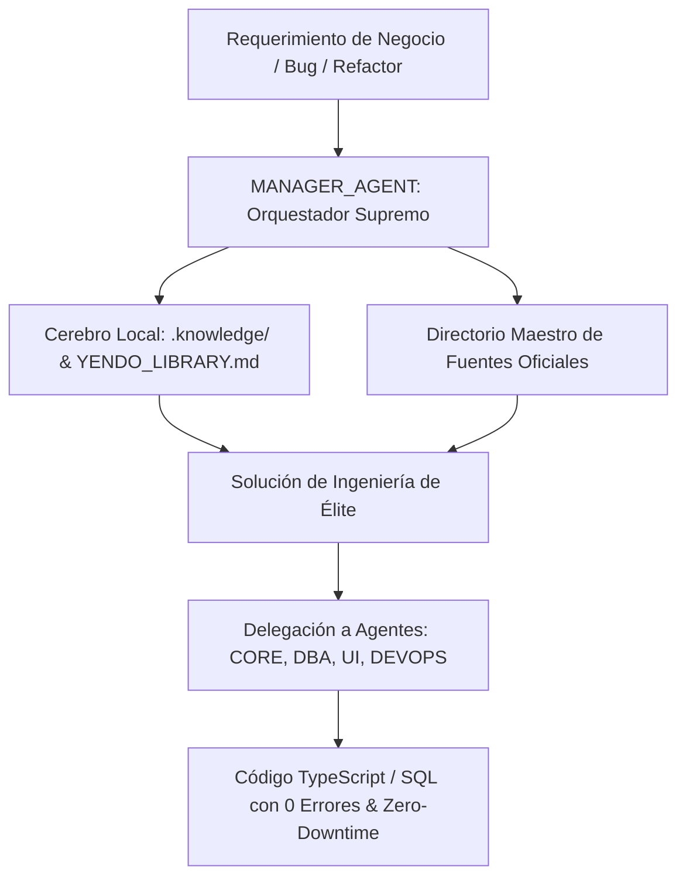
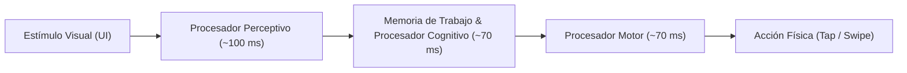

# CANON: Biblioteca Maestra Consolidada de Yendo Mobile y Centinela Studio (Libros, Cursos, Documentación Oficial y Repositorios 2026)

**Alcance:** Consolidación completa de los catálogos maestros de libros, videocursos, documentación oficial y repositorios de referencia de **Yendo Mobile (`yendo_obsidian_vault`)** y **Centinela Studio (`centinela_knowledge`)**: `YENDO_LIBRARY.md`, `Directorio_Maestro_Fuentes_Oficiales.md`, `MASTER_LIBRARY_CATALOG.md`, `COURSES_AND_BOOKS.md`, `CATALOGO_30_FUENTES.md`, `SOTA_FOSS_CANON_AND_CURRICULUM_2026.md` y `SOTA_MULTIMODAL_COURSES_PAPERS_COMPENDIUM_2026.md`.

---

## Parte I — Biblioteca Maestra y Directorio de Fuentes Oficiales (`yendo_obsidian_vault`)


### 📖 Fuente Yendo: `.knowledge/YENDO_LIBRARY.md` (113 fragmentos)

#### 🛠️ DOMINIO D: Ingeniería, IA y Arquitectura de Software (El "Motor") > Tier 1: Las Biblias / Fundamentos Inquebrantables (Dominio D) > ⭐ Pattern Recognition and Machine Learning (Christopher M. Bishop, 2006) & Scikit-Learn Framework

`[TIER 1]` `[Tipo: Libro Canónico / Machine Learning Probabilístico]`

- **Concepto Clave:** Inferencia bayesiana y modelado probabilístico de incertidumbre en el comportamiento humano. La probabilidad de que una mesa se llene o de que un usuario asista no puede gobernarse por reglas heurísticas estáticas, sino por distribuciones posteriores calibradas sobre series temporales y volatilidad barrial.
- **Cita Directa:** > _"By adopting a Bayesian viewpoint, we can quantify the uncertainty in our predictions, allowing complex ensemble models to make real-time decisions with incomplete data."_ — (Cap. 1: Introduction & Probability Theory, pág. 21).
- **Impacto en Yendo:** `[INNEGOCIABLE]` **El Algoritmo de Liquidez Social:** La visibilidad y el orden de los grupos en el feed están gobernados por una arquitectura predictiva. Yendo despliega un modelo de _Voting Ensemble_ (combinando clasificadores logísticos y árboles de decisión) implementado con _scikit-learn_ y optimizado con _LightGBM_ (Ke et al., Microsoft Research, 2017). El sistema evalúa en sub-milisegundos variables multifactoriales (clima en tiempo real, día de la semana, tasa histórica de asistencia barrial y densidad de usuarios activos a <1 km) para proyectar la probabilidad $P(\text{Mesa llena} \ge 4/6)$ y priorizar en pantalla aquellas mesas con mayor probabilidad de consolidación exitosa.

---

#### 🧠 DOMINIO A: Filosofía, Neurobiología y Comportamiento (El "Por Qué") > Tier 2: Metodologías y Frameworks Core (Dominio A) > ⭐ The Strength of Weak Ties (Mark Granovetter, 1973) & Sandstrom & Dunn (2014)

`[TIER 2]` `[Tipo: Paper Seminal / Sociología de Redes]`

- **Concepto Clave:** Interactuar con conocidos casuales y lazos débiles mide directamente la felicidad diaria y maximiza el acceso a nuevas oportunidades. El paper de Sandstrom (_Is Efficiency Overrated?_) demuestra que una charla breve de 30 segundos con un barista o extraño genera sentido de pertenencia medible.
- **Cita Directa:** > _"Social interactions with weak ties contribute to social and emotional well-being. Treating a stranger like a weak tie leads to positive affect and a sense of belonging."_ — (Sandstrom & Dunn, SPPS, Vol. 5, pág. 438).
- **Impacto en Yendo:** `[INNEGOCIABLE]` Valida el valor de los micro-grupos para conocer gente nueva en el barrio frente a la soledad de los canales digitales.

---

#### 🎨 DOMINIO B: UI/UX, Interacción y Ergonomía (El "Sentir") > Tier 1: Las Biblias & Guidelines Oficiales Tier-1 (Dominio B) > ⭐ The Design of Everyday Things (Don Norman, Basic Books / Revised Ed. 2013)

`[TIER 1]` `[Tipo: Libro Canónico / Fundamentos UCD & HCI]`

- **Concepto Clave:** Escrito por el padre del diseño centrado en el usuario (UCD) y co-fundador de Nielsen Norman Group, establece los principios cognitivos universales de interacción:
  - **Affordances & Signifiers:** Las propiedades reales y percibidas de un objeto que determinan cómo podría usarse, y las señales visuales perceptibles (_signifiers_) que comunican explícitamente dónde y cómo actuar.
  - **Modelos Mentales & Mapeo Natural:** La correspondencia intuitiva entre los controles espaciales de la interfaz y los resultados en el mundo físico.
  - **Diseño Defensivo & Prevención de Errores:** Las restricciones visuales y lógicas que hacen imposible cometer fallos críticos por distracción.
- **Cita Directa:** > _"Good design is actually a lot harder to notice than poor design, in part because good designs fit our needs so well that the design is invisible. When you manipulate something, there must be an immediate perceptible signifier and feedback indicating the system state."_ — ([Don Norman's JND Design Hub & Publications](https://jnd.org/the-design-of-everyday-things/)).
- **Impacto en Yendo:** `[INNEGOCIABLE]` **Botones y Controles Ergonómicos Sin Fricción:** Fundamenta por qué los botones principales de acción (ej. "Explorar Eventos", "Unirme al Grupo") poseen una altura táctil estricta de 56dp, color de alto contraste (`#FF5500`), esquinas redondeadas tipo píldora (`borderRadius: 100`) y micro-animaciones hápticas: el usuario jamás debe "pensar" cómo presionar o si la acción fue recibida por el sistema.
- **Recursos Relacionados:** [Don Norman Official Resources](https://jnd.org/the-design-of-everyday-things/) y [Interaction Design Foundation (IxDF): Affordances & Signifiers](https://www.interaction-design.org/literature/topics/affordances).

---

#### 🛠️ DOMINIO D: Ingeniería, IA y Arquitectura de Software (El "Motor") > Tier 3: Datos Técnicos, Acústica y Telemetría (Dominio D) > ⭐ The Soundscape: Our Sonic Environment and the Tuning of the World (R. Murray Schafer, 1977/1994) & Light: Science and Magic (Fil Hunter, Steven Biver, Paul Fuqua)

`[TIER 3]` `[Tipo: Tratados Canónicos / Acústica Hi-Fi e Iluminación]`

- **Concepto Clave:** Ecología Acústica Urbana, Relación Señal-Ruido (SNR) y Curaduría Visual Computacional de Alto Rango Dinámico.
  - **Ecología Acústica (Schafer):** Diferenciación entre paisajes sonoros _Hi-Fi_ (donde los sonidos individuales se distinguen con claridad debido a un ruido de fondo bajo) y _Lo-Fi_ (donde la señal acústica está enmascarada por saturación ambiental).
  - **Fotografía e Iluminación (Hunter et al.):** Manejo de contraste, reflexión y profundidad de campo con sensores Full-Frame y lentes luminosos ($f/1.4 - f/2.8$).
- **Cita Directa:** > _"A hi-fi soundscape is one in which discrete sounds can be heard clearly because of a low ambient noise level. Visual warmth requires managing dynamic range and depth to focus human attention on the subject's essential character."_ — (Schafer, The Soundscape, Cap. 3 / Hunter, Light: Science and Magic, Cap. 2).
- **Impacto en Yendo:**
  - **Acústica Conversacional:** El límite biológico de Dunbar (4 a 6 personas) exige que los locales verificados garanticen una relación señal-ruido adecuada ($<72\text{ dB}$ ambiente). De la misma manera que en la producción musical profesional se ecualizan y combinan instrumentos de hardware, sintetizadores analógicos, teclados MIDI y efectos digitales para evitar la saturación armónica, los locales de Yendo son curados para que el murmullo de fondo o la música en vivo (ej. jazz o acústico) sirvan como atmósfera envolvente sin forzar la voz de los comensales.
  - **Estándar Visual Full-Frame:** Las imágenes de los comercios gastronómicos en la app deben transmitir hospitalidad táctil, textura y profundidad real, alineándose con el estándar óptico y el rango dinámico de un sensor Full-Frame profesional réflex (como una cámara Canon EOS 5D Mark IV con óptica prime 35mm/50mm a $f/1.8$), erradicando fotos frías, planas o sobreexpuestas.

---

#### P1 — Capa Arquitectónica Core

Compendio Canónico de Especialización (210 fuentes Tier-1): [[TECNOLOGIAS_SOTA_STACK_CANON_2026]]
Tratado Maestro de Escalabilidad Exponencial (7 Dimensiones): [[TRATADO_MAESTRO_ESCALABILIDAD_EXPONENCIAL_YENDO_2026]]
Stack verificado 2026-08-29 (`package.json` + `src/`). Docs: [Expo 57](https://docs.expo.dev/versions/v57.0.0/) · [RN New Arch](https://reactnative.dev/architecture/overview) · [Reanimated](https://docs.swmansion.com/react-native-reanimated/) · [TanStack Query](https://tanstack.com/query/latest/docs/framework/react/overview) · [TkDodo](https://tkdodo.eu/blog/practical-react-query) · [Zustand](https://docs.pmnd.rs/zustand/getting-started/introduction) · [MMKV](https://github.com/mrousavy/react-native-mmkv)

---

#### 📊 DOMINIO C: Economía de Plataformas B2B/B2C y Crecimiento (La "Escala") > Tier 1: Las Biblias / Fundamentos Inquebrantables (Dominio C) > ⭐ Blue Ocean Strategy: How to Create Uncontested Market Space (W. Chan Kim & Renée Mauborgne, Harvard Business School Press, 2005/2015)

`[TIER 1]` `[Tipo: Libro Canónico / Estrategia Competitiva & Océanos Azules]`

- **Concepto Clave:** La creación de un "Océano Azul" (mercado no disputado) mediante la innovación en valor (*Value Innovation*), rompiendo la disyuntiva tradicional entre costo y diferenciación. Se aplica la **Matriz de las Cuatro Acciones (ERIC)** para redefinir las curvas de valor de la industria:
  - *Eliminar:* Swiping 1-a-1, catálogos de perfiles superficiales, DMs privados previos al encuentro, algoritmos de retención adictiva en pantalla.
  - *Reducir:* Fricción burocrática de coordinación de agendas, tiempos de espera para el encuentro (>48h), barreras financieras de entrada (modelo de costo cero).
  - *Incrementar:* Seguridad psicológica previa, transparencia financiera (`averageSpend`), asistencia real al evento (anti-no-show <2%).
  - *Crear:* Social Dynamic Seating para locales aliados, Live Arrival Pass (Santo y Seña), Cápsula de Memoria D+1 que neutraliza el Liking Gap.
- **Cita Directa:** > _"The only way to beat the competition is to stop trying to beat the competition. In blue oceans, demand is created rather than fought over. There is ample opportunity for growth that is both profitable and rapid."_ — (Blue Ocean Strategy, Cap. 1).
- **Impacto en Yendo:** `[INNEGOCIABLE]` Es la columna vertebral del **Pitch Deck ante inversores**: posiciona a Yendo fuera de la sangrienta competencia de apps de citas ("Océano Rojo") y de ticketing transaccional, fundando la categoría de **Conexión Social Presencial en Terceros Lugares**.

---

#### 🛠️ DOMINIO D: Ingeniería, IA y Arquitectura de Software (El "Motor") > Tier 2: Metodologías, Algoritmos y Sistemas (Dominio D) > ⭐ Building Micro-Frontends: Scaling Teams and Projects, Empowering Developers (Luca Mezzalira, O'Reilly Media, 2021)

`[TIER 2]` `[Tipo: Libro Canónico / Arquitectura Modular & Aislamiento de Fallas]`

- **Concepto Clave:** Descomposición de aplicaciones complejas en subsistemas desacoplados, autónomos y de responsabilidad acotada. Extiende los principios de microservicios al cliente: en lugar de un monolito frontend donde cualquier fallo en una pantalla bloquea la app entera, cada funcionalidad opera como un micro-módulo independiente con su propio ciclo de vida, estado encapsulado y comunicación asíncrona desacoplada mediante un Event Bus o Custom Events.
- **Cita Directa:** > _"Micro-frontends represent a mental shift from monolithic frontend thinking to decentralized systems, allowing multidisciplinary teams to deliver value iteratively without stepping on each other's toes and ensuring that failure in one domain does not take down the entire user experience."_ — (Cap. 1: What Are Micro-Frontends?, pág. 7).
- **Impacto en Yendo:** `[INNEGOCIABLE]` **Modularización de Features en React Native:** La arquitectura del código en `src/` se estructura en módulos aislados por dominio: el subsistema de *Exploración y Mapa* (`src/screens/ExploreScreen.tsx`), el subsistema de *Feed y Descubrimiento* (`src/screens/HomeScreen.tsx`), el subsistema de *Chat Grupal* (`useGroupChat.ts`) y el subsistema de *Perfil*. Si el servicio de websockets de chat sufre una interrupción o latencia, el feed de eventos y el motor geoespacial de mapas continúan operando con total normalidad a 120 FPS sin propagación de excepciones.
- **Recursos Relacionados:** [O'Reilly Building Micro-Frontends](https://www.oreilly.com/library/view/building-micro-frontends/9781492082989/), [AWS Architecture Blog on Modular Frontends by Luca Mezzalira](https://aws.amazon.com/blogs/architecture/).

---

#### 🎨 DOMINIO B: UI/UX, Interacción y Ergonomía (El "Sentir") > Tier 2: Metodologías y Frameworks Core (Dominio B) > ⭐ Microinteractions: Designing with Details (Dan Saffer, O'Reilly Media, 2013)

`[TIER 2]` `[Tipo: Libro Canónico / Microinteracciones & Detalle Funcional]`

- **Concepto Clave:** La anatomía cuádruple de la microinteracción de élite: **Trigger** (disparador táctil o contextual), **Rules** (lógica de negocio invisible), **Feedback** (confirmación sensorial inmediata) y **Loops & Modes** (ciclos de repetición y meta-reglas). La diferencia entre una app ordinaria y una app amada radica en el diseño milimétrico de sus detalles.
- **Cita Directa:** > _"Microinteractions are the functional, tiny details of a product that deliver moments of delight or friction. The difference between a good product and a great one is how thoughtfully these small moments are designed."_ — (Microinteractions, Cap. 1: Designing with Details).
- **Impacto en Yendo:** `[INNEGOCIABLE]` Modela la interacción atómica del botón principal (`InteractiveButton.tsx`): Trigger táctil, Rule de quórum Dunbar, Feedback háptico en milisegundo cero (<50ms) y compresión elástica a 120 FPS que erradica el *Ghost Interaction Gap*.

---

#### 🎨 DOMINIO B: UI/UX, Interacción y Ergonomía (El "Sentir") > Tier 3: Datos Empíricos, Informes y Tácticas Rápidas (Dominio B) > ⭐ The State of UX (Publicación Anual de UX Collective)

`[TIER 3]` `[Tipo: Informe Anual de Industria / Estado del Arte]`

- **Concepto Clave:** El informe analítico y crítico de referencia global en la industria del diseño. Sintetiza los grandes cambios de paradigma: la superación de los patrones oscuros (_Anti-Dark Patterns_), el giro hacia el bienestar digital (_Digital Wellness_), el auge de las interfaces agénticas y la necesidad de sistemas de diseño éticos que prioricen la autenticidad humana sobre el engagement artificial.
- **Cita Directa:** > _"The next era of product design belongs to interfaces that respect human time, eliminate dark patterns, and act as calm enablers of real-world experiences rather than attention traps."_ — ([UX Collective State of UX](https://uxdesign.cc/)).
- **Impacto en Yendo:** Respalda nuestra filosofía de **Digital Minimalism**: Yendo no busca retener al usuario frente a la pantalla con feeds infinitos de scroll dopaminérgico; utiliza la app como un trampolín rápido para apagar el teléfono y disfrutar del encuentro presencial cara a cara.
- **Recursos Relacionados:** [UX Collective - State of UX](https://uxdesign.cc/) y [Trends in Digital Product Design Reports](https://trends.uxdesign.cc/).

---

#### 📊 DOMINIO C: Economía de Plataformas B2B/B2C y Crecimiento (La "Escala") > Tier 3: Datos Empíricos y Métricas de Industria (Dominio C) > ⭐ Restaurant Cancellation Policies and No-Show Awareness (Kim et al., 2025 / Int. J. of Consumer Studies) & OpenTable Data

`[TIER 3]` `[Tipo: Paper / Estudios de Cancelaciones]`

- **Concepto Clave:** La visibilidad del compromiso ante pares y las políticas claras reducen el no-show gastronómico del 20% habitual a menos del 6%. OpenTable demuestra que el compromiso activo reduce cancelaciones de último minuto en un 72% por aversión a la pérdida (_Loss Aversion_).
- **Cita Directa:** > _"Peers' visibility and lightweight progressive commitments drop no-show rates from the industry standard 20% down to under 6%."_ — (Kim et al., 2025).
- **Impacto en Yendo:** Las métricas de asistencia visible y el bloqueo de 15 minutos en el Loop +1 protegen la rentabilidad del local gastronómico.

---

---

#### 🎨 DOMINIO B: UI/UX, Interacción y Ergonomía (El "Sentir") > Tier 1: Las Biblias & Guidelines Oficiales Tier-1 (Dominio B) > ⭐ About Face: The Essentials of Interaction Design (Alan Cooper, Robert Reimann, David Cronin & Christopher Noessel, 4ta Edición, Wiley, 2014)

`[TIER 1]` `[Tipo: Libro Canónico / Interacción Persona-Computadora]`

- **Concepto Clave:** Considerada la biblia técnica de la Interacción Persona-Computadora (HCI) y el diseño de interacción mobile. Formaliza el _Goal-Directed Design_ (diseño dirigido por metas en vez de tareas técnicas), distingue entre el _Implementation Model_ (cómo funciona el código) y el _Mental Model_ (cómo el usuario percibe la realidad), y define la postura de las aplicaciones (_Mobile Transient & Sovereign Postures_) para eliminar el "impuesto cognitivo" (_excise_).
- **Cita Directa:** > _"Users shouldn't have to understand how the system is constructed in order to achieve their goals. Well-designed interfaces eliminate cognitive excise, respect user attention, and maintain spatial clarity across state transitions."_ — ([Wiley Official Interaction Design Guide](https://www.wiley.com/en-us/About+Face%3A+The+Essentials+of+Interaction+Design%2C+4th+Edition-p-9781118766576)).
- **Impacto en Yendo:** `[INNEGOCIABLE]` **Jerarquía Espacial de 3 Niveles:** Guía la navegación arquitectónica de Yendo asegurando que el usuario nunca pierda la orientación espacial: Nivel 1 (_Explorar Eventos_ en Feed/Mapa) ➔ Nivel 2 (_Grupos Activos y Cupos_ dentro del Evento) ➔ Nivel 3 (_Chat Seguro & Epílogo D+1_). Además, aplica el diseño defensivo en modales de confirmación con doble verificación al intentar abandonar un grupo confirmado.
- **Recursos Relacionados:** [Cooper Design Methodology](https://www.cooper.com/) y [About Face 4th Edition Companion](https://www.wiley.com/).

---

#### 🎨 DOMINIO B: UI/UX, Interacción y Ergonomía (El "Sentir") > Tier 2: Metodologías y Frameworks Core (Dominio B) > ⭐ Laws of UX: Design Principles for Persuasive and High-Performing Products (Jon Yablonski, O'Reilly, 2020)

`[TIER 2]` `[Tipo: Libro / Principios Psicológicos de Interacción]`

- **Concepto Clave:** Codificación sistemática de las leyes cognitivas universales que rigen la experiencia humana ante interfaces digitales:
  - **Ley de Fitts:** El tiempo para alcanzar un objetivo depende de la distancia y el tamaño del objetivo. Justifica botones táctiles primarios de 56dp con áreas de impacto (*hitSlop*) generosas.
  - **Ley de Hick:** El tiempo para tomar una decisión aumenta con el número y la complejidad de las opciones. Justifica filtros simplificados en 3 dimensiones (Barrio, Categoría, Precio).
  - **Ley de Miller:** La memoria de trabajo almacena $7 \pm 2$ elementos.
  - **Regla del Pico y el Fin (Kahneman):** Los usuarios juzgan una experiencia por su punto más intenso y su desenlace final, no por el promedio de cada segundo.
  - **Efecto de Usabilidad Estética:** Los usuarios perciben los diseños estéticamente atractivos como más tolerantes a errores y fáciles de usar.
- **Cita Directa:** > _"Understanding how users perceive, process, and interact with digital interfaces is the key to creating experiences that feel intuitive, delightful, and human. The laws of UX bridge the gap between psychology and software architecture."_ — (Laws of UX, Introducción & Cap. 1-4).
- **Impacto en Yendo:** `[INNEGOCIABLE]` Manual de reglas para `UX_AGENT` y `UI_AGENT`: modela el Customer Journey Map, el botón flotante unificado en la zona del pulgar y el dimensionamiento de las tarjetas de evento.

---

#### 🛠️ DOMINIO D: Ingeniería, IA y Arquitectura de Software (El "Motor") > Tier 2: Metodologías, Algoritmos y Sistemas (Dominio D) > ⭐ Who Can You Trust? How Technology Brought Us Together (Rachel Botsman, 2017)

`[TIER 2]` `[Tipo: Libro / Confianza Distribuida & Gobernanza]`

- **Concepto Clave:** La confianza evolucionó de lo institucional a la **"Confianza Distribuida"** (_Distributed Trust_): la confianza entre extraños mediada por plataformas que combinan verificación, trazabilidad y rating mutuo.
- **Cita Directa:** > _"Trust is the confident relationship to the unknown. Distributed trust is the new currency: it flows horizontally through networks and platforms rather than top-down through centralized institutions."_ — (Cap. 1 & 3, The Trust Economy).
- **Impacto en Yendo:** `[INNEGOCIABLE]` Justifica la arquitectura de confianza de Yendo: verificación de comercios, perfil transparente y sistema de reportes comunitarios.

---

#### 🔗 DIRECTORIO CANÓNICO: Directorio Rápido para NotebookLM & Pitch a Inversores > 🏛️ Compendio de Tratados Canónicos Ingeridos (Unsorted Master Archive 2026) > 🧠 Dominio 2: Psicología del Comportamiento, Gamificación & UX

- **Actionable Gamification / Octalysis (Yu-kai Chou):** [[CANON_ACTIONABLE_GAMIFICATION_OCTALYSIS_CHOU]] — Los 8 Core Drives, White Hat vs Black Hat, Left Brain vs Right Brain, 4 fases de experiencia del jugador.
- **Predictably Irrational / Las Trampas del Deseo (Dan Ariely):** [[CANON_PREDICTABLY_IRRATIONAL_ARIELY_TRAMPAS_DESEO]] — Efecto señuelo (Decoy Effect), el costo del precio cero, normas sociales vs normas de mercado, efecto dotación.
- **Escasez y el Impuesto de Ancho de Banda (Mullainathan & Shafir):** [[CANON_SCARCITY_ESCASEZ_BANDWIDTH_TAX]] — Bandwidth Tax (-13 pts CI), túnel atencional, falta de holgura (slack), diseño tolerante a fallas en la noche.
- **100 Things Every Designer Needs to Know About People (Susan Weinschenk):** [[CANON_100_THINGS_DESIGNER_PEOPLE_WEINSCHENK]] — Visión periférica, memoria de trabajo de 3-4 chunks, número de Dunbar, escaneo en F.
- **Designing for Emotion (Aarron Walter):** [[CANON_DESIGNING_FOR_EMOTION_WALTER]] — Jerarquía emocional (Placer > Usabilidad), psicología de la mascota (Carpincho Yendo), tono rioplatense cálido, surprise & delight.
- **Laws of UX (Jon Yablonski):** [[CANON_LAWS_OF_UX_PSYCHOLOGY_FRAMEWORKS]] — Fitts ($48\times 48\text{dp}$), Hick, Jakob, Miller, Peak-End Rule, Zeigarnik, Von Restorff.
- **The Attention Merchants (Tim Wu):** [[CANON_ATTENTION_MERCHANTS_TIM_WU]] — Captura industrial de la atención, imperativo "Time Well Spent" fuera de la pantalla, cero spam push.

---

#### 🧠 DOMINIO A: Filosofía, Neurobiología y Comportamiento (El "Por Qué") > Tier 1: Las Biblias / Fundamentos Inquebrantables (Dominio A) > ⭐ La Sociedad del Cansancio & Psicopolítica (Byung-Chul Han, 2010 / 2014)

`[TIER 1]` `[Tipo: Libro / Sociología Crítica]`

- **Concepto Clave:** La hipercomunicación digital no genera cercanía, sino un "enjambre digital" de individuos atomizados y autoexplotados encerrados en el narcisismo de "lo igual", donde la desaparición de la _Otredad_ (el contacto con el extraño real) produce agotamiento neuronal y soledad masiva.
- **Cita Directa:** > _"La comunicación digital es un contacto sin distancia, pero la cercanía real solo es posible a través de la distancia. El enjambre digital no forma ningún 'nosotros'; está compuesto por individuos aislados que se producen a sí mismos. La hipercomunicación destruye el silencio y la capacidad de escuchar al otro."_ — (La Sociedad del Cansancio, Cap. 2 / Psicopolítica, Cap. 4).
- **Impacto en Yendo:** `[INNEGOCIABLE]` Yendo es el antídoto contra el narcisismo de "lo igual": confronta al usuario con la **Otredad positiva** en el mundo real, sacándolo del aislamiento del enjambre para sentarlo con personas distintas en una mesa compartida.

---

#### 🧠 DOMINIO A: Filosofía, Neurobiología y Comportamiento (El "Por Qué") > Tier 2: Metodologías y Frameworks Core (Dominio A) > ⭐ Digital Minimalism: Choosing a Focused Life in a Noisy World (Cal Newport, 2019)

`[TIER 2]` `[Tipo: Libro / Filosofía de Producto Ético]`

- **Concepto Clave:** Filosofía del uso de la tecnología: las herramientas digitales solo deben servir a valores humanos profundamente arraigados en el mundo real; cualquier interacción digital que reemplace una conversación presencial degrada la felicidad.
- **Cita Directa:** > _"The sugar-high of digital connection is not a substitute for the rich, multi-sensory experience of face-to-face conversation. We must use technology as a tool to facilitate real-world presence, not as a permanent destination."_ — (Cap. 4: Reclaiming Conversation, pág. 142).
- **Impacto en Yendo:** Métrica de oro: el valor de Yendo se mide por los minutos de conversación presencial que genera, no por los minutos de permanencia dentro de la pantalla.

---

#### 🧠 DOMINIO A: Filosofía, Neurobiología y Comportamiento (El "Por Qué") > Tier 1: Las Biblias / Fundamentos Inquebrantables (Dominio A) > ⭐ Social: Why Our Brains Are Wired to Connect (Matthew D. Lieberman, 2013 / UCLA Social Cognitive Neuroscience Lab)

`[TIER 1]` `[Tipo: Libro Científico / Neurobiología Cognitiva]`

- **Concepto Clave:** Como neurocientífico y director del _Social Cognitive Neuroscience Lab_ de UCLA, Lieberman demuestra mediante neuroimagen funcional por resonancia magnética (fMRI) que el cerebro humano posee una red neuronal predeterminada (_Default Mode Network_ - DMN) dedicada exclusivamente al procesamiento social cada vez que entra en reposo de tareas analíticas. Demuestra además que el dolor por rechazo o aislamiento social activa la corteza cingulada anterior dorsal (dACC) y la ínsula anterior, exactamente los mismos circuitos neuronales y sustratos biológicos que procesan el dolor físico.
- **Cita Directa:** > _"Our brains evolved to experience threats to our social connections in much the same way they experience physical pain. By activating the same neural circuitry, the experience of social pain ensures that staying socially connected will be a lifelong fundamental need, like food and warmth."_ — ([Farnam Street Summary & Excerpts of Matthew Lieberman's Social](https://fs.blog/why-our-brains-are-wired-to-connect/)).
- **Impacto en Yendo:** `[INNEGOCIABLE]` Fundamenta científicamente por qué la soledad barrial o el aislamiento digital generan un malestar biológico y metabólico real. Valida que la misión de Yendo de conectar personas presencialmente a través de actividades compartidas no es un "lujo recreativo", sino una respuesta médica y neuronal a una necesidad primaria de supervivencia humana.
- **Recursos Relacionados:** [Farnam Street Learning Community Guide on Social Brain](https://fs.blog/why-our-brains-are-wired-to-connect/), [UCLA Semel Institute Lecture on Social Neuroscience](https://www.semel.ucla.edu/), y [Social Cognitive Neuroscience Lab at UCLA](https://scnl.psych.ucla.edu/).

---

#### P1 — Capa Arquitectónica Core > Stack (una línea por área) > Contratos CORE

* Lenguaje: Venue → Experiencia → Grupo (Dunbar 4–6) → Member. Nunca "mesa"/"bar" genérico.
* Sheet: solo [[YendoBottomSheet]] (`useSharedValue` + `withSpring(theme.physics.sheetTransition)`). **`@gorhom/bottom-sheet` no se instala.**
* JSX &lt;150 líneas. Vistas sin red. Lógica en hooks.
* Cold Start &lt;1200 ms. Primer frame 2D. Jank &lt; 2%. RPC geo &lt; 50 ms.
* Tras deps: `npx expo install --fix` + `npx tsc --noEmit` (0 errores).

---

#### 🔗 DIRECTORIO CANÓNICO: Directorio Rápido para NotebookLM & Pitch a Inversores

| #   | Dominio         | Tier     | Fuente Canónica                                                                     | Por qué sirve para Yendo                                                                     | Formato / Tipo de Acceso                                                                                                                                    |
| --- | --------------- | -------- | ----------------------------------------------------------------------------------- | -------------------------------------------------------------------------------------------- | ----------------------------------------------------------------------------------------------------------------------------------------------------------- |
| 1   | **A (Por Qué)** | `TIER 1` | ⭐ **Aristóteles** — _Ética a Nicómaco (Libros VIII–IX)_                            | Teoría de la Philia: vínculos reales requieren repetición y ocio presencial.                 | [Texto Completo] Filosofía Clásica                                                                                                                          |
| 2   | **A (Por Qué)** | `TIER 1` | ⭐ **Matthew D. Lieberman (2013)** — _Social: Brains Wired to Connect_              | Red neuronal DMN social y equivalencia biológica entre dolor social y dolor físico.          | [Libro / Reseña UCLA](https://fs.blog/why-our-brains-are-wired-to-connect/)                                                                                 |
| 3   | **A (Por Qué)** | `TIER 1` | ⭐ **Byung-Chul Han** — _La Sociedad del Cansancio & Psicopolítica_                 | Crítica del enjambre digital y necesidad de recuperar la Otredad.                            | [Texto Completo] Sociología Crítica                                                                                                                         |
| 4   | **A (Por Qué)** | `TIER 1` | ⭐ **Ray Oldenburg (1989)** — _The Great Good Place_                                | Teoría del Tercer Lugar: bares y cafés como infraestructura comunitaria.                     | [Libro / Resumen Extenso] Sociología                                                                                                                        |
| 5   | **A (Por Qué)** | `TIER 1` | ⭐ **Robert Putnam (1995/2000)** — _Bowling Alone_                                  | Pérdida de capital social como macro-problema que Yendo resuelve.                            | [Paper / Libro Completo] Sociología                                                                                                                         |
| 6   | **A (Por Qué)** | `TIER 1` | ⭐ **Robert Cialdini (1984/2001)** — _Influence: Compromiso y Consistencia_         | La confirmación activa reduce el no-show a su mínima expresión.                              | [Libro / Resumen UX] Psicología Conductual                                                                                                                  |
| 7   | **A (Por Qué)** | `TIER 1` | ⭐ **Zygmunt Bauman (2003)** — _Amor Líquido_                                       | Sustenta el compromiso ligero sin suscripciones forzadas.                                    | [Texto Completo] Sociología                                                                                                                                 |
| 8   | **A (Por Qué)** | `TIER 2` | ⭐ **Priya Parker (2018)** — _The Art of Gathering_                                 | Exclusión positiva, cruce del umbral y dinámicas de anfitrión (Carpincho).                   | [Libro / Reseña] Dinámica Grupal                                                                                                                            |
| 9   | **A (Por Qué)** | `TIER 2` | ⭐ **Cal Newport (2019)** — _Digital Minimalism_                                    | Tecnología como trampolín para el mundo real; métrica de tiempo presencial.                  | [Libro / Framework] Minimalismo

---

#### 📊 DOMINIO C: Economía de Plataformas B2B/B2C y Crecimiento (La "Escala") > Tier 1: Las Biblias / Fundamentos Inquebrantables (Dominio C) > ⭐ Platform Revolution: How Networked Markets Are Transforming the Economy (Geoffrey G. Parker, Marshall W. Van Alstyne & Sangeet Paul Choudary, W. W. Norton & Company, 2016)

`[TIER 1]` `[Tipo: Libro Canónico / Economía de Plataformas Multilaterales]`

- **Concepto Clave:** La biblia definitiva sobre modelos de negocio basados en plataformas multilaterales (_Two-Sided / Multi-Sided Platforms_). Explica cómo resolver el clásico dilema del huevo y la gallina (_Cold Start Problem_), cómo diseñar la arquitectura de la Interacción Central (_Core Interaction: Participantes + Propuesta de Valor + Filtro + Unidad de Valor_), y cómo monetizar mediante efectos de red cruzados positivos donde la demanda agregada atrae y fideliza a los proveedores de espacios físicos.
- **Cita Directa:** > _"Traditional businesses prospered through supply economies of scale, focusing on production efficiencies. In contrast, modern platform businesses benefit from demand economies of scale—where larger networks become more valuable to all participants."_ — ([Platformed Insights & Book Overview by Sangeet Paul Choudary](https://platformthinkinglabs.com/materials/platform-revolution/)).
- **Impacto en Yendo:** `[INNEGOCIABLE]` Es la guía arquitectónica para estructurar la transición del ecosistema de usuarios (B2C) hacia la plataforma de comercios y espacios asociados (**Yendo Comercio B2B**), gestionando de forma óptima el equilibrio entre la oferta barrial de espacios ociosos y la demanda orgánica de grupos que buscan actividades curadas. A partir de 2026-08-29 el lado oferta tiene producto nombrado: **Yendo Partners** (web app para dueños y hostesses). El lado demanda sigue siendo **Yendo App** (Expo). Canon de GTM: [[B2B_GTM_STRATEGY]].
- **Recursos Relacionados:** [Platform Thinking Labs by Sangeet Paul Choudary](https://platformthinkinglabs.com/materials/platform-revolution/), [MIT Initiative on the Digital Economy](https://ide.mit.edu/), y [Harvard Business Review: Pipelines, Platforms, and the New Rules of Strategy](https://hbr.org/2016/04/pipelines-platforms-and-the-new-rules-of-strategy).

---

#### 📊 DOMINIO C: Economía de Plataformas B2B/B2C y Crecimiento (La "Escala") > Tier 3: Datos Empíricos y Métricas de Industria (Dominio C) > ⭐ Implementing Restaurant Revenue Management & RevPASH (Sheryl E. Kimes, Cornell University, 1999/2004)

`[TIER 3]` `[Tipo: Paper Académico / Revenue Management]`

- **Concepto Clave:** Métrica RevPASH (Revenue Per Available Seat-Hour). Una mesa vacía a las 20:00 hs un martes es inventario perecedero irremediablemente perdido.
- **Cita Directa:** > _"Restaurant revenue management focuses on selling the right seat to the right customer at the right time. Unsold seat-hours cannot be inventoried for tomorrow."_ — (Cornell Hospitality Report, Vol. 4, pág. 6).
- **Impacto en Yendo:** Yendo llena mesas ociosas en horarios valle sin comisiones predatorias, maximizando el RevPASH del comerciante.

---

#### P3 — Capa Operativa y Archivo > QA / E2E

Custodia: [[QUALITY_RELIABILITY_SQUAD]]. E2E = **Maestro** (`.maestro/`). Detox no está. Features nuevas: Cross-Check contra `.knowledge/specs/*.spec.md` + los gates de la tabla. Canon: [[SDD_Framework_Master]].

| Gate | Comando | Criterio |
| --- | --- | --- |
| Tipos | `npx tsc --noEmit` | 0 |
| Expo | `npx expo-doctor` | 21/21 |
| Deps | `npx expo install --fix` | pins 57 |
| Invariantes | `node tools/tests/test_core_invariants.js` | pass |
| Humo / Dunbar | `.maestro/smoke_test_flow.yaml` · `dunbar_rsvp_flow.yaml` | launch · cupo 4–6 |
| Nativo | `npm run testlab:plan` / `testlab:run` APK `preview` | físicos; `--virtual` no es gate · [[QA_DEVOPS_PIPELINE]] Fase A |
| Infra híbrida | spec [[002_hybrid_supabase_gcp]] `approved` + Gate §4 | Worker: `npm run gcp:deploy` (Cloud Build remoto, cero Docker local). Act 002: `npm run gcp:hybrid:apply` (Run + CDN). Tasks/Looker/Test Lab físico = oleada siguiente |
| VLM | `npm run audit:ui` | WCAG AAA · OLED · Thumb Zone · frames Test Lab |

Loop VLM: `expo start -w` → `.knowledge/frames/latest_ui.png` (o foto Telegram) → Vertex 2.5 Pro. No sustituye Maestro. Guerrilla: [[SOP_Guerrilla_Usability_Testing_CABA]].

No reabrir QA `seeded`/`done`. No tests cosméticos.

---

#### 📚 YENDO LIBRARY — SSOT jerárquico (P0–P3 + Canon) > Índice (prioridad corporativa)

| P | Capa | Qué hay aquí |
| --- | --- | --- |
| **0** | Supervivencia | RLS, secretos, ignores, MASVS, errores/logs |
| **1** | Arquitectura Core | Stack, 3-tier + caché, 60 FPS, veto bloatware, Expo Web |
| **2** | Producto y divergencia | UX manifesto, OLED, Triad, Explorador |
| **3** | Operativa y archivo | QA, librarian, icebox, POS, Canon A–D |

---

---

#### 🛠️ DOMINIO D: Ingeniería, IA y Arquitectura de Software (El "Motor") > Tier 1: Las Biblias / Fundamentos Inquebrantables (Dominio D) > ⭐ Domain-Driven Design: Tackling Complexity in the Heart of Software (Eric Evans, Addison-Wesley, 2003)

`[TIER 1]` `[Tipo: Libro Canónico / Arquitectura Empresarial & Modelado de Dominio]`

- **Concepto Clave:** El software corporativo de gran escala solo es sostenible cuando su arquitectura refleja fielmente el modelo del negocio y no la conveniencia técnica transitoria. Introduce dos pilares estratégicos:
  1. **Lenguaje Ubicuo (*Ubiquitous Language*):** Un vocabulario riguroso, compartido y sin ambigüedades entre desarrolladores, diseñadores y negocio, que debe plasmarse de manera idéntica en conversaciones, documentación, bases de datos y nombres de código.
  2. **Contextos Delimitados (*Bounded Contexts*):** Fronteras explícitas donde un modelo de dominio específico tiene validez absoluta, evitando modelos monolíticos inflados mediante la encapsulación en Entidades, Value Objects, Agregados (*Aggregates*) y Eventos de Dominio.
- **Cita Directa:** > _"A domain model is not a diagram; it is an idea, an abstraction, an expression of the domain concepts in software. The Ubiquitous Language forces developers and domain experts to share a single, unambiguous mental model, eliminating the translation overhead that ruins software."_ — (Cap. 2: Communication and the Use of Language, pág. 24).
- **Impacto en Yendo:** `[INNEGOCIABLE]` **Lenguaje Ubicuo y Bounded Contexts:** Obliga a que una reunión social se denomine universalmente como **"Grupo"** (`Group` Aggregate) y nunca "Mesa", "Room" o "Chat" en base de datos, tipos de TypeScript (`src/types/supabase.ts`), stores y UI. Segmenta la plataforma en Bounded Contexts nítidos: *Identity Context* (autenticación y perfiles biométricos), *Gathering Context* (encuentro, cupos Dunbar y eventos), *Venue Context* (comercios y acústica) y *Billing Context* (Yendo-Split).
- **Recursos Relacionados:** [Domain Language Official Portal](https://www.domainlanguage.com/ddd/), [DDD Reference Guide (Eric Evans)](https://www.domainlanguage.com/ddd/reference/).

---

#### 🛠️ DOMINIO D: Ingeniería, IA y Arquitectura de Software (El "Motor") > Tier 3: Datos Técnicos, Acústica y Telemetría (Dominio D) > ⭐ Data Science: Doing Data Science (Cathy O'Neil & Rachel Schutt, 2014 / Ed. Rusa 2019)

`[TIER 3]` `[Tipo: Libro Técnico / Data Science y Ética]`

- **Concepto Clave:** Motores de recomendación probabilísticos (_рекомендательные движки_), filtrado bayesiano de spam y ética algorítmica.
- **Cita Directa:** > _"Построение моделей — это внедрение ценностей. Рекомендательный алгоритм должен оптимизировать долгосрочное благополучие пользователя, а не кратковременный кликбейтный шум."_ — (Cap. 16: Рекомендательные системы и этика).
- **Impacto en Yendo:** El algoritmo de emparejamiento hiperlocal optimiza la probabilidad de un encuentro presencial exitoso, sin optimizar por retención adictiva en pantalla.

---

---

#### Canon Intelectual (Dominios A–D)

Las 124 fuentes científicas **no se reescriben**. Argumento de producto, diseño e inversión. Las ⭐ son el 80% del razonamiento. Consultar **después** de P0–P1.

---

---

#### 🧠 DOMINIO A: Filosofía, Neurobiología y Comportamiento (El "Por Qué") > Tier 3: Datos Empíricos, Estudios y Tácticas (Dominio A) > ⭐ La Ciudad de los 15 Minutos (Carlos Moreno, 2022) & The Death and Life of Great American Cities (Jane Jacobs, 1961)

`[TIER 3]` `[Tipo: Libros / Urbanismo Humano]`

- **Concepto Clave:** Proximidad como derecho ciudadano: acceso a ocio y vínculos a <15 minutos a pie. Las aceras vivas con "ojos sobre la calle" (_Eyes on the street_) generan seguridad comunitaria.
- **Cita Directa:** > _"La ciudad de los 15 minutos regenera el tejido social y la economía local al sincronizar el ritmo de vida con la escala humana y la caminabilidad."_ — (Moreno, Cap. 1, pág. 35).
- **Impacto en Yendo:** El motor de descubrimiento filtra por radio hiperlocal (<1 km a <3 km), fortaleciendo la vida comercial de cada barrio.

---

#### 🧠 DOMINIO A: Filosofía, Neurobiología y Comportamiento (El "Por Qué") > Tier 3: Datos Empíricos, Estudios y Tácticas (Dominio A) > ⭐ Third Place Aesthetics (Meskin, Universidad de Georgia)

`[TIER 3]` `[Tipo: Estudio Académico / Estética y Atmósfera]`

- **Concepto Clave:** La atmósfera estética y sensorial de un bar o café (iluminación cálida, madera, murmullo de fondo) reduce biológicamente la ansiedad social y el escrutinio interpersonal.
- **Cita Directa:** > _"The aesthetic affordances of third places create an informal atmospheric canopy where social scrutiny diminishes, enabling individuals to perform sociality without fear."_ — (Aesthetics & Society, pág. 45).
- **Impacto en Yendo:** Fundamenta la curaduría de **Comercios Físicos Verificados**: selección exclusiva de locales con la calidez ambiental propicia para el encuentro.

---

#### 🧠 DOMINIO A: Filosofía, Neurobiología y Comportamiento (El "Por Qué") > Tier 2: Metodologías y Frameworks Core (Dominio A) > ⭐ Hooked: How to Build Habit-Forming Products (Nir Eyal, Portfolio / Penguin, 2014)

`[TIER 2]` `[Tipo: Libro / Framework de Psicología de Producto]`

- **Concepto Clave:** El Modelo Hook de 4 fases (_Trigger, Action, Variable Reward, Investment_). Explica cómo los disparadores externos migran hacia disparadores internos (combatir el aburrimiento o la soledad), la reducción drástica de fricción para ejecutar la acción ($B = MAP$), la dopamina asociada a recompensas variables (de la tribu, de la caza y del ser) y la fase de inversión que incrementa el valor de la próxima interacción. En Yendo se aplica bajo un marco ético estricto (_Digital Minimalism_): el bucle digital no busca retener la atención dentro de la pantalla, sino utilizar el disparador digital como catalizador para expulsar al usuario hacia el encuentro físico presencial.
- **Cita Directa:** > _"The goal of habit-forming products is to influence users’ daily routines and form unprompted engagements. By shifting the investment phase toward real-world actions, digital triggers successfully translate screen time into genuine physical presence."_ — ([NirAndFar Official Digital Resources & Frameworks](https://www.nirandfar.com/hooked/)).
- **Impacto en Yendo:** `[INNEGOCIABLE]` Modela la cadencia de notificaciones inteligentes, la confirmación en 1 toque y la **Cápsula de Memoria (Epílogo D+1)**: el trigger digital (notificación contextual del jueves sobre eventos del fin de semana) dispara la acción de sumarse, la recompensa variable ocurre en la interacción cara a cara con gente nueva, y la inversión (Vibe Check silencioso y fotos comunitarias compartidas) consolida el hábito recurrente de salir semana a semana.
- **Recursos Relacionados:** [NirAndFar Resource Hub & Habit Loops Workbook](https://www.nirandfar.com/hooked/), [Stanford Behavior Design Lab (BJ Fogg)](https://behaviordesign.stanford.edu/), y [Behavioral Product Design Canvas](https://www.nirandfar.com/).

---

#### 📊 DOMINIO C: Economía de Plataformas B2B/B2C y Crecimiento (La "Escala") > Tier 2: Metodologías y Frameworks Core (Dominio C) > ⭐ Contagious: Why Things Catch On (Jonah Berger, 2013) & Invisible Influence (2016)

`[TIER 2]` `[Tipo: Libro / Framework de Viralidad STEPPS]`

- **Concepto Clave:** Los 6 principios STEPPS de viralidad (_Social Currency, Triggers, Emotion, Public, Practical Value, Stories_). La presencia de otros modula la conformidad social sin resistencia consciente.
- **Cita Directa:** > _"Social currency makes people look good to those around them. If sharing your product makes someone feel cool, smart, or in-the-know, virality is virtually guaranteed."_ — (Cap. 1, pág. 32).
- **Impacto en Yendo:** El botón **"Sumar a un amigo (+1)"** confiere Moneda Social y Valor Práctico: el usuario le regala a su amigo un cupo exclusivo en un grupo pre-armado.

---

#### 🛠️ DOMINIO D: Ingeniería, IA y Arquitectura de Software (El "Motor") > Tier 1: Las Biblias / Fundamentos Inquebrantables (Dominio D) > ⭐ Designing Data-Intensive Applications (Martin Kleppmann, 2017)

`[TIER 1]` `[Tipo: Libro Canónico / Sistemas Distribuidos & Concurrencia]`

- **Concepto Clave:** Prevención de _Race Conditions_ y sobrecupos en sistemas de alta concurrencia mediante serialización y transacciones atómicas a nivel de base de datos.
- **Cita Directa:** > _"In high-contention booking systems, you must guarantee atomic compare-and-set semantics at the storage layer with row-level locks."_ — (Cap. 7, pág. 228).
- **Impacto en Yendo:** `[INNEGOCIABLE]` Asignación atómica del cupo 6/6 mediante `SELECT FOR UPDATE` en PostgreSQL/Supabase. **SSOT dual:** el mismo Postgres es la única fuente de verdad para **Yendo App** (móvil) y **Yendo Partners** (web). Prohibido un segundo datastore de reservas o tokens. Los clientes solo hablan con Supabase (RLS). Las integraciones **Fudo / Maxirest** son Server-to-Server (Worker Node `tools/` o Edge Functions), nunca desde `src/`. Roadmap: [[Roadmap_Oficial_POS_Fudo_Maxirest]].

---

#### 🧠 DOMINIO A: Filosofía, Neurobiología y Comportamiento (El "Por Qué") > Tier 1: Las Biblias / Fundamentos Inquebrantables (Dominio A) > ⭐ Liquid Love: On the Frailty of Human Bonds (Zygmunt Bauman, 2003)

`[TIER 1]` `[Tipo: Libro / Sociología Contemporánea]`

- **Concepto Clave:** En la modernidad líquida, los lazos humanos se degradan en "conexiones" instantáneas y desechables que se cancelan con un clic, generando soledad e inseguridad crónica.
- **Cita Directa:** > _"En el mundo de la vida líquida, las relaciones son reemplazadas por las conexiones: a diferencia de las relaciones, las conexiones pueden ser desactivadas a voluntad, sin previo aviso y sin costos aparentes."_ — (Cap. 1, pág. 14).
- **Impacto en Yendo:** Yendo ofrece el compromiso ligero ideal (salidas puntuales sin suscripciones atadas ni barreras de entrada), pero reintroduce la solidez física del encuentro cara a cara.

---

---

#### P2 — Capa de Producto y Divergencia

* Roles/checklists: [[UX_UI_MASTER_MANIFESTO]]. Identidad YDS: [[YENDO_DNA_BRAND_BOOK]]. Radar visual: [[VISUAL_GUIDELINES]]. Motion: [[MOTION_GRAPHICS_CODING]]. 3D: [[3D_TECHNICAL_ART_GUIDE]].
* Arquitectura/UX con exploración: [[LATERAL_THINKING_PROTOCOL]] — Camino A/B/C; Camino C no afloja P0.
* Dark OLED: `surfaceSolid` `#121212`, acento `#FF5500`, contraste ≥4.5:1 (body chico 7:1). Touch 48 dp · CTA 56 dp.
* Copy: `src/constants/rioplatenseCopy.ts` — "Armar plan" / "Sumarme". Sentence case. MVP **solo ES-AR**; no instalar i18n.
* Dual-sided: App + Partners = mismo Postgres. GTM: [[B2B_GTM_STRATEGY]].

---

#### 🔗 DIRECTORIO CANÓNICO: Directorio Rápido para NotebookLM & Pitch a Inversores > 🏛️ Compendio de Tratados Canónicos Ingeridos (Unsorted Master Archive 2026) > 📱 Dominio 3: UI, Ergonomía Táctil, Motion, Game Feel y Tipografía

- **Designing for Touch (Josh Clark):** [[CANON_DESIGNING_FOR_TOUCH_JOSH_CLARK]] — Thumb Zone (Natural, Reach, Ow-zone), botones en tercio inferior, micro-hápticos en $<16\text{ms}$.
- **Game Feel (Steve Swink):** [[CANON_GAME_FEEL_VIRTUAL_SENSATION_SWINK]] — Control en tiempo real a 60-120 FPS, simulación espacial, resortes calibrados Reanimated (`snappy`, `modal`, `bouncy`).
- **Principios de Animación en UI (Thomas, Johnston & Williams):** [[CANON_ANIMATION_PRINCIPLES_ILLUSION_OF_LIFE_DISNEY]] — Los 12 principios Disney traducidos a Reanimated (Squash & Stretch, Anticipation, Staging, Stagger 40ms, Arcos).
- **Tipografía Áurea y Grillas (Bringhurst & Tondreau):** [[CANON_ELEMENTS_OF_TYPOGRAPHIC_STYLE_AND_GRIDS]] — Escala modular áurea ($\phi = 1.618$), grilla base de 8pt, medida de línea óptima 35-55 caracteres.
- **Gráficos de Bajo Nivel y Shaders Skia (Apple Metal & Moore):** [[CANON_LOW_LEVEL_GRAPHICS_METAL_GPU_SHADERS]] — Off-thread GPU rendering, SkSL shaders, eliminación de overdraw en OLED, espacio de color Display P3.

---

#### 🎨 DOMINIO B: UI/UX, Interacción y Ergonomía (El "Sentir") > Tier 1: Las Biblias & Guidelines Oficiales Tier-1 (Dominio B) > ⭐ Google Material Design 3 (Material You & Semantic Tokens Architecture, 2024–2026)

`[TIER 1]` `[Tipo: Guía Oficial / Sistema de Tokens MD3]`

- **Concepto Clave:** La revolución de los **Design Tokens Semánticos** (`sys.color`, `ref.palette`) y el modelado de superficies elevadas en modo oscuro (`surface`, `surfaceContainer`, `surfaceElevated`). Material You prioriza la accesibilidad con áreas de toque mínimas de 48x48dp, estados interactivos claros (_Hover, Focus, Pressed, Disabled_) y contraste dinámico según ratios WCAG.
- **Cita Directa:** > _"Material Design 3 transforms color and elevation into an adaptive design system. Elevation is expressed through tonal color surfaces rather than harsh drop shadows, ensuring accessible, legible dark themes."_ — ([Google Material Design 3 Documentation](https://m3.material.io/)).
- **Impacto en Yendo:** `[INNEGOCIABLE]` Estructura el sistema de tokens en `constants/theme.ts`: paleta Dark-First nativa donde la jerarquía visual de elevación se logra mediante tonalidades de superficie (`#121212` ➔ `#1A1A1A` ➔ `#242424`) y no con sombras opacas que degradan la estética en pantallas OLED.
- **Recursos Relacionados:** [Google Material Design 3 Guidelines](https://m3.material.io/) y [Material Theme Builder Tool](https://m3.material.io/theme-builder).

---

---

#### 🧠 DOMINIO A: Filosofía, Neurobiología y Comportamiento (El "Por Qué") > Tier 2: Metodologías y Frameworks Core (Dominio A) > ⭐ Social Physics: How Good Ideas Spread — The Lessons from a New Science (Alex "Sandy" Pentland, MIT Media Lab / Penguin, 2014)

`[TIER 2]` `[Tipo: Libro Científico / Sociología Computacional & Redes Humanas]`

- **Concepto Clave:** Como director del *Human Dynamics Lab* del MIT, Pentland demuestra matemáticamente mediante sensores sociométricos y big data urbano que la inteligencia colectiva y la innovación de una comunidad no dependen del coeficiente intelectual individual, sino del **flujo de ideas (*Idea Flow*)**, compuesto por la *Exploración* (interacción cara a cara con lazos débiles fuera de la propia red) y el *Engagement* (cooperación local repetida). El aislamiento de los algoritmos de burbuja destruye la exploración, mientras que el encuentro presencial fortuito la cataliza.
- **Cita Directa:** > _"Face-to-face interaction is by far the most powerful communication channel for building trust and spreading new ideas. To maximize collective intelligence and creative output, a society must encourage active exploration beyond established social silos."_ — (Social Physics, Cap. 2: Exploration & Idea Flow).
- **Impacto en Yendo:** `[INNEGOCIABLE]` Fundamento de la recomendación de **Lazos Débiles**: el motor de descubrimiento expone a los usuarios a grupos heterogéneos en su barrio, facilitando la exploración social cara a cara que eleva el bienestar individual y revitaliza la cohesión cívica barrial.

---

---

#### 🧠 DOMINIO A: Filosofía, Neurobiología y Comportamiento (El "Por Qué") > Tier 1: Las Biblias / Fundamentos Inquebrantables (Dominio A) > ⭐ Influence: The Psychology of Persuasion — Compromiso y Consistencia (Robert B. Cialdini, 1984 / Ed. Rusa 2001)

`[TIER 1]` `[Tipo: Libro Canónico / Psicología Conductual]`

- **Concepto Clave:** Principio de Compromiso y Coherencia: una micro-afirmación explícita previa obliga psicológicamente a actuar en consecuencia. Principio de Escasez (_Дефицит_): el valor se dispara cuando el cupo es limitado.
- **Cita Directa:** > _"Once we make a choice or take a stand, we will encounter personal and interpersonal pressures to behave consistently with that commitment."_ — (Cap. 3, pág. 57 / Ed. Rusa Cap. 7: Принцип дефицита).
- **Impacto en Yendo:** `[INNEGOCIABLE]` Solicitar una confirmación activa con temporizador ("Confirmo mi asistencia") abate drásticamente el no-show frente a un recordatorio pasivo.

---

#### 🛠️ DOMINIO D: Ingeniería, IA y Arquitectura de Software (El "Motor") > Tier 2: Metodologías, Algoritmos y Sistemas (Dominio D) > ⭐ A Philosophy of Software Design (John Ousterhout, Stanford University / Yaknyam Press, 2018/2021)

`[TIER 2]` `[Tipo: Libro Canónico / Arquitectura de Software & Gestión de Complejidad]`

- **Concepto Clave:** La complejidad es el enemigo primordial de los sistemas de software. Define los **Módulos Profundos (*Deep Modules*)**: abstracciones que ofrecen interfaces externas extremadamente sencillas y limpias mientras ocultan un poder y una lógica interna sofisticada, contrastándolos con los *Shallow Modules* (módulos superficiales cuya interfaz es casi tan compleja como su implementación).
  - **Los Tres Síntomas Fatales:** *Change Amplification* (un cambio menor obliga a editar decenas de archivos), *Cognitive Load* (el desarrollador debe retener demasiada información contextual en su mente) y *Unknown Unknowns* (efectos colaterales imprevistos que causan bugs en producción).
- **Cita Directa:** > _"The most important single aspect of software design is managing complexity. A deep module provides powerful capabilities through a simple, elegant interface, hiding all the messy implementation details."_ — (A Philosophy of Software Design, Cap. 2 & 4).
- **Impacto en Yendo:** `[INNEGOCIABLE]` Rige el diseño de los Custom Hooks y Stores de `CORE_ENGINEERING_SQUAD`: `useNearbyEvents.ts` es un módulo profundo que expone un contrato limpio de una línea para la vista, resolviendo internamente la geolocalización, el cálculo Haversine de distancias, el clustering y el almacenamiento en caché sin contaminar los componentes visuales.

---

#### P0 — Capa de Supervivencia > Secretos e ignores > RLS (Postgres)

* Toda tabla de cliente: RLS on. Grants mínimos. Políticas por verbo, `TO authenticated`. `(select auth.uid())`.
* `project_knowledge` y `messages`: deny-to-client. `service_role` solo en `tools/`.
* DEFINER (Dunbar): `search_path` fijo + `p_user_id = auth.uid()`. Authz en `raw_app_meta_data`, no `user_meta_data`.
* Playbook SEC-1: [[Auditoria_Integral_CleanCode_SEC1_20260829]].

---

#### P0 — Capa de Supervivencia

Fuentes: [[CYBERSECURITY_MASTER_PROTOCOL]] · [OWASP MASVS](https://mas.owasp.org/MASVS/) · [Supabase RLS](https://supabase.com/docs/guides/database/postgres/row-level-security) · [RN Security](https://reactnative.dev/docs/security) · [SecureStore v57](https://docs.expo.dev/versions/v57.0.0/sdk/securestore/) · [GCP IAM SA](https://cloud.google.com/iam/docs/best-practices-for-securing-service-accounts)

---

#### 🔗 DIRECTORIO CANÓNICO: Directorio Rápido para NotebookLM & Pitch a Inversores > 🏛️ Compendio de Tratados Canónicos Ingeridos (Unsorted Master Archive 2026) > 📈 Dominio 1: Economía, Pricing, Monetización y Plataformas

- **Monetizing Innovation (Simon-Kucher):** [[CANON_MONETIZING_INNOVATION_SIMON_KUCHER]] — WTP, 4 fallas de monetización (Feature Shock, Minivation, Hidden Gem, Undead), Leaders/Fillers/Killers, empaquetamiento y precio de valor.
- **The Calculus of Consent (Buchanan & Tullock):** [[CANON_CALCULUS_OF_CONSENT_BUCHANAN_PUBLIC_CHOICE]] — Teoría de la Elección Pública, costos externos vs costos de decisión, regla de quórum óptimo $k^*$, logrolling grupal y consenso en squads.
- **Platform Revolution & Scale (Parker, Van Alstyne, Choudary):** [[CANON_PLATFORM_REVOLUTION_SCALE_NETWORK_EFFECTS]] — Pipelines vs Plataformas, The Core Interaction, efectos de red de dos lados, liquidez hiperlocal en CABA.
- **The Experience Economy (Pine & Gilmore):** [[CANON_EXPERIENCE_ECONOMY_PINE_GILMORE]] — Progresión de valor (Commodities → Experiences), The 4Es, RevPASH (Revenue Per Available Seat Hour), monetización de horas muertas.
- **Capitalism in the Platform Age (Urban Spaces & Labour):** [[CANON_PLATFORM_URBAN_SPACES_LABOUR_WELFARE]] — Plataformas espaciales, nocturnidad como bienestar urbano, simbiosis vs extracción con venues de barrio.
- **Tokenización de Activos Reales 2026 (Zatti et al.):** [[CANON_TOKENIZACION_ACTIVOS_EVENTOS_2026]] — RWA en eventos, smart contracts para split de royalties automático, control de reventa anti-scalping.
- **La Moneda en el Aire (Gerchunoff & Rapetti):** [[CANON_ARGENTINA_MACRO_LA_MONEDA_EN_EL_AIRE.md]] — Bimonetarismo ARS/USD, resiliencia del ocio nocturno porteño, pricing adaptativo a la inflación.

---

#### P2 — Capa de Producto y Divergencia > Explorador (Maps + Live Search)

* Mapa: `PROVIDER_GOOGLE` + `YENDO_MAP_STYLE`. POI/transit off. Pines Yendo. `tracksViewChanges={false}`. Selección no re-renderiza `MapView`.
* Lámina **sobre** el mapa (3 snaps: 0.25 / 0.50 / 0.88). Prohibido `navigate` a detalle Venue. Teclado: `useAnimatedKeyboard`.
* Search: Zustand pinta al toque; TanStack fetch con debounce 300 ms. ≥2 chars → FTS; vacío → `get_nearby_venues`.
* Backend FTS: `tsvector` + GIN, `plainto_tsquery('spanish')`. **Prohibido** `LIKE`/`ILIKE`. RLS igual. [FTS](https://supabase.com/docs/guides/database/full-text-search)
* Empty: Carpincho + limpiar búsqueda. FTS caído ≠ `ILIKE` de consuelo.
* Código ya en disco: debounce + 3 snaps. **Pendiente:** columna FTS + pines avatar/isologo.

```sql
ALTER TABLE public.venues
  ADD COLUMN IF NOT EXISTS search_vector tsvector
  GENERATED ALWAYS AS (
    to_tsvector('spanish', coalesce(nombre, '') || ' ' || coalesce(direccion, ''))
  ) STORED;
CREATE INDEX IF NOT EXISTS venues_search_gin ON public.venues USING GIN (search_vector);
```

---

---

#### 🧠 DOMINIO A: Filosofía, Neurobiología y Comportamiento (El "Por Qué") > Tier 3: Datos Empíricos, Estudios y Tácticas (Dominio A) > ⭐ The Red and the Black: Mental Accounting of Savings and Debt (Drazen Prelec & George Loewenstein, 1998)

`[TIER 3]` `[Tipo: Paper / Neuroeconomía]`

- **Concepto Clave:** El "Dolor de Pagar" (_The Pain of Paying_): ver llegar una cuenta abierta o dividir el ticket activa la ínsula cerebral (dolor físico), arruinando la memoria emocional del encuentro.
- **Cita Directa:** > _"The pain of paying acts as a psychological tax on consumption. When payments are decoupled or transparently pre-settled, consumers experience far greater hedonic enjoyment."_ — (Marketing Science, Vol. 17, pág. 24).
- **Impacto en Yendo:** `[INNEGOCIABLE]` `averageSpend` transparente y beneficio comercial explícito (2x1 / trago cortesía). El usuario conoce el gasto de antemano y no experimenta fricción de pago.

---

#### 🛠️ DOMINIO D: Ingeniería, IA y Arquitectura de Software (El "Motor") > Tier 2: Metodologías, Algoritmos y Sistemas (Dominio D) > ⭐ Software Engineering at Google: Lessons Learned from Programming Over Time (Titus Winters, Tom Manshreck & Hyrum Wright, O'Reilly Media, 2020)

`[TIER 2]` `[Tipo: Tratado Canónico / Ingeniería de Software a Escala & Sostenibilidad]`

- **Concepto Clave:** Diferenciación fundamental entre "programar" (hacer que una feature funcione en el presente) y "hacer ingeniería de software" (mantener un sistema viable, seguro y actualizable a lo largo de décadas frente a cambios de escala, dependencias externas y rotación de equipos).
  - **La Ley de Hyrum:** *Con un número suficiente de usuarios de una API, no importa lo que prometas en el contrato: todos los comportamientos observables de tu sistema serán dependidos por alguien.*
- **Cita Directa:** > _"Software engineering is programming integrated over time. If code cannot be safely changed, tested, and scaled across years and framework upgrades, it is an engineering liability, not an asset."_ — (Software Engineering at Google, Cap. 1: What is Software Engineering?).
- **Impacto en Yendo:** `[INNEGOCIABLE]` Justifica la política de tipado estricto (`tsc --noEmit` con 0 errores), la suite de checks de `expo-doctor` y el diseño con degradación progresiva (Rive ➔ Lottie ➔ SVG): el código de Yendo está diseñado para resistir las actualizaciones mayores de React Native y Expo sin deuda técnica.

---

#### 🛠️ DOMINIO D: Ingeniería, IA y Arquitectura de Software (El "Motor") > Tier 1: Las Biblias / Fundamentos Inquebrantables (Dominio D) > ⭐ Zero Trust Networks: Building Secure Systems in Untrusted Networks (Evan Gilman & Doug Barth, O'Reilly Media, 2017)

`[TIER 1]` `[Tipo: Libro Canónico / Ciberseguridad & Paradigma Zero Trust]`

- **Concepto Clave:** Erradicación del modelo obsoleto de seguridad perimetral ("castillo y foso"). El paradigma Zero Trust se fundamenta en la premisa innegociable de que **la red siempre se presume hostil y comprometida** (tanto Wi-Fi públicos de bares como conexiones móviles). La confianza ya no se deduce de la ubicación de la red ni de la IP; cada petición individual debe autenticarse y autorizarse dinámicamente en función de la identidad del usuario, el contexto del dispositivo y el principio de mínimo privilegio.
- **Cita Directa:** > _"Zero Trust assumes that the network is hostile, that internal threats exist at all times, and that network locality is not sufficient for deciding trust in a system. Every transaction must be authenticated and authorized based on dynamic identity and contextual assertions."_ — (Cap. 1: Zero Trust Fundamentals, pág. 12).
- **Impacto en Yendo:** `[INNEGOCIABLE]` **Seguridad Implícita en Supabase (RLS Zero Trust):** Ningún cliente (móvil **ni** Partners web) confía en otro. PostgreSQL aplica RLS: el Yender solo ve su `group_id`; la hostess solo ve su `venue_id`. API keys de POS y `service_role` no salen del worker. Los JWTs tienen vida corta (15 min) y los refresh tokens rotativos viven en Keystore / Keychain (app) o cookie httpOnly (Partners).
- **Recursos Relacionados:** [O'Reilly Zero Trust Networks Portal](https://www.oreilly.com/library/view/zero-trust-networks/9781491962831/), [NIST Special Publication 800-207 on Zero Trust Architecture](https://csrc.nist.gov/publications/detail/sp/800-207/final).

---

---

#### 🎨 DOMINIO B: UI/UX, Interacción y Ergonomía (El "Sentir") > Tier 2: Metodologías y Frameworks Core (Dominio B) > ⭐ Designing with the Mind in Mind: Simple Guide to Understanding User Interface Design Rules (Jeff Johnson, Morgan Kaufmann, 3ra Edición 2020)

`[TIER 2]` `[Tipo: Libro Científico / Neurobiología Perceptual & Cognición UI]`

- **Concepto Clave:** La ciencia cognitiva y neurobiológica detrás de las reglas de diseño: límites de la memoria de trabajo humana (capacidad máxima de 3 a 4 fragmentos de información simultánea), ceguera por inatención (*Inattentional Blindness*), percepción visual foveal vs. periférica y procesamiento pre-atentivo.
- **Cita Directa:** > _"Our working memory is severely limited. Users can only hold a few chunks of information in mind at once. If an interface forces users to remember details from one screen to the next, it creates immediate cognitive strain."_ — (Designing with the Mind in Mind, Cap. 8: Working Memory and Attention).
- **Impacto en Yendo:** `[INNEGOCIABLE]` Dicta la densidad de información de las tarjetas de evento (`EventItemCard`): la interfaz se estructura en exactamente **3 unidades perceptuales** (Título e imagen inmersiva, Cupo Dunbar restante, Distancia y nivel de decibeles sonoros), eliminando cualquier sobrecarga cognitiva.

---

#### 🛠️ DOMINIO D: Ingeniería, IA y Arquitectura de Software (El "Motor") > Tier 2: Metodologías, Algoritmos y Sistemas (Dominio D) > ⭐ The Logic of Logistics: Theory, Algorithms, and Applications for Logistics Management (David Simchi-Levi, Julien Bramel, Xin Chen, Springer 2013)

`[TIER 2]` `[Tipo: Libro Académico / Enrutamiento Dinámico & Balanceo de Carga]`

- **Concepto Clave:** Optimización de redes de distribución, enrutamiento dinámico estocástico (_Dynamic Stochastic Routing_) y gestión de inventarios perecederos en tiempo real.
- **Cita Directa:** > _"Effective supply chain management requires the dynamic routing of resources to balance load and eliminate bottlenecks before they occur. Coordinating inventory with dynamic spatial demand is the key to maximizing system-wide utilization."_ — (Cap. 4 & 7: Inventory Routing and Perishable Goods).
- **Impacto en Yendo:** `[INNEGOCIABLE]` **Cadena de Suministro Humana & Balanceo Barrial:** Yendo opera bajo los principios de logística de inventario altamente perecedero: un asiento libre a las 20:30 hs es inventario irrecuperable. Si 50 usuarios abren la app simultáneamente en un radio de 5 cuadras, los algoritmos de enrutamiento y balanceo de carga distribuyen la visibilidad para no saturar un único local (generando esperas y ruidos intolerables), desviando dinámicamente la demanda hacia comercios asociados a 100-200 metros con mesas ociosas. Esto optimiza el RevPASH de todo el ecosistema gastronómico barrial sin fricciones.

---

#### P1 — Capa Arquitectónica Core > Stack (una línea por área) > Split de poder (híbrido Supabase + GCP)

Canon: [[Arquitectura_Hibrida_Supabase_GCP]] · spec [[002_hybrid_supabase_gcp]] (`approved` HITL 2026-08-31).

* Transaccional / realtime / RLS: [[Supabase]] Postgres 17. Clientes solo `anon` + JWT. Un `createClient`.
* Compute pesado / S2S / Vertex / Test Lab / CDN: GCP `project-6565e6dc-f33c-49ff-b22`. Worker `tools/` (Cloud Run Jobs + un Service HTTP scale-to-zero post-HITL).
* Eventos pesados: Webhook → [[Cloud Tasks]] → Job. Looker lee BigQuery ingestido por el Service, no el teléfono. North Star: Show-Up Rate (check-in IRL / join), no minutos de pantalla.
* Act CDN/Run/Build: `npm run gcp:hybrid:apply`. Defaults de `cloudbuild.yaml` siguen `_ENABLE_EAS=false` / `_ENABLE_TESTLAB=false` / `_ENABLE_HTTP_SERVICE=false`. Tasks/Looker: `looker_showup.schema.sql` aún no `bq mk`. Key: `tools/gcp-key.json` en gitignore/docker/gcloudignore.
* Prohibido: SDK POS en `src/`, cliente BigQuery en el bundle, segundo ledger Dunbar.

---

---

#### P3 — Capa Operativa y Archivo > QA / E2E > Fuentes oficiales (consultar antes de codear)

| Tech | URL |
| --- | --- |
| Expo SDK 57 | https://docs.expo.dev/versions/v57.0.0/ |
| RN + New Arch | https://reactnative.dev/docs/getting-started · https://reactnative.dev/architecture/overview |
| Reanimated | https://docs.swmansion.com/react-native-reanimated/ |
| Supabase / RLS / FTS | https://supabase.com/docs · https://supabase.com/docs/guides/database/postgres/row-level-security · https://supabase.com/docs/guides/database/full-text-search |
| Maps v57 | https://docs.expo.dev/versions/v57.0.0/sdk/maps/ |
| TanStack / Zustand / MMKV | https://tanstack.com/query/latest/docs/framework/react/overview · https://docs.pmnd.rs/zustand/getting-started/introduction · https://github.com/mrousavy/react-native-mmkv |
| R3F / Skia / FlashList | https://r3f.docs.pmnd.rs/getting-started/introduction · https://shopify.github.io/react-native-skia/ · https://shopify.github.io/flash-list/ |
| HIG / M3 / NN/g / MASVS | https://developer.apple.com/design/human-interface-guidelines/ · https://m3.material.io/ · https://www.nngroup.com/articles/ten-usability-heuristics/ · https://mas.owasp.org/MASVS/ |
| EAS / Expo Web / Maestro / PostGIS | https://docs.expo.dev/build/introduction/ · https://docs.expo.dev/workflow/web/ · https://docs.maestro.dev/ · https://postgis.net/documentation/ |
| GCP híbrido (Build / Run / Tasks / CDN / Test Lab) | https://docs.cloud.google.com/build/docs/build-config-file-schema · https://cloud.google.com/run/docs/create-jobs · https://docs.cloud.google.com/tasks/docs/creating-http-target-tasks · https://docs.cloud.google.com/cdn/docs/setting-up-cdn-with-bucket · https://firebase.google.com/docs/test-lab/android/command-line |

Directorio extendido: [[Directorio_Maestro_Fuentes_Oficiales]].

---

---

#### 🎨 DOMINIO B: UI/UX, Interacción y Ergonomía (El "Sentir") > Tier 2: Metodologías y Frameworks Core (Dominio B) > ⭐ Mismatch: How Inclusion Shapes Design (Kat Holmes, MIT Press, 2018)

`[TIER 2]` `[Tipo: Libro / Diseño Inclusivo & Ergonomía Universal]`

- **Concepto Clave:** Ex-directora de diseño inclusivo en Microsoft, Holmes redefine la exclusión como un **"desajuste" (*mismatch*)** entre las capacidades del cuerpo humano y los artefactos tecnológicos diseñados para un usuario estándar inexistente. Demuestra que diseñar para los extremos resuelve problemas para la totalidad del mercado.
- **Cita Directa:** > _"Exclusion happens when we solve problems using our own biases. Inclusive design doesn't mean designing one thing for all people; it means designing a diversity of ways for people to participate."_ — (Mismatch, Cap. 2: The Cycle of Exclusion).
- **Impacto en Yendo:** `[INNEGOCIABLE]` Rige la usabilidad móvil situacional: la app debe poder operarse caminando por la calle con una sola mano en movimiento, en un bar con ruido ensordecedor o bajo condiciones de conectividad intermitente (*Offline-First*).

---

#### 🎨 DOMINIO B: UI/UX, Interacción y Ergonomía (El "Sentir") > Tier 2: Metodologías y Frameworks Core (Dominio B) > ⭐ Uber Base Design System (Uber Engineering & Design)

`[TIER 2]` `[Tipo: Design System / Velocidad de Decisión en Movimiento]`

- **Concepto Clave:** Optimizado para **Velocidad de Decisión en Movimiento**: alto contraste radical, tipografía técnica de lectura instantánea y reducción drástica del ruido visual para que el usuario tome decisiones en menos de 3 segundos bajo la luz del sol o en la noche.
- **Cita Directa:** > _"Base is built for clarity and speed in the physical world. In high-mobility contexts, users do not read interfaces; they scan them. High contrast and immediate visual affordances eliminate cognitive friction."_ — (Uber Base Design Architecture).
- **Impacto en Yendo:** Sustenta la **Regla de los 3 Segundos**: tipografía con jerarquías de peso contrastadas, chips de filtro rápidos de 48dp y visualización clara del mapa sin saturación de datos.

---

#### 🧠 DOMINIO A: Filosofía, Neurobiología y Comportamiento (El "Por Qué") > Tier 3: Datos Empíricos, Estudios y Tácticas (Dominio A) > ⭐ The Anxious Generation (Jonathan Haidt, 2024)

`[TIER 3]` `[Tipo: Libro / Psicología Social y Juvenil]`

- **Concepto Clave:** El paso del juego libre presencial a las redes de hiper-juicio asíncrono disparó la fobia social juvenil.
- **Cita Directa:** > _"The Great Rewiring of childhood replaced real-world, embodiment-based social play with virtual, hyper-judgmental asynchronous networks, causing a catastrophic surge in anxiety."_ — (Part II, pág. 78).
- **Impacto en Yendo:** Prohíbe las dinámicas de scroll infinito y perfiles de vanidad; orienta la app exclusivamente a generar salidas presenciales.

---

#### 🛠️ DOMINIO D: Ingeniería, IA y Arquitectura de Software (El "Motor") > Tier 3: Datos Técnicos, Acústica y Telemetría (Dominio D) > ⭐ The State of Online Harassment (Pew Research Center, 2021/2023)

`[TIER 3]` `[Tipo: Informe Estadístico / Seguridad e Interacción]`

- **Concepto Clave:** El 57% de las mujeres entre 18 y 34 años reportan haber recibido mensajes no deseados o acoso sexual en plataformas con mensajería privada 1-a-1 abierta.
- **Cita Directa:** > _"Women are significantly more likely than men to report severe online harassment, particularly through unsolicited private messages in open digital environments."_ — (Report Findings, pág. 12).
- **Impacto en Yendo:** `[INNEGOCIABLE - BANNED FEATURE]` **Prohibición estricta de DMs 1-a-1 previos al evento.** Toda la interacción previa ocurre exclusivamente en el chat grupal público de la mesa.

---

#### 🎨 DOMINIO B: UI/UX, Interacción y Ergonomía (El "Sentir") > Tier 2: Metodologías y Frameworks Core (Dominio B) > ⭐ Designing Interface Animation (Val Head, Rosenfeld Media, 2016) & Material Motion System

`[TIER 2]` `[Tipo: Libro / Animación Funcional & Físicas de Motion]`

- **Concepto Clave:** El movimiento en interfaces digitales nunca es decorativo ni un añadido superficial (_"eye-candy"_): es **movimiento funcional**.
  - **Continuidad Espacial & Orientación Cognitiva:** La animación comunica de dónde proviene un elemento, cómo se transformó y hacia dónde va, reduciendo drásticamente la carga cognitiva del usuario al cambiar de vista.
  - **Físicas del Mundo Real (Spring Physics vs. Linear Motion):** Las animaciones lineales parecen artificiales y robóticas. Las interfaces táctiles deben responder a la física natural (masa, rigidez, fricción y amortiguación mediante _Spring Physics_), reaccionando a la velocidad y fuerza del gesto táctil del usuario.
  - **Duraciones Perceptuales:** Micro-interacciones entre 150ms y 300ms para mantener la interfaz ágil y receptiva, evitando retrasos artificiales que frustren la navegación.
- **Cita Directa:** > _"Animation in design isn't just about making things look pretty; it's about making them make sense. Motion tells the user how the interface is organized and what to do next without a single word of instruction."_ — ([Rosenfeld Media: Designing Interface Animation](https://rosenfeldmedia.com/books/designing-interface-animation/)).
- **Impacto en Yendo:** `[INNEGOCIABLE]` **Físicas con React Native Reanimated v3 a 60 FPS:** Dirige al `UI_AGENT` en el uso exclusivo de `withSpring` y transiciones fluidas en el hilo de la UI: la apertura de la tarjeta de eventos, la expansión del drawer de miembros y el feedback táctil al unirse a un grupo responden con físicas elásticas calibradas (`theme.animation.spring`), emulando el peso y la resistencia de objetos del mundo real.
- **Recursos Relacionados:** [Rosenfeld Media Book Portal](https://rosenfeldmedia.com/books/designing-interface-animation/), [Google Material Design 3 Motion Guidelines](https://m3.material.io/styles/motion/overview) y [CSS Tricks: 12 Principles of UX Animation](https://css-tricks.com/the-12-principles-of-animation-in-css/).

---

#### 🛠️ DOMINIO D: Ingeniería, IA y Arquitectura de Software (El "Motor") > Tier 3: Datos Técnicos, Acústica y Telemetría (Dominio D) > ⭐ Governing the Commons (Elinor Ostrom, Premio Nobel 2009) & The Evolution of Cooperation (Robert Axelrod, 1984)

`[TIER 3]` `[Tipo: Libros / Teoría de Juegos y Bienes Comunes]`

- **Concepto Clave:** Gestión comunitaria de bienes comunes con sanciones graduadas y cooperación _Tit-for-Tat_ bajo la "Sombra del Futuro".
- **Cita Directa:** > _"When individuals know they will interact again, the shadow of the future alters incentives in favor of mutual cooperation."_ — (Axelrod, Cap. 1, pág. 12).
- **Impacto en Yendo:** Sanciones graduales automáticas ante no-shows y reputación implícita de cordialidad barrial.

---

#### P1 — Capa Arquitectónica Core > Stack (una línea por área) > Performance y veto bloatware

* Worklets / Skia en GPU. Cero `Animated` clásico en features nuevas.
* WebGL: ≤5k tris, `dispose()` + `forceContextLoss`. Fallback Rive → Lottie → SVG.
* Prohibido: gorhom, Tamagui, NativeWind, Detox, Sentry, LangGraph **Python**, n8n, segundo cliente Supabase, POS SDK en `src/`.
* Excepción `INV_PROHIBICION_BLOATWARE` (solo lo listado): `@langchain/langgraph` + `zod` + `posthog-node` en `tools/`; Vision Camera B2B y `date-fns`/`dayjs` en `src/` cuando el spec SDD esté `approved`. Cero install adelantado. Detalle: [[OSS_WHITELIST_REGISTRY]].
* Lista positiva: [[OSS_WHITELIST_REGISTRY]]. Alta de deps fuera de esa lista = Comité (HITL CTO) **antes** de install. Features nuevas: [[SDD_Framework_Master]] (spec `approved` o no se toca `src/`).
* Expo Web: `npx expo start -w` para VLM. No sustituye Maestro/`tsc`. [Expo Web](https://docs.expo.dev/workflow/web/)

---

#### 🧠 DOMINIO A: Filosofía, Neurobiología y Comportamiento (El "Por Qué") > Tier 3: Datos Empíricos, Estudios y Tácticas (Dominio A) > ⭐ It's How You Say It: Digital Messaging A/B Testing Cut No-Show Rates (Berliner Senderey et al., Co-autor Dan Ariely, PLoS ONE 2020)

`[TIER 3]` `[Tipo: Paper / Ensayo Experimental A/B Testing]`

- **Concepto Clave:** Ensayo experimental en **161.587 casos**: el fraseo y encuadre psicológico del recordatorio (mencionando el impacto en el grupo y la escasez del turno) reduce la tasa de no-show hasta un 40%.
- **Cita Directa:** > _"Behaviorally designed reminders that highlight the opportunity cost and mutual social commitment significantly outperformed standard informational reminders in preventing no-shows."_ — (PLoS ONE 15(6): e0234717).
- **Impacto en Yendo:** `[INNEGOCIABLE]` Modela el copy exacto de las notificaciones push: _"Tu grupo te espera a las 20:00 hs en la mesa. Si no vas, avisá para liberar el cupo a otro amigo"_.

---

#### 🛠️ DOMINIO D: Ingeniería, IA y Arquitectura de Software (El "Motor") > Tier 2: Metodologías, Algoritmos y Sistemas (Dominio D) > ⭐ PostGIS in Action (Regina Obe & Leo Hsu, 3ra Edición 2021)

`[TIER 2]` `[Tipo: Libro Técnico / Motores Geoespaciales e Indexación GiST]`

- **Concepto Clave:** Indexación GiST (_Generalized Search Tree_) combinada con el operador de Bounding Box (`&&`) previo a `ST_DWithin` para consultas sub-10ms sobre millones de coordenadas.
- **Cita Directa:** > _"Always apply the bounding box operator (&&) before high-precision spherical distance functions. Index scans on GiST reduce geospatial search times from O(N) to O(log N)."_ — (Cap. 5, pág. 142).
- **Impacto en Yendo:**

  ```sql
  CREATE INDEX idx_venues_location_gist ON public.venues USING GIST (location);

  SELECT v.id, v.name, v.address,
         ST_Distance(v.location, ST_MakePoint($lon, $lat)::geography) AS distance_meters
  FROM public.venues v
  WHERE v.location && ST_Expand(ST_MakePoint($lon, $lat)::geography, 3000)
    AND ST_DWithin(v.location, ST_MakePoint($lon, $lat)::geography, 3000)
  ORDER BY distance_meters ASC
  LIMIT 30;
  ```

---

#### 📚 YENDO LIBRARY — SSOT jerárquico (P0–P3 + Canon)

**Versión:** 18.3 (Híbrido Supabase+GCP · spec 002 approved) | **Actualizado:** 2026-08-31  
**Custodia:** [[MANAGER_AGENT]] · [[RESEARCHER_AGENT]] · [[CORE_ENGINEERING_SQUAD]]  
**Clasificación Vertex:** [[resumen_20260829T235530Z]]

> [!warning] Primacy Effect
> Los LLMs atienden el **principio** del contexto. P0 (supervivencia) y P1 (arquitectura) van primero. El Canon Intelectual (124 fuentes, Dominios A–D) es archivo argumental: **no se reescribe**, vive al final. El ADN local ([[YENDO_DNA]]) pisa a internet. Consultar docs oficiales **no autoriza** instalar librerías.

---

---

#### 🛠️ DOMINIO D: Ingeniería, IA y Arquitectura de Software (El "Motor") > Tier 2: Metodologías, Algoritmos y Sistemas (Dominio D) > ⭐ Extreme Programming Explained: Embrace Change (Kent Beck, 2da Edición, Addison-Wesley, 2004)

`[TIER 2]` `[Tipo: Libro Canónico / Metodología Ágil XP & TDD]`

- **Concepto Clave:** El manifiesto fundacional de las metodologías ágiles radicales y la ingeniería de software centrada en el feedback continuo. En lugar de diseñar especificaciones monolíticas durante meses en el vacío, Extreme Programming (XP) propone abrazar el cambio mediante 5 valores esenciales: _Comunicación, Simplicidad, Feedback, Coraje y Respeto_. Introduce prácticas técnicas inseparables: desarrollo guiado por pruebas (TDD), integración continua (CI), pair programming e iteraciones ultracortas donde cada incremento entrega valor funcional validable de inmediato.
- **Cita Directa:** > _"Optimism is an occupational hazard of programming. Feedback is the treatment. XP is a lightweight methodology for small-to-medium-sized teams developing software in the face of vague or rapidly changing requirements."_ — (Cap. 2: The Values of XP, pág. 18).
- **Impacto en Yendo:** `[INNEGOCIABLE]` **Metodología de Sprints Ágiles en IDE:** Fundamenta la dinámica de trabajo de Yendo basada en sprints modulares y acotados (Fase a Fase con el equipo multi-agente en el IDE) con validación inmediata de compilación TypeScript (`tsc --noEmit`), prevención de regresiones en emulador y diseño evolutivo simple antes de escalar la complejidad del backend.
- **Recursos Relacionados:** [Kent Beck's Substack & Thought Leadership](https://kentbeck.substack.com/), [Agile Manifesto Official Guide](https://agilemanifesto.org/), y [Tidy First? A Personal Guide to Software Design (Kent Beck, 2023)](https://www.oreilly.com/library/view/tidy-first/9781098151232/).

---

#### 🧠 DOMINIO A: Filosofía, Neurobiología y Comportamiento (El "Por Qué") > Tier 1: Las Biblias / Fundamentos Inquebrantables (Dominio A) > ⭐ The Great Good Place (Ray Oldenburg, 1989)

`[TIER 1]` `[Tipo: Libro Canónico / Sociología Urbana]`

- **Concepto Clave:** Los Terceros Lugares (bares, cafés, tabernas) son la infraestructura cívica que sostiene la vida comunitaria en terreno neutral.
- **Cita Directa:** > _"Third places exist on neutral ground and serve to level their guests to a condition of social equality. The main activity within them is conversation, which is lively, sparkling, and engaging."_ — (Cap. 2, pág. 22).
- **Impacto en Yendo:** `[INNEGOCIABLE]` El 100% de los encuentros ocurren en locales comerciales verificados en el mapa PostGIS. Prohibición de domicilios privados.

---

#### 📊 DOMINIO C: Economía de Plataformas B2B/B2C y Crecimiento (La "Escala") > Tier 3: Datos Empíricos y Métricas de Industria (Dominio C) > ⭐ Restaurant Customer Acquisition Cost (CAC) Benchmarks & Cost of No-Shows (Dishpair 2026 / Raiontech)

`[TIER 3]` `[Tipo: Reporte de Industria / Métricas Gastronómicas B2B]`

- **Concepto Clave:** El CAC tradicional de un restaurante oscila entre **$20 y $180 por cliente**. Yendo reduce el CAC a **$5–$8 implícito** al entregar mesas completas de 4 a 6 personas ya consolidadas.
- **Cita Directa:** > _"Acquiring a new dining customer through traditional ads costs between $20 and $180. Group aggregators that guarantee table occupancy lower the effective CAC to under $8."_ — (Dishpair CAC Report 2026).
- **Impacto en Yendo:** El argumento numérico de pitch para cerrar acuerdos B2B con dueños de bares y cadenas gastronómicas.

---

#### 🧠 DOMINIO A: Filosofía, Neurobiología y Comportamiento (El "Por Qué") > Tier 3: Datos Empíricos, Estudios y Tácticas (Dominio A) > ⭐ What Is Commensality? & Oxford Social Eating Study (Robin Dunbar / Oxford, 2021)

`[TIER 3]` `[Tipo: Reporte Científico / Antropología]`

- **Concepto Clave:** Comer y beber juntos alrededor de una mesa es el ritual antropológico fundacional de la cohesión humana: activa el sistema de endorfinas y genera apego en el 76% de los comensales.
- **Cita Directa:** > _"Eating together triggers the endorphin system in the brain, fostering interpersonal bonding and trust far more effectively than digital interaction. Commensality is humanity’s oldest social technology."_ — (Oxford Social Eating Report, pág. 12).
- **Impacto en Yendo:** Valida el mecanismo central del producto: no reunimos gente en el vacío; los sentamos a compartir una mesa en un comercio gastronómico.

---

#### P1 — Capa Arquitectónica Core > Stack (una línea por área) > Estado y caché (3-tier)

| Capa | Dónde | Qué vive | Qué no |
| --- | --- | --- | --- |
| Server | TanStack Query v5 `src/lib/queryClient.ts` | Venues, grupos, FTS | FSM de UI |
| Client | Zustand 5 `src/store/` + `useShallow` | sheet snap, query string, mascot mood, auth UI | cache de red |
| Disco | `src/lib/storage.ts` `createMMKV()` | persist Query + sesión cifrada | secretos sin SecureStore |

Defaults reales (`queryClient`): `staleTime` 2 min · `gcTime` 24 h · `retry` 2 (queries) / 1 (mutations) · `networkMode: 'offlineFirst'` · `refetchOnMount: false` · persist `YENDO_QUERY_CACHE` vía MMKV.

* Keys: `['venues', 'nearby' \| 'fts', debounced]` — no strings sueltas.
* Mutación (join/create): `setQueryData` / `invalidateQueries` del key padre. Optimistic en `useGroupStore`; rollback si RPC falla.
* Cero `useEffect` para fetch. Search: `useDebouncedSearch` 300 ms; 0 HTTP por tecla.
* MMKV: un id `yendo-app-storage`. Si cambia el shape persistido, bump de key (`YENDO_QUERY_CACHE_v2`) — no migrar blobs a ciegas.
* Fallback nativo ausente: AsyncStorage solo para no-secretos. Tokens no bajan a ese path.

---

#### 🎨 DOMINIO B: UI/UX, Interacción y Ergonomía (El "Sentir") > Tier 2: Metodologías y Frameworks Core (Dominio B) > ⭐ Airbnb Design Language System (DLS — Karri Saarinen, Airbnb Design)

`[TIER 2]` `[Tipo: Case Study Oficial / Lenguaje Visual Cohesivo]`

- **Concepto Clave:** Principios de diseño universal: **Unified** (organismo vivo cohesivo), **Universal** (legible para cualquier persona sin ambigüedad), **Iconic** (funcionalidad audaz y reconocible) y **Conversational** (la interfaz habla con la calidez de un anfitrión humano).
- **Cita Directa:** > _"We defined design components not as rigid templates, but as elements of a living organism. Color should be used purposefully to guide attention: our signature accent color is not decoration, it is the beacon for critical user action."_ — (Building a Visual Language, Airbnb Design).
- **Impacto en Yendo:** Aplica la fotografía inmersiva de los locales gastronómicos, la calidez conversacional del Carpincho y el uso de un color acento único e icónico (`#FF5500`) como faro visual de acción.

---

#### 🛠️ DOMINIO D: Ingeniería, IA y Arquitectura de Software (El "Motor") > Tier 2: Metodologías, Algoritmos y Sistemas (Dominio D) > ⭐ Llama Guard 3 & Inferencia en el Borde / Edge AI (Meta AI Research, 2024 / Apple Intelligence)

`[TIER 2]` `[Tipo: Paper & Modelos / Moderación Semántica en Tiempo Real]`

- **Concepto Clave:** La moderación de interacciones y el análisis semántico de texto no deben ralentizar la experiencia del usuario ni exponer datos personales confidenciales. La clasificación de contenido mediante modelos de lenguaje compactos en el borde (_Edge Functions_ / On-Device) permite latencias **sub-80ms**.
- **Cita Directa:** > _"Edge-based safety classifiers provide sub-100ms real-time semantic guardrails, enabling applications to block phishing, financial scams, and toxic behavior at zero perceptual latency."_ — (Meta AI Llama Guard 3 Benchmarks).
- **Impacto en Yendo:** `[INNEGOCIABLE]` Base técnica del **Invisible Shield**: escaneo en 0ms en el hook `useGroupChat.ts` que bloquea estafas, links sospechosos y pedidos de dinero sin frenar la fluidez del chat.

---

#### P0 — Capa de Supervivencia > Secretos e ignores > Errores y logs (producción)

Clasificación: **UI recuperable** (empty/Carpincho + CTA) · **red** (retry jitter, circuit breaker, degradar a MMKV) · **lógico/dominio** (RPC Dunbar, cupo) · **fatal nativo** (crash EAS / logcat). Sentry **no está** en `package.json`; no instalar sin orden del CTO.

* `__DEV__`: `console.warn` / `[Yendo TTI]` permitidos. Release: cero JWT, bodies de Auth, emails, GPS exacto, `service_role`.
* Telemetría: `src/services/telemetry.ts` — cola MMKV, sanitize PII (Ley 25.326). Optimiza liquidez 4–6 / RevPASH, **no** minutos de pantalla.
* WebGL/Rive/Splash: `ErrorBoundary` local (`SceneErrorBoundary`, Rive, Splash3D). Fallback 2D. No tumbar el árbol de Auth/Radar.
* Mutaciones: optimistic en Zustand; si el RPC falla, revertir + copy rioplatense. Nunca stack trace al user.
* Deep links: solo `auth/callback`. No loguear la URL cruda.

---

---

#### 🧠 DOMINIO A: Filosofía, Neurobiología y Comportamiento (El "Por Qué") > Tier 1: Las Biblias / Fundamentos Inquebrantables (Dominio A) > ⭐ Bowling Alone: America's Declining Social Capital (Robert D. Putnam, 1995 / 2000)

`[TIER 1]` `[Tipo: Libro / Paper de Sociología]`

- **Concepto Clave:** Documenta la caída del capital social y la atomización de la vida asociativa. Diferencia entre _Bonding Capital_ (círculos cerrados) y _Bridging Capital_ (puentes entre extraños).
- **Cita Directa:** > _"We have become disconnected from one another and from our communities. Bridging social capital is essential for creating broad social solidarity and collective efficacy."_ — (Cap. 1, pág. 22).
- **Impacto en Yendo:** Posiciona a Yendo como la plataforma de _Bridging Social Capital_ del siglo XXI.

---

#### P3 — Capa Operativa y Archivo > QA / E2E > Release / SRE

* EAS `development` / `preview` (APK) / `production`. OTA: `expo-updates` JS-only.
* Señales: TTI &lt;1200 · Jank &lt;2% · FTS = GIN · `npm run gcp:smoke` · Test Lab físico (`testlab:run`) · CDN para KTX2/3D (post-TTI)
* Fallback 3D: Rive → Lottie → SVG. `useCanvasLifecycle` al unmount.

---

#### P1 — Capa Arquitectónica Core > Stack (una línea por área)

* Runtime: Expo **57** · RN **0.86.3** · React **19.2.3** · Fabric/Bridgeless · TS **~6.0.3** `strict`
* UI: `StyleSheet.create` al final. `className` / NativeWind **erradicados**. Tokens: `src/constants/theme.ts`
* Nav: `@react-navigation/native` + native-stack v7 (no Expo Router)
* Mapa: `react-native-maps` 1.27.2 + `src/lib/mapStyle.ts`
* Motion: Reanimated **4.5.1** + worklets. Micro-interacciones en **UI thread**
* 3D: R3F 9 + `expo-gl` — `React.lazy` + `InteractionManager` **después** del TTI
* Listas: FlashList 2.0.2. Worker: `tools/package.json` (Crawlee/Telegraf/Vertex) **fuera** del bundle RN

---

#### 🛠️ DOMINIO D: Ingeniería, IA y Arquitectura de Software (El "Motor") > Tier 2: Metodologías, Algoritmos y Sistemas (Dominio D) > ⭐ Designing Agentive Technology: AI That Works for People (Christopher Noessel, Rosenfeld Media, 2017) & Generative / Server-Driven UI (SDUI)

`[TIER 2]` `[Tipo: Libro / Interfaces Agénticas & Server-Driven UI]`

- **Concepto Clave:** Interfaces Agénticas (_Agentic UI_) y Arquitectura de Interfaz Generativa Dirigida por Servidor (_Server-Driven UI_). La IA moderna supera el paradigma del chatbot pasivo basado en texto: actúa como un agente autónomo que evalúa el contexto en segundo plano y renderiza componentes de interfaz interactivos y procesables en tiempo real.
- **Cita Directa:** > _"Agentive technology does things for us. It operates in the background, monitors the environment, and presents fully formed, actionable solutions rather than raw textual responses."_ — (Cap. 2: The Agentive Spectrum, pág. 41).
- **Impacto en Yendo:** `[INNEGOCIABLE]` **El Carpincho como Agente Proactivo en JSX:** En la sala del grupo, el Carpincho no responde con respuestas genéricas de texto plano. Si un integrante dice _"¿A dónde vamos después de esta mesa?"_, el agente invoca el motor PostGIS, consulta la disponibilidad de locales cercanos a menos de 400 metros, genera un payload estructurado Server-Driven UI e inyecta directamente dentro del flujo del chat un componente nativo interactivo (una `FlashList` horizontal con 3 tarjetas de locales recomendados con botón de 1 toque "Votar destino"). Cero fricción, cero cambio de pantalla.

---

#### 🧠 DOMINIO A: Filosofía, Neurobiología y Comportamiento (El "Por Qué") > Tier 3: Datos Empíricos, Estudios y Tácticas (Dominio A) > ⭐ The Liking Gap in Conversations (Erica Boothby et al., 2018) & Mistakenly Seeking Solitude (Epley & Schroeder, 2014)

`[TIER 3]` `[Tipo: Paper / Psicología Experimental]`

- **Concepto Clave:** Las personas subestiman sistemáticamente cuánto les cayeron bien a los demás (_Liking Gap_) y asumen erróneamente que quedarse solos es más placentero que socializar.
- **Cita Directa:** > _"Across five studies, people systematically underestimated how much their conversation partners liked them and enjoyed their company—a phenomenon we term the Liking Gap."_ — (Boothby et al., Psychological Science, pág. 1742).
- **Impacto en Yendo:** Fundamenta el **Epílogo D+1 (Cápsula de Memoria)**: refuerzo positivo matutino y Vibe Check silencioso para disolver la autocrítica post-salida.

---

#### 📊 DOMINIO C: Economía de Plataformas B2B/B2C y Crecimiento (La "Escala") > Tier 2: Metodologías y Frameworks Core (Dominio C) > ⭐ A Rake Too Far: Optimal Platform Pricing Strategy (Bill Gurley, Benchmark Capital, 2013)

`[TIER 2]` `[Tipo: Ensayo Canónico / Estrategia de Pricing en Marketplaces]`

- **Concepto Clave:** Las plataformas con comisiones abusivas (_take rate_ > 20%) destruyen a sus proveedores. Los marketplaces más duraderos mantienen un rake bajo con alto volumen transaccional.
- **Cita Directa:** > _"The most durable marketplaces keep their take-rates low. Charging an excessive rake creates a fragile ecosystem, pushes participants off-platform, and opens the door for competitors."_ — (Above the Crowd, pág. 4).
- **Impacto en Yendo:** `[INNEGOCIABLE]` Cero comisiones confiscatorias a los bares asociados; monetización basada en servicios de valor agregado y membresías.

---

#### 🎨 DOMINIO B: UI/UX, Interacción y Ergonomía (El "Sentir") > Tier 3: Datos Empíricos, Informes y Tácticas Rápidas (Dominio B) > ⭐ Refactoring UI (Adam Wathan & Steve Schoger, 2018)

`[TIER 3]` `[Tipo: Libro & Tácticas / Diseño Visual para Desarrolladores]`

- **Concepto Clave:** El manual táctico definitivo para ingenieros de software y desarrolladores que necesitan construir interfaces visuales excepcionales y con acabado profesional ("pixel-perfect") sin depender de un equipo de diseño gráfico tradicional.
  - **Espaciado y Tipografía sobre Bordes y Líneas:** Prohíbe el uso excesivo de bordes duros y separadores para agrupar información. La jerarquía visual premium se logra mediante espacios en blanco generosos (grilla de 8pt) y contrastes tipográficos intencionales (peso y color).
  - **Jerarquía de Grises y Profundidad Tonal:** En lugar de saturar con múltiples colores primarios, se utiliza una escala de grises curada (del blanco puro al gris medio y grafito) combinada con un único color de acento vibrante (`#FF5500`) reservado exclusivamente para la acción principal.
  - **Diseñar con Datos Reales:** Rechaza el uso de placeholders estériles (_"Lorem Ipsum"_). Las tarjetas e interfaces se diseñan considerando títulos largos, nombres reales, distancias asimétricas y estados de error desde el primer boceto.
- **Cita Directa:** > _"Stop relying on borders and backgrounds to group elements. Use white space and typography. Design with realistic data, and don't design too far ahead of what you're actually building."_ — ([Refactoring UI Official Book & Screencasts](https://www.refactoringui.com/)).
- **Impacto en Yendo:** `[INNEGOCIABLE]` **Manual Táctico del UI_AGENT:** Rige las decisiones visuales en los componentes React Native: eliminación de bordes innecesarios, utilización estricta de la escala tipográfica (`fonts.titleFamily`, `fonts.bodyBold`, `fonts.bodyMedium`), márgenes proporcionales (`theme.spacing.m`, `theme.spacing.l`) y paleta monocromática de grises nocturnos (`#121212`, `#1A1A1A`, `#242424`) para lograr un aspecto de producto de $100M+ sin saturación visual.
- **Recursos Relacionados:** [Refactoring UI Official Book & Tutorials](https://www.refactoringui.com/), [Steve Schoger Design Screencasts (YouTube)](https://www.youtube.com/c/SteveSchoger) y [Tailwind CSS Design Principles](https://tailwindcss.com/docs).

---

#### 🧠 DOMINIO A: Filosofía, Neurobiología y Comportamiento (El "Por Qué") > Tier 3: Datos Empíricos, Estudios y Tácticas (Dominio A) > ⭐ Our Epidemic of Loneliness and Isolation: The U.S. Surgeon General’s Advisory (Dr. Vivek H. Murthy, 2023)

`[TIER 3]` `[Tipo: Informe Oficial / Salud Pública]`

- **Concepto Clave:** Más del 50% de los adultos reportan soledad crónica. El aislamiento eleva la mortalidad prematura al nivel de fumar **15 cigarrillos por día**.
- **Cita Directa:** > _"Loneliness is far more than just a bad feeling—it harms both individual and societal health. Social connection is a fundamental human need, as essential to survival as food, water, and shelter."_ — (Executive Summary, pág. 8).
- **Impacto en Yendo:** La estadística ancla para justificar el tamaño del problema de mercado ante inversores y el propósito ético de Yendo.

---

#### 📊 DOMINIO C: Economía de Plataformas B2B/B2C y Crecimiento (La "Escala") > Tier 1: Las Biblias / Fundamentos Inquebrantables (Dominio C) > ⭐ Who Gets What — and Why: The New Economics of Matchmaking (Alvin E. Roth, Premio Nobel 2012)

`[TIER 1]` `[Tipo: Libro Canónico / Teoría de Mercados de Emparejamiento]`

- **Concepto Clave:** Los mercados de emparejamiento (_Matching Markets_) no se resuelven solo con dinero; requieren diseño de mercado: **Espesor (_Thick Market_)**, **Descongestión (_Congestion-Free_)** y **Seguridad (_Safe to participate_)**.
- **Cita Directa:** > _"To thrive, markets must provide thickness: they must attract a large enough proportion of potential participants to produce satisfactory matches. And they must deal with congestion when transactions take time."_ — (Cap. 1, pág. 12).
- **Impacto en Yendo:** `[INNEGOCIABLE]` Justifica la ventana operativa de creación de grupos de **2 a 4 horas de anticipación**: concentra la liquidez temporalmente (_Thick Market_) y evita la dispersión en eventos vacíos.

---

#### 🧠 DOMINIO A: Filosofía, Neurobiología y Comportamiento (El "Por Qué") > Tier 2: Metodologías y Frameworks Core (Dominio A) > ⭐ How Many Hours Does It Take to Make a Friend? (Jeffrey A. Hall, Univ. of Kansas, 2018/2019)

`[TIER 2]` `[Tipo: Paper Científico / Psicología Relacional]`

- **Concepto Clave:** Se necesitan **40-60 horas de interacción presencial compartida** para pasar de extraño a conocido casual; **80-100 horas** para amigo; y **+200 horas** para amigo íntimo. El ocio compartido es el único acelerador comprobado.
- **Cita Directa:** > _"It takes roughly 50 hours of time together to move from an acquaintance to a casual friend, 90 hours to move to a friend, and more than 200 hours to move to a close friend. The quality of shared leisure time is the primary catalyst."_ — (Journal of Social and Personal Relationships, Vol. 36, pág. 1280).
- **Impacto en Yendo:** `[INNEGOCIABLE]` Modela la curva de **retención D+7 / D+30**: provee la infraestructura para acumular esas 50 horas de interacción a lo largo de salidas semanales.

---

#### 🛠️ DOMINIO D: Ingeniería, IA y Arquitectura de Software (El "Motor") > Tier 1: Las Biblias / Fundamentos Inquebrantables (Dominio D) > ⭐ React Native New Architecture & Performance Guide (Meta Engineering & Expo SDK 57, 2024–2026)

`[TIER 1]` `[Tipo: Guía Oficial / Arquitectura Nativa Mobile]`

- **Concepto Clave:** La Nueva Arquitectura de React Native erradica el antiguo puente asíncrono serializado en JSON (_Legacy Bridge_) e introduce la interfaz C++ directa de bajo nivel: **JSI (JavaScript Interface)**. Se apoya en tres pilares estructurales:
  1. **Fabric Renderer:** Renderizador nativo concurrente en C++ con árboles de sombras inmutables y soporte para renderizado multihilo sin bloquear el hilo principal de la UI.
  2. **TurboModules:** Módulos nativos tipados con carga perezosa (_lazy-loading_) invocados síncronamente vía JSI en 0ms.
  3. **Bridgeless Mode:** Eliminación total del runtime legado, ejecutando todo el pipeline de eventos y mutaciones nativas a 60 FPS estables.
- **Cita Directa:** > _"The New Architecture modernizes the core of React Native, introducing Fabric for native UI rendering and TurboModules for lazy-loaded native modules, enabling synchronous native access and fluid 60 FPS interfaces."_ — ([Expo Official Guide on the New Architecture](https://docs.expo.dev/guides/new-architecture/)).
- **Impacto en Yendo:** `[INNEGOCIABLE]` **Arquitectura Bridgeless 0ms:** Justifica la prohibición de dependencias legadas y métodos obsoletos (`findNodeHandle`). Asegura que las mutaciones de UI Optimística de Zustand se sincronicen en 0ms, que las listas con `@shopify/flash-list` v2 reciclen celdas con $TTI < 2s$, y que los marcadores vectoriales SVG interactúen fluidamente con el mapa nativo sin caídas de frames ni fugas de memoria.
- **Recursos Relacionados:** [Expo Official Documentation on the New Architecture](https://docs.expo.dev/guides/new-architecture/), [React Native Architecture Overview](https://reactnative.dev/architecture/overview), y [Meta Engineering: Inside the New React Native Architecture](https://engineering.fb.com/).

---

#### 🎨 DOMINIO B: UI/UX, Interacción y Ergonomía (El "Sentir") > Tier 3: Datos Empíricos, Informes y Tácticas Rápidas (Dominio B) > ⭐ Interaction of Color & Psicología del Color Social (Josef Albers / Color Psychology)

`[TIER 3]` `[Tipo: Tratado Clásico / Óptica y Contraste]`

- **Concepto Clave:** El color es el medio más relativo en el arte; su impacto emocional depende del contraste de figura y fondo.
  - **El Naranja Eléctrico/Cálido Yendo (`#FF5500` / `#FF3D00`):** Combina la dopamina y energía de acción del rojo con la hospitalidad, calidez y optimismo del amarillo. Despierta el apetito social sin generar la alarma agresiva del rojo ni la frialdad corporativa del azul.
  - **Dark Mode Nocturno (`#121212` / `#1A1A1A`):** Diseñado específicamente para entornos de baja iluminación (bares y cervecerías), evitando el deslumbramiento ocular en la mesa y garantizando contraste accesible WCAG AAA.
- **Cita Directa:** > _"In visual perception, a color is almost never seen as it really is physically. Orange demands attention and conveys enthusiasm, warmth, and collective action, making it the definitive color of social vibrancy."_ — (Interaction of Color).
- **Impacto en Yendo:** Define la paleta de tokens en `constants/theme.ts`: fondo inmersivo nocturno con acentos en naranja vibrante para llamadas a la acción vitales.

---

#### P0 — Capa de Supervivencia > Secretos e ignores

* Cliente: solo `EXPO_PUBLIC_SUPABASE_URL` + `EXPO_PUBLIC_SUPABASE_ANON_KEY`. `service_role` **jamás** en `src/`.
* Un `createClient` en `src/lib/supabase.ts`. Tipos: `src/types/supabase.ts`.
* Disco de sesión: `supabaseStorageAdapter` → MMKV cifrado con key en [[SecureStore]]. Prohibido tokens en AsyncStorage plano.
* `.env`, `tools/.env`, `tools/gcp-key.json`, `supabase/.temp/`, `chat_id.json` en `.gitignore` + `.dockerignore` + `.cursorignore`.
* Gates: `npm run security:scan` · `npm run security:check` (`npm audit --audit-level=high`). Hook: `git config core.hooksPath .githooks`.
* SA worker: Vertex + Test Lab. Prohibido Owner/Editor. JSON fuera de git/Docker/Cloud Agents.
* EAS production: R8/ProGuard. Secretos en EAS Secrets / Secret Manager, no en el APK.
* Si un secreto tocó `origin`: rotar (Postgres, `service_role`, JWT, GCP key). Pinning SPKI: [[SEC_02_SSL_PINNING]] hasta RC.
* PR: contrastar [[CYBERSECURITY_MASTER_PROTOCOL]] antes de merge.

---

#### P3 — Capa Operativa y Archivo > QA / E2E > Librarian / Vertex

* `npm run learn -- "URL"` — Tier 1/2 only. Luego `npm run ingest:knowledge -- --file …`
* `npm run imagine -- "UI de Login"` — tríada A/B/C en `_wireframe_lab/` (no es `src/`). Vision Loop: [[VISUAL_EXPERIENCE_SQUAD]]
* X-Ray: URL de GitHub → matemática (springs/snaps/gestos) en `.knowledge/benchmarks/`. Cero clone, cero paste. Plantilla: [[Uber_BottomSheet_Pattern_Example]]
* Trust Tiers: [[RESEARCH_AGENT]]. Medium/Dev.to/GfG abortan.
* Scripts: `tools/scrapers/buscar_web.js`, `leer_url.js`, `escuchar_audio.js`, `investigar_video.js`. Inbox: `node tools/bots/qa_inbox_status.js`.

---

#### P3 — Capa Operativa y Archivo > QA / E2E > Icebox (congelado)

* Maestro Cloud, Detox, granjas extra: [[QA_DEVOPS_PIPELINE]]
* LangGraph **Python** / Sonar / Ollama / n8n: [[OSS_GCP_INTEGRATION]]. LangGraph JS (`@langchain/langgraph`) en worker: [[OSS_WHITELIST_REGISTRY]] (freeze de install hasta spec).
* Cloud Tasks + Looker/BQ: aún no thaw. Cloud Run + Cloud Build + origen CDN: Act spec 002 (`npm run gcp:hybrid:apply`).
* SSL pinning: [[SEC_02_SSL_PINNING]]
* Ledger / Split / KYC: [[Icebox_B2B_Ledger_Portal_PostMVP]]
* POS Fudo/Maxirest: puntero [[Roadmap_Oficial_POS_Fudo_Maxirest]] — S2S en `tools/`, nunca `src/`

---

#### 🛠️ DOMINIO D: Ingeniería, IA y Arquitectura de Software (El "Motor") > Tier 1: Las Biblias / Fundamentos Inquebrantables (Dominio D) > ⭐ Clean Code: A Handbook of Agile Software Craftsmanship (Robert C. Martin / "Uncle Bob", Prentice Hall, 2008)

`[TIER 1]` `[Tipo: Libro Canónico / Artesanía del Software & SRP]`

- **Concepto Clave:** El ratio de tiempo dedicado a leer código frente a escribir código nuevo supera el 10:1. La legibilidad, la intencionalidad semántica de las variables y el Principio de Responsabilidad Única (SRP: _una función o módulo debe tener una sola razón para cambiar_) son barreras directas contra la entropía del software. La regla del Boy Scout (_"deja el campamento más limpio de lo que lo encontraste"_) y la erradicación de la duplicación accidental garantizan que una base de código en React Native y TypeScript evolucione durante años sin colapsar por deuda técnica.
- **Cita Directa:** > _"Even bad code can function, but if code isn't clean, it can bring a development organization down. Every time you write messy code, you are making a down payment on a technical debt that will eventually bankrupt the project."_ — (Cap. 1: Clean Code, pág. 4).
- **Impacto en Yendo:** `[INNEGOCIABLE]` **Separación Estricta de Responsabilidades:** Rigor absoluto en la modularidad del frontend. Queda terminantemente prohibido mezclar lógica de red, mutaciones de Supabase o transformaciones de datos dentro de los componentes JSX. La lógica reside exclusivamente en Custom Hooks atómicos (como `useNearbyEvents`) o stores de Zustand (`useGroupStore`), mientras que la capa visual se compone de componentes puros y fuertemente tipados.
- **Recursos Relacionados:** [Clean Code Concepts in JavaScript/TypeScript (GitHub Repository)](https://github.com/ryanmcdermott/clean-code-javascript) — Guía práctica de adaptación de los principios de Uncle Bob a JavaScript/TypeScript moderno, y [The Clean Code Talks - Inheritance, Polymorphism, & Testing (Google TechTalks)](https://www.youtube.com/watch?v=26QmBxbVZ4g).

---

#### 🔗 DIRECTORIO CANÓNICO: Directorio Rápido para NotebookLM & Pitch a Inversores > 🏛️ Compendio de Tratados Canónicos Ingeridos (Unsorted Master Archive 2026) > 🛠️ Dominio 4: Arquitectura de Software, TypeScript, Accesibilidad y ML

- **Effective & Programming TypeScript (Cherny & Vanderkam):** [[CANON_EFFECTIVE_TYPESCRIPT_CHERNY_VANDERKAM]] — Tipado estructural, cero `any`, uniones discriminadas, validación en frontera con Valibot, 3 capas.
- **JavaScript The Good Parts (Douglas Crockford):** [[CANON_JAVASCRIPT_GOOD_PARTS_CROCKFORD]] — Inmutabilidad en Zustand, clausuras léxicas en Custom Hooks, composición funcional.
- **Accessibility for Everyone (Laura Kalbag):** [[CANON_ACCESSIBILITY_FOR_EVERYONE_KALBAG]] — Discapacidad situacional en la noche, WCAG 2.1 AA/AAA, contraste $\ge 4.5:1$, soporte VoiceOver/TalkBack.
- **Machine Learning Engineering (Andriy Burkov):** [[CANON_MACHINE_LEARNING_ENGINEERING_BURKOV]] — Pipeline de 3 fases (PostGIS geográfico $\to$ Qdrant vectorial $\to$ Re-ranking social), mitigación de Cold Start.

---

---

#### 🧠 DOMINIO A: Filosofía, Neurobiología y Comportamiento (El "Por Qué") > Tier 1: Las Biblias / Fundamentos Inquebrantables (Dominio A) > ⭐ Ética a Nicómaco, Libros VIII–IX: Teoría de la Philia (Aristóteles, ~340 a.C.)

`[TIER 1]` `[Tipo: Libro Canónico / Filosofía Clásica]`

- **Concepto Clave:** Distingue tres tipos de amistad: por _Utilidad_, por _Placer_ y por _Virtud/Carácter_. Las relaciones transaccionales son frágiles; la verdadera amistad (_philia_) solo florece mediante el tiempo compartido, la repetición y el ocio común.
- **Cita Directa:** > _"La amistad perfecta es la de los hombres buenos e iguales en virtud. Aquellos que se desean el bien mutuamente por interés propio no se aman por sí mismos, sino en la medida en que obtienen algún provecho. La distancia no destruye la amistad en absoluto, sino su actividad."_ — (Libro VIII, Cap. 3-5).
- **Impacto en Yendo:** `[INNEGOCIABLE]` Explica por qué las plataformas de ticketing transaccional fallan en retención: sin repetición ni contexto compartido, el vínculo no madura. Yendo estructura micro-salidas hiperlocales recurrentes para que el lazo evolucione hacia la amistad real.

---

#### P1 — Capa Arquitectónica Core > Stack (una línea por área) > Entornos (no-secretos)

* Dev/preview/prod: perfiles EAS. Flags de producto = DNA/icebox, no LaunchDarkly.
* Worker: `tools/.env` + Secret Manager. Cliente nunca lee `tools/`.

---

#### 🎨 DOMINIO B: UI/UX, Interacción y Ergonomía (El "Sentir") > Tier 3: Datos Empíricos, Informes y Tácticas Rápidas (Dominio B) > 🎨 Fundamentos de Arte Técnico y Motion (Richard Williams, Austin Shaw, Substance PBR & Blain Brown)

`[TIER 2]` `[Tipo: Compendio Canónico / Technical Art & Motion Graphics]`

- **Concepto Clave:** Codificación de las leyes de la animación y del renderizado tridimensional para interfaces móviles de alto rendimiento (120 FPS sin saturación de CPU/GPU):
  - **Los 12 Principios de la Animación aplicados a UI (*The Animator's Survival Kit* - Richard Williams):** Conservación de volumen en *Squash & Stretch* (deformación de botones con compensación isométrica $X \times Y = 1$), micro-anticipación previa a la apertura de modales, inercia escalonada (*Follow-through / Stagger*) y trayectorias parabólicas suaves (*Arcs*).
  - **Físicas de Resorte vs. Easing Lineal (*Ley de Hooke*):** Reemplazo absoluto de curvas de Bézier rígidas por osciladores armónicos amortiguados ($F = -kx - cv$) en Reanimated 4, garantizando que el movimiento responda a masa y rigidez real.
  - **Estandarización PBR & Texturas ORM (*The PBR Guide* - Allegorithmic/Substance):** Flujo Metalness/Roughness optimizado para móvil empaquetando Oclusión Ambiental en R, Roughness en G y Metallic en B dentro de un único mapa de textura de 1024x1024 px, reduciendo las llamadas de GPU a un tercio.
  - **Iluminación Cinematográfica de 3 Puntos (*Cinematography: Theory and Practice* - Blain Brown):** Orquestación de Key Light (1.4 cálido), Fill Light (0.5 difuso) y Backlight/Rim Light (0.8 con acento primario `#FF5500`), separando al sujeto del fondo nocturno Dark-First (`#121212`) con elegancia visual.
  - **Presupuestos Móviles de Rendimiento WebGL:** Techo estricto de 25.000 triángulos por personaje, < 50 draw calls por fotograma e instancing obligatorio.
- **Cita Directa:** > _"Animation is not about making drawings move; it is about bringing them to life by respecting the physics of mass, gravity, and timing. In digital interfaces, motion is the tactile bridge between the glass screen and human perception."_ — (The Animator's Survival Kit & Design for Motion).
- **Impacto en Yendo:** `[INNEGOCIABLE]` Rige la arquitectura de [`ModelViewer3D.tsx`](file:///c:/Users/Tomi/yendo_mobile/src/components/3d/ModelViewer3D.tsx), [`SpatialCard3D.tsx`](file:///c:/Users/Tomi/yendo_mobile/src/components/animations/SpatialCard3D.tsx) y los estados de la mascota interactiva (`CapybaraInteractive`). Todo activo visual complejo debe cumplir este estándar antes de ingresar al repositorio.
- **Dossiers Relacionados en Bóveda:**
  - [[Motion_And_Animation_Bibles]]
  - [[3D_PBR_And_Cinematography_Guide]]
  - [[Pipeline_Optimizacion_Render_3D_Motion]]

---

---

#### 📊 DOMINIO C: Economía de Plataformas B2B/B2C y Crecimiento (La "Escala") > Tier 2: Metodologías y Frameworks Core (Dominio C) > ⭐ The Sharing Economy: Crowd-Based Capitalism (Arun Sundararajan, MIT Press, 2016)

`[TIER 2]` `[Tipo: Libro Académico / Economía Colaborativa y Reputación]`

- **Concepto Clave:** Capitalismo basado en la multitud: las plataformas escalan sin poseer inventario físico al orquestar micro-proveedores descentralizados y gobernar la confianza mediante reputación digital.
- **Cita Directa:** > _"Platform ecosystems create high-trust commercial exchanges between strangers by replacing institutional enforcement with distributed digital reputation and mutual social rating."_ — (Cap. 3, pág. 68).
- **Impacto en Yendo:** Modela el rol del comercio verificado como nodo de oferta descentralizada que aporta el espacio físico mientras Yendo aporta la demanda agrupada.

---

#### 🛠️ DOMINIO D: Ingeniería, IA y Arquitectura de Software (El "Motor") > Tier 2: Metodologías, Algoritmos y Sistemas (Dominio D) > ⭐ Designing Data-Intensive Applications: The Big Ideas Behind Reliable, Scalable, and Maintainable Systems (Martin Kleppmann, O'Reilly Media, 2017)

`[TIER 2]` `[Tipo: Libro Canónico / Sistemas Distribuidos, Transacciones & Concurrencia]`

- **Concepto Clave:** La biblia de la consistencia de datos, modelos de transacciones, concurrencia, replicación y almacenamiento distribuido. Analiza las carreras críticas (*Race Conditions*), la idempotencia de mutaciones y la sincronización entre el estado local síncrono del cliente y la base de datos distribuida en el servidor.
- **Cita Directa:** > _"A system is reliable if it continues to work correctly even when things go wrong. Concurrency bugs and race conditions are the hardest to debug because they depend on unpredictable timing."_ — (Designing Data-Intensive Applications, Cap. 1 & 7).
- **Impacto en Yendo:** `[INNEGOCIABLE]` Gobierna la reserva atómica del cupo biológico de Dunbar (4 a 6 personas) en Supabase: para evitar que dos usuarios reserven el último asiento al mismo tiempo (*phantom read / race condition*), la mutación se resuelve mediante una función RPC con bloqueo atómico a nivel de fila (`SELECT FOR UPDATE`), garantizando consistencia absoluta en el quórum social.

---

---

#### 🎨 DOMINIO B: UI/UX, Interacción y Ergonomía (El "Sentir") > Tier 1: Las Biblias & Guidelines Oficiales Tier-1 (Dominio B) > ⭐ Apple Human Interface Guidelines (HIG, 2024–2026 Liquid Glass & Spatial Hierarchy)

`[TIER 1]` `[Tipo: Guía Oficial / Estándar de Industria iOS]`

- **Concepto Clave:** Los tres pilares supremos del diseño iOS: **Clarity** (claridad tipográfica y legibilidad absoluta en Dynamic Type), **Deference** (la interfaz cede el protagonismo al contenido visual real) y **Depth** (profundidad mediante capas sutiles, materiales translúcidos _Liquid Glass_, desenfoques gaussianos y jerarquía espacial).
- **Cita Directa:** > _"Clarity: Text is legible at every size, icons are precise, and a focus on functionality motivates every design decision. Deference: Fluid motion and a crisp, beautiful interface help people understand and interact with the content while never competing with it. Depth: Visual layers and realistic motion impart vitality and heighten understanding."_ — ([Apple Developer HIG](https://developer.apple.com/design/human-interface-guidelines/)).
- **Impacto en Yendo:** `[INNEGOCIABLE]` Rige la estética **MD3 Dark-First Glassmorphic**: fondo `#121212`, tarjetas `#1A1A1A` con bordes sutiles translúcidos (`rgba(255,255,255,0.08)`), grilla de espaciado estricta a múltiplos de 8pt (`theme.spacing`) y micro-animaciones a 60 FPS estables.
- **Recursos Relacionados:** [Apple Human Interface Guidelines](https://developer.apple.com/design/human-interface-guidelines/) y [Apple Design Resources (Figma & iOS Kits)](https://developer.apple.com/design/resources/).

---

#### 🎨 DOMINIO B: UI/UX, Interacción y Ergonomía (El "Sentir") > Tier 2: Metodologías y Frameworks Core (Dominio B) > ⭐ Strategic Writing for UX & Microcopy: The Complete Guide (Torrey Podmajersky, O'Reilly 2019 / Kinneret Yifrah, 2017)

`[TIER 2]` `[Tipo: Libro / Guía de UX Writing & Microcopy]`

- **Concepto Clave:** El texto dentro de la interfaz (Microcopy / UX Writing) no es decoración estética: es la interfaz de conversación misma. El diseño de contenido estratégico guía al usuario a través del flujo, disuelve la fricción cognitiva, neutraliza la ansiedad social y construye una relación de confianza indestructible.
  - **Voz vs. Tono:** La _Voz_ de la marca es inmutable (la personalidad cálida, cercana, comunitaria y auténtica de Yendo); el _Tono_ modula flexiblemente según el estado emocional del usuario (alegre y cómplice en el éxito de sumarse a un grupo; sereno, empático y resolutivo ante un error o un estado vacío).
  - **Eliminación de la Culpa:** Ante un fallo del sistema o de la red, la interfaz jamás culpa al usuario ni muestra códigos numéricos abstractos ("Error 500", "Null Pointer"). Asume la responsabilidad y provee una salida directa y accionable en lenguaje humano natural.
- **Cita Directa:** > _"UX writing helps people achieve their goals—and the business achieve its goals—with the interface. When users encounter an error, the copy shouldn't blame them. It should explain what happened, why, and exactly how to fix it in plain, human language."_ — ([O'Reilly: Strategic Writing for UX](https://www.oreilly.com/library/view/strategic-writing-for/9781492049388/)).
- **Impacto en Yendo:** `[INNEGOCIABLE]` **Manual Canónico del UX_WRITER_AGENT:** Gobierna la regla de nunca usar jerga técnica ni traducciones automáticas neutras. En los Empty States y Error States, Yendo dialoga con calidez Rioplatense ("¡Ups! Tuvimos un inconveniente al consultar los eventos cercanos. Ya estamos trabajando para resolverlo. ¿Probamos de nuevo?"), eliminando cualquier callejón sin salida y transformando momentos de frustración en empatía de marca.
- **Recursos Relacionados:** [UX Writing Hub (Cursos & Guías)](https://uxwritinghub.com/), [Microcopy: The Complete Guide (Nemala)](https://www.microcopybook.com/) y [O'Reilly Strategic Writing for UX Portal](https://www.oreilly.com/library/view/strategic-writing-for/9781492049388/).

---

#### 🛠️ DOMINIO D: Ingeniería, IA y Arquitectura de Software (El "Motor") > Tier 1: Las Biblias / Fundamentos Inquebrantables (Dominio D) > ⭐ Refactoring: Improving the Design of Existing Code (Martin Fowler, 2da Edición, Addison-Wesley, 2018)

`[TIER 1]` `[Tipo: Libro Canónico / Técnicas de Refactorización & Code Smells]`

- **Concepto Clave:** La reestructuración disciplinada de código existente sin alterar su comportamiento observable externo. Fowler formaliza el concepto de "Code Smells" (síntomas de diseño degradado como _Long Function_, _Feature Envy_, _Data Clumps_, _Primitive Obsession_) y establece un catálogo riguroso de micro-transformaciones atomizadas (_Extract Function, Rename Variable, Replace Temp with Query, Move Function_) respaldadas por pruebas continuas para preservar la salud del sistema.
- **Cita Directa:** > _"Refactoring is a controlled technique for improving the design of an existing code base. Its essence is applying a series of small behavior-preserving transformations, each of which is too small to be worth doing, but the cumulative effect of each of these transformations quite radically improves the design."_ — ([Martin Fowler's Official Refactoring Guide](https://martinfowler.com/books/refactoring.html)).
- **Impacto en Yendo:** `[INNEGOCIABLE]` **Refactorización Continua sin Regresiones:** Guía el desacoplamiento iterativo de la arquitectura de Yendo (como la transición limpia de "Mesas" a "Grupos", y de "Grupos" a la jerarquía "Eventos > Grupos") asegurando que los selectores atómicos de Zustand y los contratos de tipos en `src/types/supabase.ts` evolucionen sin romper las pantallas existentes.
- **Recursos Relacionados:** [Martin Fowler's Refactoring Portal & Catalog](https://refactoring.com/), [Refactoring Guru — Interactive Design Patterns & Code Smells](https://refactoring.guru/), y [Thoughtworks Engineering Insights](https://www.thoughtworks.com/insights).

---

#### 🎨 DOMINIO B: UI/UX, Interacción y Ergonomía (El "Sentir") > Tier 2: Metodologías y Frameworks Core (Dominio B) > ⭐ Microsoft Inclusive Design Toolkit & WCAG 2.2 Standards (Microsoft Design / W3C, 2023)

`[TIER 2]` `[Tipo: Guía Oficial & Estándar Web / Accesibilidad Universal]`

- **Concepto Clave:** _"Resuelve para uno, extiéndelo a muchos"_ (_Solve for one, extend to many_). La accesibilidad (A11y) no es una lista de verificación burocrática para evitar litigios legales; es el motor principal de la innovación en interacción humana.
  - **El Modelo de Desajuste Humano:** La discapacidad no se define como una condición médica individual, sino como un **desajuste temporal, situacional o permanente** entre las capacidades de una persona y el entorno físico/digital.
    - _Permanente:_ Usuario con ceguera o baja visión que depende de VoiceOver / TalkBack.
    - _Temporal:_ Usuario con un brazo inmovilizado que necesita operar la app con una sola mano en el transporte público (_Thumb Zone_).
    - _Situacional:_ Usuario en un bar ruidoso a oscuras que no puede escuchar audios y necesita contraste visual extremo (WCAG AAA) y confirmaciones hápticas.
  - **Estándares WCAG 2.2:** Ratios mínimos de contraste de color de $4.5:1$ para texto normal y $3:1$ para componentes interactivos, áreas táctiles no obstructivas y soporte de lectores de pantalla.
- **Cita Directa:** > _"Designing inclusively doesn't mean you're making one thing for all people. You're designing a diversity of ways to participate so that everyone has a sense of belonging."_ — ([Microsoft Inclusive Design Manuals & Infographics](https://inclusive.microsoft.design/)).
- **Impacto en Yendo:** `[INNEGOCIABLE]` **Etiquetas A11y, Contraste y Operación con Una Sola Mano:** Obliga a etiquetar todos los componentes interactivos con `accessible={true}`, `accessibilityRole`, `accessibilityLabel` y `accessibilityHint` descriptivos para lectores de pantalla. Garantiza contraste accesible en modo Dark-First (`#FFFFFF` sobre `#1A1A1A` y `#FF5500`), asegurando legibilidad óptima bajo la penumbra de un bar o el sol directo de la calle.
- **Recursos Relacionados:** [W3C Web Content Accessibility Guidelines (WCAG) 2.2](https://www.w3.org/TR/WCAG22/), [Microsoft Inclusive Design Toolkit](https://inclusive.microsoft.design/) y [A11y Project Community Guide](https://www.a11yproject.com/).

---

#### 🎨 DOMINIO B: UI/UX, Interacción y Ergonomía (El "Sentir") > Tier 3: Datos Empíricos, Informes y Tácticas Rápidas (Dominio B) > ⭐ Nielsen Norman Group (NN/g) Mobile UI & Ergonomics Research Reports (Jakob Nielsen, Don Norman & NN/g Team)

`[TIER 3]` `[Tipo: Estudios Empíricos / Ergonomía y Usabilidad Mobile]`

- **Concepto Clave:** Investigaciones empíricas basadas en estudios de seguimiento ocular (_eye-tracking_), zonas ergonómicas del pulgar (_Thumb Zone_ de Steven Hoober), y tiempos de respuesta perceptuales:
  - **Área Táctil Mínima:** Tamaño de objetivo táctil de **48x48dp** con márgenes de seguridad para evitar toques accidentales (_Fat-Finger Problem_).
  - **Ley de Fitts en Mobile:** Los elementos de mayor frecuencia deben situarse en el cuadrante inferior de la pantalla al alcance natural del pulgar sin forzar la muñeca.
  - **Tiempos de Respuesta Perceptuales:** Límites de latencia humana: $<100\text{ ms}$ se percibe como instantáneo (UI Optimística); $>1000\text{ ms}$ rompe el flujo de pensamiento del usuario.
- **Cita Directa:** > _"Mobile users expect tactile feedback and instant response. Designing for the thumb zone and providing interactive touch targets of at least 48x48dp with sub-100ms feedback is essential to eliminate interaction errors and user frustration."_ — ([Nielsen Norman Group Mobile Usability Research](https://www.nngroup.com/)).
- **Impacto en Yendo:** `[INNEGOCIABLE]` **Ergonomía Táctil y Latencia Sub-100ms:** Los botones críticos de navegación y confirmación están posicionados en la zona inferior de la pantalla con alturas de 56px, `hitSlop` generoso y respuestas optimísticas en 0ms en el store de Zustand para garantizar fluidez absoluta sin sensación de espera.
- **Recursos Relacionados:** [Nielsen Norman Group Research Articles](https://www.nngroup.com/), [NN/g Mobile Usability Guidelines](https://www.nngroup.com/topic/mobile-usability/) y [Touch Targets and Ergonomics Guidelines](https://www.nngroup.com/articles/touch-target-size/).

---

#### 🛠️ DOMINIO D: Ingeniería, IA y Arquitectura de Software (El "Motor") > Tier 1: Las Biblias / Fundamentos Inquebrantables (Dominio D) > ⭐ Designing Distributed Systems: Patterns and Paradigms for Scalable, Reliable Services (Brendan Burns, O'Reilly Media, 2018)

`[TIER 1]` `[Tipo: Libro Canónico / Sistemas Distribuidos, Serverless & Resiliencia]`

- **Concepto Clave:** Como co-creador de Kubernetes y Distinguished Engineer en Microsoft Azure, Burns formaliza los patrones arquitectónicos reutilizables para construir sistemas distribuidos confiables a partir de componentes inherentemente defectuosos o propensos a fallas de red. Introduce patrones modulares de un solo nodo (*Sidecar, Ambassador, Adapter*) y patrones multi-nodo (*Replicated Load-Balanced Services, Sharded Data, Scatter-Gather*). Establece los principios de resiliencia ante latencia impredecible: *Circuit Breakers* para evitar fallos en cascada y *Retry with Exponential Backoff and Full Jitter*.
- **Cita Directa:** > _"In a distributed system, failure is not an anomaly; it is an inevitable condition of operation. The goal of distributed systems design is to build reliable applications from unreliable parts by decomposing services into modular, resilient patterns."_ — (Cap. 1: Introduction to Distributed Algorithms, pág. 3).
- **Impacto en Yendo:** `[INNEGOCIABLE]` **Resiliencia en Edge Functions y Caídas de Red:** Si la conexión a Supabase o a las Edge Functions experimenta micro-cortes mientras un usuario confirma su cupo o activa el Pase +1, el cliente móvil nunca expone un error crudo ni bloquea la interfaz. Implementa un *Circuit Breaker* client-side con reintentos exponenciales con jitter y degrada a almacenamiento local en MMKV con sincronización asíncrona en background.
- **Recursos Relacionados:** [O'Reilly Designing Distributed Systems](https://www.oreilly.com/library/view/designing-distributed-systems/9781491983638/), [Brendan Burns' Microsoft Azure Architecture Center](https://learn.microsoft.com/en-us/azure/architecture/).

---

#### 📊 DOMINIO C: Economía de Plataformas B2B/B2C y Crecimiento (La "Escala") > Tier 2: Metodologías y Frameworks Core (Dominio C) > ⭐ Get Together: How to Build a Community With Your People (Bailey Richardson, Kevin Huynh & Kai Elmer Sotto / People & Company, Stripe Press, 2019)

`[TIER 2]` `[Tipo: Libro / Metodología de Construcción Comunitaria]`

- **Concepto Clave:** Escrito por los fundadores de People & Company (estrategas de comunidad adquiridos por Substack), este libro enseña que las comunidades sostenibles no se gestionan desde arriba hacia abajo como audiencias pasivas, sino que se construyen _con_ las personas y no _para_ las personas. Estructura el ciclo de vida comunitario en 3 fases: _Get Together_ (identificar quiénes y por qué se reúnen), _Keep Getting Together_ (establecer una actividad central compartida y rituales recurrentes de pertenencia) y _Get Bigger Together_ (empoderar a los líderes y anfitriones locales).
- **Cita Directa:** > _"Building a community isn't about you and what you can do; rather, it's dependent upon what you and your people can do. To determine the central shared activity for your community, ask yourself: What is something your people crave that would be better performed or experienced as a group?"_ — ([Stripe Press Official Book Overview of Get Together](https://press.stripe.com/get-together)).
- **Impacto en Yendo:** Proporciona la metodología de expansión orgánica por clusters barriales. Demuestra cómo identificar a los primeros usuarios proactivos (_Handraisers_) en cada barrio para convertirlos en anfitriones y líderes orgánicos de actividades (fútbol, juegos de mesa, fotografía, música) y conectar a los comercios barriales como la sede física permanente de la comunidad local.
- **Recursos Relacionados:** [Stripe Press Publications — Get Together](https://press.stripe.com/get-together), [People & Company Strategy Archive](https://peopleandcompany.com/), y [Substack Community Guides](https://on.substack.com/).

---

#### 📊 DOMINIO C: Economía de Plataformas B2B/B2C y Crecimiento (La "Escala") > Tier 2: Metodologías y Frameworks Core (Dominio C) > ⭐ Shape Up: Stop Running in Circles and Ship Work that Matters (Ryan Singer / 37signals Basecamp, 2019)

`[TIER 2]` `[Tipo: Libro / Metodología de Planificación & Gestión de Producto]`

- **Concepto Clave:** Revoluciona la gestión de proyectos de software reemplazando los sprints reactivos por ciclos de trabajo enfocados de 6 semanas seguidos de 2 semanas de enfriamiento (*Cooldown*).
  - **Appetite over Estimates:** En vez de pedir estimaciones de tiempo abiertas que siempre fallan, la dirección fija un "apetito" cerrado de inversión de tiempo y moldea el alcance para encajar en esa ventana.
  - **Shaping & Fat Marker Sketches:** El trabajo se moldea antes de programar definiendo los límites de lo que NO se debe hacer y bocetando la solución al nivel de abstracción correcto (sin microgestionar botones en Figma).
  - **Bets, Not Backlogs:** Elimina los backlogs infinitos que paralizan equipos. Cada ciclo es una apuesta fresca e independiente; lo que no se prioriza, se descarta o va al Icebox.
- **Cita Directa:** > _"An estimate starts with a design and guesses the time. Appetite starts with a number of weeks and shapes a solution to fit inside that box. If you don't set boundaries on the appetite, features will expand indefinitely."_ — (Shape Up, Cap. 2: Principles of Shaping).
- **Impacto en Yendo:** `[INNEGOCIABLE]` Gobierna la disciplina de `PRODUCT_STRATEGY_SQUAD` y el archivo `.knowledge/🧊_icebox_backlog/`: protege al equipo contra el *feature creep*, asegurando que el MVP 1.0 se concentre 100% en la experiencia social central y no en herramientas complejas no validadas.

---

#### 🛠️ DOMINIO D: Ingeniería, IA y Arquitectura de Software (El "Motor") > Tier 1: Las Biblias / Fundamentos Inquebrantables (Dominio D) > ⭐ React Architecture & Server State: The TanStack Query Patterns (Dominik Dorfmeister / "TkDodo" & Tanner Linsley, 2022–2026)

`[TIER 1]` `[Tipo: Guía Canónica de Arquitectura / Estado Asíncrono & Cache]`

- **Concepto Clave:** Establece la frontera innegociable de la ingeniería frontend moderna: **Server State vs. Client State**. El estado del servidor no pertenece a la aplicación móvil; es asíncrono, reside remotamente y solo está "prestado" en el cliente. Intentar gestionarlo mediante `useEffect` o almacenarlo manualmente en stores de cliente (como Redux o Zustand) genera condiciones de carrera, pantallas de carga infinitas, datos obsoletos y fugas de memoria. TanStack Query resuelve esto mediante *Stale-While-Revalidate*, invalidación determinista por Query Keys jerárquicas, deduplicación de peticiones en vuelo, y recolección de basura (*gcTime*) de datos en reposo.
- **Cita Directa:** > _"React Query is not a data fetching library; it is an async state manager for server state. If you put server state in a traditional client state store, you are managing a cache manually without realizing it, and you will inevitably do it poorly."_ — ([TkDodo's Practical React Query](https://tkdodo.eu/blog/practical-react-query)).
- **Impacto en Yendo:** `[INNEGOCIABLE]` **Arquitectura de Estado 3-Tier Desacoplada:** La data de Supabase (eventos, perfiles, grupos) es Server State gestionado estrictamente con TanStack Query (`staleTime: 60s`, persistencia local con MMKV para soporte Offline-First). Zustand se reserva de forma pura y exclusiva para Client State efímero (modales activos, filtros seleccionados, estado reactivo del Carpincho). Erradicación total de `useEffect` para llamadas a APIs en toda la app.
- **Recursos Relacionados:** [Practical React Query Blog Series (TkDodo)](https://tkdodo.eu/blog/practical-react-query), [TanStack Query Official Architecture Docs](https://tanstack.com/query/latest/docs/framework/react/overview).

---

#### 🧠 DOMINIO A: Filosofía, Neurobiología y Comportamiento (El "Por Qué") > Tier 3: Datos Empíricos, Estudios y Tácticas (Dominio A) > ⭐ La Era del Individuo Tirano (Éric Sadin, 2020)

`[TIER 3]` `[Tipo: Libro / Filosofía de la Tecnología]`

- **Concepto Clave:** Los smartphones y algoritmos de personalización alimentaron la ilusión de un "yo omnipotente" que rechaza el roce y la fricción social comunitaria, atomizando la sociedad en islas solitarias.
- **Cita Directa:** > _"El smartphone ha instaurado la condición del individuo tirano: un sujeto que pretende controlar el mundo a golpe de pulgar y que tolera cada vez menos la imprevisibilidad del encuentro humano fortuito."_ — (Introducción, pág. 18).
- **Impacto en Yendo:** Reintroduce la belleza del encuentro fortuito curado: la app simplifica la logística pero devuelve la magia de la espontaneidad interpersonal.

---

---

#### 📊 DOMINIO C: Economía de Plataformas B2B/B2C y Crecimiento (La "Escala") > Tier 1: Las Biblias / Fundamentos Inquebrantables (Dominio C) > ⭐ The Cold Start Problem: How to Start and Scale Network Effects (Andrew Chen, 2021)

`[TIER 1]` `[Tipo: Libro Canónico / Efectos de Red & Redes Atómicas]`

- **Concepto Clave:** Triunfar en plataformas requiere conquistar **"Redes Atómicas"** (_Atomic Networks_): la escala mínima local auto-sostenible donde la densidad produce valor inmediato.
- **Cita Directa:** > _"Don’t launch globally. Focus all energy on creating the very first atomic network—the smallest network that can stand on its own and produce a delightful, repeatable experience."_ — (Cap. 2, pág. 34).
- **Impacto en Yendo:** `[INNEGOCIABLE]` Lanzamiento por clusters hiperlocales cerrados (barrio por barrio, ej. Palermo) antes de habilitar aperturas masivas sin liquidez.

---

---

#### 🎨 DOMINIO B: UI/UX, Interacción y Ergonomía (El "Sentir") > Tier 2: Metodologías y Frameworks Core (Dominio B) > ⭐ The Laws of Simplicity (John Maeda, MIT Media Lab / MIT Press, 2006)

`[TIER 2]` `[Tipo: Libro / Filosofía del Diseño & Simplicidad Digital]`

- **Concepto Clave:** Las 10 Leyes universales de la simplicidad tecnológica. *Ley 1 (REDUCE):* La forma más sencilla de lograr simplicidad es mediante la reducción meditada: eliminar lo obvio y añadir lo significativo. *Ley 2 (ORGANIZE):* La organización hace que un sistema parezca compuesto de muchas menos partes. *Ley 3 (TIME):* El tiempo ahorrado se percibe directamente como simplicidad.
- **Cita Directa:** > _"Simplicity is about subtracting the obvious and adding the meaningful. When a system is thoroughly organized, complexity collapses into clarity. Saving time feels like simplicity."_ — (The Laws of Simplicity, Laws 1-3).
- **Impacto en Yendo:** `[INNEGOCIABLE]` Rige el minimalismo estético **Dark-Vibrancy**: erradicar pantallas redundantes, eliminar formularios burocráticos y permitir que el usuario descubra y se sume a un plan en **menos de 3 segundos** sobre un fondo negro OLED puro (#000000).

---

#### 📊 DOMINIO C: Economía de Plataformas B2B/B2C y Crecimiento (La "Escala") > Tier 2: Metodologías y Frameworks Core (Dominio C) > ⭐ Continuous Discovery Habits: Discover Products that Create Customer Value and Business Value (Teresa Torres, Product Talk, 2021)

`[TIER 2]` `[Tipo: Libro / Metodología de Descubrimiento Continuo & Entrevistas]`

- **Concepto Clave:** El descubrimiento de producto no es una fase inicial aislada: es un **hábito continuo semanal**.
  - **Opportunity Solution Tree (OST):** Estructura visual que conecta el resultado deseado con las oportunidades reales (dolores y deseos detectados en entrevistas semanales con usuarios) y genera múltiples experimentos paralelos de bajo costo.
- **Cita Directa:** > _"Continuous discovery is at its best when teams conduct weekly touchpoints with customers, mapping opportunities in an Opportunity Solution Tree to ensure they are building what people truly crave before investing in engineering."_ — (Continuous Discovery Habits, Cap. 3: Opportunity Mapping).
- **Impacto en Yendo:** Fundamenta el proceso de iteración rápida de `HUMAN_EXPERIENCE_SQUAD` con entrevistas y pruebas de guerrilla en CABA para validar prototipos antes de iniciar sprints de código pesado.

---

---

#### 🔗 DIRECTORIO CANÓNICO: Directorio Rápido para NotebookLM & Pitch a Inversores > 🔗 Fuentes, APIs y URLs de Referencia

- **React Native:** https://reactnative.dev/docs/getting-started
- **RN Architecture:** https://reactnative.dev/architecture/overview
- **Expo SDK 57:** https://docs.expo.dev/versions/v57.0.0/
- **Expo New Architecture:** https://docs.expo.dev/guides/new-architecture/
- **Supabase:** https://supabase.com/docs
- **pgvector:** https://supabase.com/docs/guides/database/extensions/pgvector
- **Full-Text Search:** https://supabase.com/docs/guides/database/full-text-search
- **Vertex AI:** https://cloud.google.com/vertex-ai/docs
- **Vertex Generative AI:** https://cloud.google.com/vertex-ai/generative-ai/docs
- **R3F:** https://r3f.docs.pmnd.rs/getting-started/introduction
- **Reanimated:** https://docs.swmansion.com/react-native-reanimated/
- **Expo Maps v57:** https://docs.expo.dev/versions/v57.0.0/sdk/maps/
- **Maestro:** https://docs.maestro.dev/
- **EAS Build:** https://docs.expo.dev/build/introduction/
- **EAS APK:** https://docs.expo.dev/build-reference/apk/
- **EAS local:** https://docs.expo.dev/build-reference/local-builds/
- **OWASP MASVS:** https://mas.owasp.org/MASVS/
- **NN/g 10 heuristics:** https://www.nngroup.com/articles/ten-usability-heuristics/
- **Material 3 content design:** https://m3.material.io/foundations/content-design/overview
- **Apple HIG foundations:** https://developer.apple.com/design/human-interface-guidelines/foundations
- **React Native Security:** https://reactnative.dev/docs/security
- **Supabase RLS:** https://supabase.com/docs/guides/database/postgres/row-level-security
- **GCP IAM service accounts:** https://cloud.google.com/iam/docs/best-practices-for-securing-service-accounts
- **Expo SecureStore v57:** https://docs.expo.dev/versions/v57.0.0/sdk/securestore/
- **Firebase Test Lab CLI:** https://firebase.google.com/docs/test-lab/android/command-line?hl=en
- **gcloud firebase test android run:** https://docs.cloud.google.com/sdk/gcloud/reference/firebase/test/android/run
- **Expo Web:** https://docs.expo.dev/workflow/web/
- **TkDodo Practical React Query:** https://tkdodo.eu/blog/practical-react-query
- **TanStack Query defaults:** https://tanstack.com/query/latest/docs/framework/react/guides/important-defaults

---

---

#### 🎨 DOMINIO B: UI/UX, Interacción y Ergonomía (El "Sentir") > Tier 1: Las Biblias & Guidelines Oficiales Tier-1 (Dominio B) > ⭐ Don't Make Me Think: A Common Sense Approach to Web & Mobile Usability (Steve Krug, 3ra Edición, New Riders, 2014)

`[TIER 1]` `[Tipo: Libro Canónico / Usabilidad Práctica]`

- **Concepto Clave:** La primera ley inquebrantable de la usabilidad: _"¡No me hagas pensar!"_. Los usuarios en movilidad no leen pantallas, las escanean a la velocidad de un cartel en la autopista (_Billboard Design_). Cada signo de interrogación mental ("¿Esto es clickeable?", "¿Dónde quedaron los cupos?") satura la memoria de trabajo y provoca el abandono inmediato de la aplicación.
- **Cita Directa:** > _"Your goal should be to make each screen self-evident, so that just by looking at it the average user can say: 'I get it.' If something requires a moment of hesitation or deciphering, it’s a design failure."_ — ([Sensible Usability by Steve Krug](https://sensible.com/dont-make-me-think/)).
- **Impacto en Yendo:** `[INNEGOCIABLE]` **Regla del Escaneo en 3 Segundos:** Cada tarjeta de evento (`EventItemCard`) expone su jerarquía tipográfica sin ambigüedad: Título en negrita prominente, badges visuales contrastados ("Grupo de 6 • 2 cupos"), distancia al local en metros y nivel acústico en decibeles inmediatamente legibles sin necesidad de abrir menús secundarios ni hacer clics exploratorios.
- **Recursos Relacionados:** [Sensible Usability Resource Library](https://sensible.com/dont-make-me-think/) y [Krug's Usability Testing Scripts](https://sensible.com/).

---

#### 🧠 DOMINIO A: Filosofía, Neurobiología y Comportamiento (El "Por Qué") > Tier 2: Metodologías y Frameworks Core (Dominio A) > ⭐ Why Are Conversations Limited to About Four People? (Robin Dunbar, 2010 / 2022)

`[TIER 2]` `[Tipo: Paper Científico / Antropología Evolutiva]`

- **Concepto Clave:** Límite neurobiológico de la corteza prefrontal: una conversación espontánea fluida tiene un techo estricto en **4 a 5 participantes**. Con 6 o más, el grupo se fractura en sub-charlas paralelas con una probabilidad $p > 0.85$.
- **Cita Directa:** > _"Natural conversational groups have a strict ceiling at five participants. As soon as a sixth person enters, the clique splinters into two separate conversational dyads or triads because of mentalising constraints."_ — (Dunbar et al., Something to talk about, pág. 8).
- **Impacto en Yendo:** `[INNEGOCIABLE]` Regla del Motor de Escasez: grupos de **4 a 6 personas**. Al llenarse (6/6), el grupo se retira del mapa y se auto-clona uno nuevo para ese local.

---

#### 📊 DOMINIO C: Economía de Plataformas B2B/B2C y Crecimiento (La "Escala") > Tier 2: Metodologías y Frameworks Core (Dominio C) > ⭐ Escaping the Build Trap: How Effective Product Management Creates Real Value (Melissa Perri, O'Reilly, 2018)

`[TIER 2]` `[Tipo: Libro / Estrategia de Producto & Gestión por Resultados]`

- **Concepto Clave:** La trampa mortal de las empresas tecnológicas que confunden el éxito con despachar funcionalidades a ciegas (*Output*) en lugar de resolver problemas reales para las personas y el negocio (*Outcome*).
  - **The Product Kata:** Framework iterativo de 4 pasos: Comprender la dirección ➔ Explorar el estado actual ➔ Definir el próximo objetivo de comportamiento del usuario ➔ Conducir experimentos rápidos para validar hipótesis.
- **Cita Directa:** > _"The build trap is when organizations become stuck measuring their success by outputs rather than outcomes. Shipping a feature is not success. Changing user behavior and generating real value is success."_ — (Escaping the Build Trap, Cap. 1: The Build Trap).
- **Impacto en Yendo:** `[INNEGOCIABLE]` Fija la **North Star Metric** de Yendo: no nos importa cuántas pantallas o botones construimos, sino el **IRL Show-Up Rate**: personas reales encontrándose presencialmente en el mundo real.

---

#### 🎨 DOMINIO B: UI/UX, Interacción y Ergonomía (El "Sentir") > Tier 2: Metodologías y Frameworks Core (Dominio B) > ⭐ Atomic Design (Brad Frost, 2016)

`[TIER 2]` `[Tipo: Libro & Metodología / Arquitectura de Sistemas de Diseño]`

- **Concepto Clave:** Metodología definitiva para construir Sistemas de Diseño y bibliotecas de componentes UI escalables, mantenibles y atómicamente testeables. En lugar de diseñar o programar "pantallas completas", las interfaces se estructuran jerárquicamente inspiradas en la química:
  1. **Átomos:** Bloques fundamentales indivisibles (paleta de colores en tokens, roles tipográficos, iconos, etiquetas `Badge.tsx`, avatares `Avatar.tsx`).
  2. **Moléculas:** Combinaciones funcionales simples de átomos (un botón + un input + un icono = un campo de búsqueda `SearchBar.tsx`, o un tag de distancia + badge de decibeles = `VenueMetaTag.tsx`).
  3. **Organismos:** Estructuras UI complejas y autónomas compuestas por moléculas y átomos (tarjeta de evento completa `EventItemCard.tsx`, mapa de clústeres `ClusteredMapView.tsx`, header de navegación `HomeHeader.tsx`).
  4. **Plantillas (Templates):** Estructura del layout y disposición espacial de los organismos sin contenido real (esqueleto del feed `HomeTemplate.tsx`).
  5. **Páginas / Pantallas:** Instancias concretas con datos dinámicos inyectados desde los Stores o Custom Hooks (`HomeScreen.tsx`, `EventDetailScreen.tsx`).
- **Cita Directa:** > _"We’re not designing pages, we’re designing systems of components. By breaking entire interfaces down into fundamental building blocks, we can create scalable, maintainable, and highly consistent UI ecosystems."_ — ([Atomic Design Book - Brad Frost Online](https://atomicdesign.bradfrost.com/)).
- **Impacto en Yendo:** `[INNEGOCIABLE]` **Arquitectura de Componentes React Native:** El `UI_AGENT` no programa vistas monolíticas. Todo el código frontend se atomiza de forma modular (`src/components/atoms`, `src/components/molecules`, `src/components/organisms`). Esto garantiza que cuando actualicemos un radio de borde, un espaciado o un color en `constants/theme.ts`, el cambio se propague limpiamente en 0ms por toda la aplicación sin regresiones visuales.
- **Recursos Relacionados:** [Atomic Design Methodology (Infografía & Libro Oficial)](https://atomicdesign.bradfrost.com/chapter-2/) y [Component-Driven Development Guide](https://www.componentdriven.org/).

---

#### 🛠️ DOMINIO D: Ingeniería, IA y Arquitectura de Software (El "Motor") > Tier 2: Metodologías, Algoritmos y Sistemas (Dominio D) > ⭐ The Ethical Algorithm: The Science of Socially Aware Algorithm Design (Michael Kearns & Aaron Roth, Oxford University Press, 2019)

`[TIER 2]` `[Tipo: Libro Científico / Ética Algorítmica, Privacidad Diferencial & Machine Learning Social]`

- **Concepto Clave:** Como profesores e investigadores de la Universidad de Pennsylvania, Kearns y Roth demuestran que los sesgos, la discriminación y la segregación en modelos de Machine Learning no se resuelven con buenas intenciones humanas, sino codificando restricciones matemáticas precisas directamente en las funciones de pérdida (*Loss Functions*). Desarrollan los fundamentos de la **Privacidad Diferencial (*Differential Privacy*)** y la equidad estadística individual y grupal.
- **Cita Directa:** > _"Algorithms that are not explicitly designed to protect human social values will inevitably violate them. Socially aware algorithm design embeds principles of fairness, privacy, and accountability directly into the mathematical optimization objective."_ — (The Ethical Algorithm, Cap. 1: The New Science of Socially Aware Design).
- **Impacto en Yendo:** `[INNEGOCIABLE]` Gobierna las directivas del `DATA_SCIENCE_AGENT`: el modelo predictivo de asignación y recomendación no puede optimizar métricas extractivas de vanidad ni crear "cámaras de eco" segregadas por nivel de gasto o popularidad. Modela la privacidad de los datos de localización geográfica en PostGIS, protegiendo la identidad del usuario en todo momento.

---

#### 🎨 DOMINIO B: UI/UX, Interacción y Ergonomía (El "Sentir") > Tier 2: Metodologías y Frameworks Core (Dominio B) > ⭐ Seductive Interaction Design: Creating Playful, Fun, and Effective User Experiences (Stephen P. Anderson, New Riders, 2011)

`[TIER 2]` `[Tipo: Libro / Psicología Afectiva & Gamificación Ética]`

- **Concepto Clave:** Superar la mera usabilidad funcional para alcanzar la **interacción afectiva y seductora**. Utiliza la curiosidad, el juego y las recompensas intrínsecas para desarmar la resistencia social y el miedo a interactuar con extraños (*Liking Gap*).
- **Cita Directa:** > _"Beyond usability lies aesthetics and emotional design. When an interface makes people feel clever, surprised, or playful, their social defenses lower and they become receptive to new connections."_ — (Seductive Interaction Design, Cap. 2 & 4).
- **Impacto en Yendo:** `[INNEGOCIABLE]` Fundamenta el rol lúdico y cálido del **Carpincho Anfitrión** y las micro-celebraciones visuales al completarse el quórum ("¡Grupo Completo! ¡Nos vemos el jueves!"), transformando la ansiedad de salir en un ritual festivo compartido.

---

---

#### 🧠 DOMINIO A: Filosofía, Neurobiología y Comportamiento (El "Por Qué") > Tier 2: Metodologías y Frameworks Core (Dominio A) > ⭐ The Art of Gathering: How We Meet and Why It Matters (Priya Parker, 2018)

`[TIER 2]` `[Tipo: Libro / Metodología de Facilitación y Grupos]`

- **Concepto Clave:** "Exclusión positiva" y ritual deliberado de **"Cruce del Umbral"** (_Crossing the Threshold_). El anfitrión debe proteger al grupo con reglas de convivencia temporales.
- **Cita Directa:** > _"A gathering that is for everyone ends up being for no one. You must close doors with purpose. And the first step is helping people cross the threshold into an alternate reality with pop-up rules."_ — (Cap. 1 & 4, pág. 19, 114).
- **Impacto en Yendo:** `[INNEGOCIABLE]` Diseña el **Live Arrival Pass (Santo y Seña / Mesa asignada)** y el rol del Carpincho como anfitrión con micro-juegos rompehielos.

---

#### 📊 DOMINIO C: Economía de Plataformas B2B/B2C y Crecimiento (La "Escala") > Tier 1: Las Biblias / Fundamentos Inquebrantables (Dominio C) > ⭐ The Experience Economy: Work Is Theatre & Every Business a Stage (B. Joseph Pine II & James H. Gilmore, Harvard Business Review Press, 1999/2011)

`[TIER 1]` `[Tipo: Libro Canónico / Economía de la Experiencia & Hospitalidad]`

- **Concepto Clave:** Establece la progresión histórica del valor económico: *Commodities* (materias primas) ➔ *Goods* (bienes manufacturados) ➔ *Services* (servicios funcionales) ➔ **Experiences (experiencias memorables escenificadas)** ➔ *Transformations* (cambio personal). Una experiencia no es un servicio intangible; es un acontecimiento memorable donde los clientes son invitados a participar activamente en un entorno físico curado.
- **Cita Directa:** > _"An experience is not an amorphous construct; it is as real an offering as any service, good, or commodity. In the Experience Economy, companies stage an experience whenever they engage customers in a personal, memorable way. Those who stage experiences must realize that the work is theatre and every business a stage."_ — (The Experience Economy, Cap. 1: Welcome to the Experience Economy).
- **Impacto en Yendo:** `[INNEGOCIABLE]` Fundamento de la propuesta de valor B2B/B2C: Yendo no vende gastronomía ni entradas; orquesta la *experiencia social comunitaria*. Los bares y cafeterías son los escenarios teatrales, y la mesa compartida es el catalizador de vínculos duraderos que transforma clientes casuales en comunidad recurrente.

---

#### 🎨 DOMINIO B: UI/UX, Interacción y Ergonomía (El "Sentir") > Tier 2: Metodologías y Frameworks Core (Dominio B) > ⭐ Microsoft Fluent 2 Design System (Microsoft Design, 2024–2026)

`[TIER 2]` `[Tipo: Guía Oficial / Diseño Multiplataforma]`

- **Concepto Clave:** Sistema de diseño multiplataforma unificado (Windows, Web, iOS y Android). Se enfoca en la velocidad de renderizado, el uso balanceado de materiales translúcidos (_Acrylic_), la tokenización avanzada de componentes y la coherencia absoluta entre diseño en Figma y código nativo mobile.
- **Cita Directa:** > _"Fluent 2 delivers seamless coherence across platforms without sacrificing native feel. It balances rich metadata density with visual breathing room, translating design tokens directly into high-performance components."_ — ([Microsoft Fluent 2 Portal](https://fluent2.microsoft.design/)).
- **Impacto en Yendo:** Modela el patrón de diseño para tarjetas ricas en datos: permite exhibir simultáneamente la categoría de la experiencia, el cupo ocupado, la distancia en tiempo real, el nivel de decibeles sonoros y el badge de verificación comercial manteniendo un diseño aireado y equilibrado.
- **Recursos Relacionados:** [Microsoft Fluent 2 Design System](https://fluent2.microsoft.design/) y [Fluent UI React Native Library](https://github.com/microsoft/fluentui-react-native).

---

#### 🔗 DIRECTORIO CANÓNICO: Directorio Rápido para NotebookLM & Pitch a Inversores > Relaciones de Contexto

- [[resumen_20260829T235530Z]]
- [[YENDO_DNA]]
- [[VISUAL_GUIDELINES]]
- [[UX_UI_MASTER_MANIFESTO]]
- [[YENDO_DNA_BRAND_BOOK]]
- [[LATERAL_THINKING_PROTOCOL]]
- [[Uber_BottomSheet_Pattern_Example]]
- [[MOTION_GRAPHICS_CODING]]
- [[3D_TECHNICAL_ART_GUIDE]]
- [[Directorio_Maestro_Fuentes_Oficiales]]
- [[Biblia_Maestra_Visual_3D_Motion_Yendo]]
- [[Roadmap_Oficial_POS_Fudo_Maxirest]]
- [[QA_DEVOPS_PIPELINE]]
- [[OSS_GCP_INTEGRATION]]
- [[OSS_WHITELIST_REGISTRY]]
- [[SDD_Framework_Master]]
- [[RESEARCH_AGENT]]
- [[Auditoria_Integral_CleanCode_SEC1_20260829]]
- [[CYBERSECURITY_MASTER_PROTOCOL]]
- [[01_CANON_PAPERS_SEMINALES_CRIPTOGRAFIA_PROTOCOLOS]]
- [[02_ARSENAL_EDUCATIVO_CURSOS_AUDITORIAS_YOUTUBE]]
- [[03_DEFENSA_PROFUNDIDAD_STACK_YENDO_APLICADA]]
- [[Protocolo_Anti_Voyeurismo_Privacidad_Progresiva]]
- [[Cloud_Agents_Firebase_TestLab_FaseA]]
- [[B2B_GTM_STRATEGY]]
- [[Reporte_Big_Data_Desarrollo_Y_PostDeploy]]
- [[YendoBottomSheet]]
- [[Zustand]]
- [[Número de Dunbar]]
- [[Terceros Lugares]]
- [[PostGIS]]
- [[Supabase]]
- [[Reanimated]]
- [[React Native Skia]]
- [[Capybara]]
- [[React Three Fiber]]
- [[Rive]]
- [[Lottie]]
- [[Capybara Mascot]]
- [[Carlos Moreno - Ciudad 15 Minutos]]
- [[Don Norman - Design of Everyday Things]]
- [[Byung-Chul Han]]


### 📖 Fuente Yendo: `main_library/Directorio_Maestro_Fuentes_Oficiales.md` (18 fragmentos)

#### 📚 Directorio Maestro de Fuentes Oficiales (Manuales, Prácticas y Estándares Canónicos) > 🎨 2. UI, UX, Animaciones & High-Performance Rendering > ⭐ NativeWind — Utility-First Styling para React Native

- **Enlace Oficial:** [nativewind.dev](https://www.nativewind.dev/)
- **Qué incluye:**
  - **Compilación a StyleSheet Nativo:** Clases de utilidad Tailwind CSS v3/v4 que compilan directamente a `StyleSheet.create` sin sobrecarga de runtime.
  - **Coherencia Visual:** Integración de tokens en `tailwind.config.js` sincronizados con el tema central de la app.

---

---

#### 📚 Directorio Maestro de Fuentes Oficiales (Manuales, Prácticas y Estándares Canónicos) > 📱 1. Frameworks & Mobile Core Stack (React Native & Expo) > ⭐ TypeScript — Handbook & Type System Oficial

- **Enlace Oficial:** [typescriptlang.org/docs](https://www.typescriptlang.org/docs/)
- **Qué incluye:**
  - **Tipado Estricto de Producción:** Compilación estricta con `tsc --noEmit` (0 errores tolerados).
  - **Genéricos & Mapeo de Tipos:** Tipos utilitarios (`Pick`, `Omit`, `Partial`, `Record`, `Parameters`, `ReturnType`).
  - **Integración Fuertemente Tipada:** Contratos autogenerados para Supabase (`Database['public']['Tables']`).

---

---

#### 📚 Directorio Maestro de Fuentes Oficiales (Manuales, Prácticas y Estándares Canónicos) > 🛠️ 5. DevOps, Testing & CI/CD > ⭐ Expo Application Services (EAS) — Automatización & Build Cloud

- **Enlace Oficial:** [docs.expo.dev/build/introduction](https://docs.expo.dev/build/introduction/)
- **Qué incluye:**
  - **Perfiles de Compilación (`eas.json`):** Configuración aislada para `development`, `preview` (staging) y `production`.
  - **EAS Submit:** Entrega automatizada y firma criptográfica de binarios para Apple App Store y Google Play Store.
  - **Credentials Management:** Gestión centralizada de certificados iOS (`.p12`, Provisioning Profiles) y Android Keystores.

---

---

#### 📚 Directorio Maestro de Fuentes Oficiales (Manuales, Prácticas y Estándares Canónicos) > 🗄️ 4. Backend, Base de Datos, PostGIS & Ciberseguridad (Supabase) > ⭐ PostGIS — Documentación Oficial Geoespacial

- **Enlace Oficial:** [postgis.net/documentation](https://postgis.net/documentation/)
- **Qué incluye:**
  - **Tipos de Datos `geography(Point, 4326)`:** Cálculos trigonométricos sobre el esferoide terrestre WGS84.
  - **Indexación Espacial GiST:** Árboles de búsqueda jerárquica R-Tree para búsquedas en tiempo logarítmico $O(\log N)$.
  - **Operador de Bounding Box (`&&`):** Pre-filtro espacial ultrarrápido antes de funciones de distancia esférica (`ST_DWithin`, `ST_Distance`).

---

---

#### 📚 Directorio Maestro de Fuentes Oficiales (Manuales, Prácticas y Estándares Canónicos) > ⚡ 3. State Management & Asynchronous Data Flow > ⭐ TanStack Query (React Query) — Gestión Canónica de Server State

- **Enlace Oficial:** [tanstack.com/query/latest](https://tanstack.com/query/latest)
- **Qué incluye:**
  - **Frontera Server State vs Client State:** Guía arquitectónica de TkDodo sobre asincronía y caché prestada.
  - **Stale-While-Revalidate:** Invalidación determinista por Query Keys estructuradas.
  - **Resiliencia & Offline-First:** Deduplicación de peticiones en vuelo, reintentos con *Exponential Backoff* y sincronización en background con persistencia local en MMKV/AsyncStorage.

---

#### 📚 Directorio Maestro de Fuentes Oficiales (Manuales, Prácticas y Estándares Canónicos) > 🎨 2. UI, UX, Animaciones & High-Performance Rendering > ⭐ React Native Skia — Gráficos 2D por Hardware

- **Enlace Oficial:** [shopify.github.io/react-native-skia](https://shopify.github.io/react-native-skia/)
- **Qué incluye:**
  - **Motor Gráfico de Google:** Renderizado 2D acelerado por GPU para mapas personalizados, sombreados avanzados y avatares con radar de proximidad.
  - **Shaders & Efectos Visuales:** Desenfoques gaussianos translúcidos en tiempo real (Liquid Glass) sin penalización de CPU.

---

#### 📚 Directorio Maestro de Fuentes Oficiales (Manuales, Prácticas y Estándares Canónicos) > 🎨 2. UI, UX, Animaciones & High-Performance Rendering > ⭐ Google Material Design 3 (MD3) — Guidelines Oficiales

- **Enlace Oficial:** [m3.material.io](https://m3.material.io/)
- **Qué incluye:**
  - **Design Tokens Semánticos:** Jerarquía de elevaciones mediante tonalidades de superficie (`surface`, `surfaceContainer`, `surfaceElevated`) en paleta **Dark-First** (`#121212` / `#1A1A1A` / `#FF5500`).
  - **Ergonomía Táctil:** Áreas de impacto mínimas de $48\times 48\text{dp}$ y botones primarios de $56\text{dp}$.
  - **Accesibilidad Universal:** Contraste accesible bajo normas WCAG 2.2 AAA ($4.5:1$ en texto, $3:1$ en controles).

---

#### 📚 Directorio Maestro de Fuentes Oficiales (Manuales, Prácticas y Estándares Canónicos) > 🗄️ 4. Backend, Base de Datos, PostGIS & Ciberseguridad (Supabase) > ⭐ Supabase — Guías Oficiales & Arquitectura en la Nube

- **Enlace Oficial:** [supabase.com/docs](https://supabase.com/docs)
- **Qué incluye:**
  - **Auth & Session Hardening:** Autenticación segura con GoTrue, JWTs efímeros y refresh tokens rotativos.
  - **Row Level Security (RLS) Zero Trust:** Políticas de seguridad forzadas con la optimización de subquery `((SELECT auth.uid()) = user_id)` y `FORCE ROW LEVEL SECURITY`.
  - **Edge Functions & Webhooks:** Serverless functions en Deno para moderación por IA y validaciones asíncronas.
  - **Supavisor Connection Pooler:** Gestión elástica de hasta 1 millón de conexiones concurrentes en modo transacción.

---

#### 📚 Directorio Maestro de Fuentes Oficiales (Manuales, Prácticas y Estándares Canónicos) > 📱 1. Frameworks & Mobile Core Stack (React Native & Expo) > ⭐ React Native — Documentación Oficial de Meta

- **Enlace Oficial:** [reactnative.dev/docs/getting-started](https://reactnative.dev/docs/getting-started)
- **Qué incluye:**
  - **Nueva Arquitectura (Fabric & Bridgeless Mode):** Renderizado concurrente en C++, interfaz JSI sin serialización JSON y TurboModules síncronos.
  - **Core Components & APIs Nativas:** `View`, `Text`, `Pressable`, `KeyboardAvoidingView` y ciclo de vida de la aplicación.
  - **Optimización de Renderizado:** Gestión del hilo principal de UI y del hilo de JavaScript a 60/120 FPS estables ($TTI < 1.2\text{s}$).

---

#### 📚 Directorio Maestro de Fuentes Oficiales (Manuales, Prácticas y Estándares Canónicos) > 🧠 Integración con el Sistema de Decisión de Yendo



Cualquier propuesta o línea de código que contradiga las especificaciones oficiales de estos manuales o los principios de `[[YENDO_DNA.md]]` queda automáticamente vetada por el [[MANAGER_AGENT]].

---
#tecnologia #documentacion #react-native #expo #supabase #postgresql #postgis #tanstack-query #zustand #flashlist #skia #reanimated #material-design #ci-cd #eas #arquitectura


---
---

---
---

---
---

---
---

---
---

---
---

---
---

---
---

---
---

---
---

---
---

---
---

---
---

---
---

---
---

---
---

---
---

---
---

---
---

---
---

---
---

---
---

---
---

---
---

---
---

---
---

---
---

---
---

---
---

---
---

---
---

---
---

---
---

---
---

---
---

---
---

---
---

---
---

---
---

---
---

---
---

---
---

---
---

---

#### 📚 Directorio Maestro de Fuentes Oficiales (Manuales, Prácticas y Estándares Canónicos) > 🗄️ 4. Backend, Base de Datos, PostGIS & Ciberseguridad (Supabase) > ⭐ PostgreSQL 16 — Manual de Referencia Técnica

- **Enlace Oficial:** [postgresql.org/docs/16/index.html](https://www.postgresql.org/docs/16/index.html)
- **Qué incluye:**
  - **Concurrencia & Bloqueos DDL:** Jerarquía de locks (`AccessExclusiveLock`, `ShareLock`), `SET lock_timeout = '2s'` y `CREATE INDEX CONCURRENTLY`.
  - **Transacciones ACID & Row-Level Locking:** Prevención de race conditions con `SELECT FOR UPDATE` para resguardar el límite Dunbar (6/6).
  - **Procedimientos Almacenados PL/pgSQL:** Funciones `SECURITY DEFINER` con `SET search_path = ''` para erradicar ataques de inyección de rutas.

---

#### 📚 Directorio Maestro de Fuentes Oficiales (Manuales, Prácticas y Estándares Canónicos) > ⚡ 3. State Management & Asynchronous Data Flow > ⭐ Zustand — Gestión Ligera de Client State Efímero

- **Enlace Oficial:** [docs.pmnd.rs/zustand](https://docs.pmnd.rs/zustand/getting-started/introduction)
- **Qué incluye:**
  - **Estado Global sin Boilerplate:** Stores atómicos sin reducers redundantes ni context overhead.
  - **UI Optimística de 0ms:** Mutaciones locales inmediatas con snapshots de rollback ante fallos de red.
  - **Middlewares Nativos:** Persistencia selectiva (`persist`) y selectores de grano fino para evitar re-renders innecesarios.

---

---

#### 📚 Directorio Maestro de Fuentes Oficiales (Manuales, Prácticas y Estándares Canónicos) > Relaciones de Contexto

- [[YENDO_LIBRARY]]
- [[YENDO_DNA]]
- [[Zustand]]
- [[Número de Dunbar]]
- [[PostGIS]]
- [[Supabase]]
- [[Reanimated]]
- [[React Native Skia]]
- [[Zero-Downtime Migrations]]

---

#### 📚 Directorio Maestro de Fuentes Oficiales (Manuales, Prácticas y Estándares Canónicos) > 📱 1. Frameworks & Mobile Core Stack (React Native & Expo) > ⭐ Expo SDK — Referencia Canónica & Guías de Plataforma

- **Enlace Oficial:** [docs.expo.dev](https://docs.expo.dev/)
- **Qué incluye:**
  - **Expo SDK 57 (React 19 & RN 0.86):** Configuración unificada multiplataforma, plugins de configuración (`app.json`) y compatibilidad de dependencias.
  - **Expo Router & Navegación:** Estructura modular de pantallas y Deep Linking.
  - **APIs de Hardware & Sistema:** `expo-haptics`, `expo-image`, `expo-blur`, `expo-linear-gradient` y `expo-font`.
  - **Servicios Cloud (EAS):** EAS Build, EAS Submit y actualizaciones OTA (Over-The-Air) mediante EAS Update.

---

#### 📚 Directorio Maestro de Fuentes Oficiales (Manuales, Prácticas y Estándares Canónicos) > 🎨 2. UI, UX, Animaciones & High-Performance Rendering > ⭐ React Native Reanimated — Animaciones Nativas en UI Thread

- **Enlace Oficial:** [docs.swmansion.com/react-native-reanimated](https://docs.swmansion.com/react-native-reanimated/)
- **Qué incluye:**
  - **Worklets en C++:** Físicas gestuales y transiciones ejecutadas directamente en el hilo de UI sin pasar por el puente JS.
  - **Físicas de Resorte (Spring Physics):** Animaciones naturales (`withSpring`) con masa, fricción y amortiguación calibradas (`theme.animation.spring`).
  - **Interacciones Hápticas:** Coordinación precisa entre gestos táctiles y micro-vibraciones (`expo-haptics`).

---

#### 📚 Directorio Maestro de Fuentes Oficiales (Manuales, Prácticas y Estándares Canónicos)

**Versión:** 1.0.0 (Canonized Tech Stack) | **Fecha:** Agosto 2026  
**Curada por:** [[MANAGER_AGENT]] (Lead Technical Director & Agent Orchestrator)  
**Destinatarios:** Equipo de 21 Agentes Autónomos de [[Yendo]] & Desarrolladores de Software  
**Propósito:** Repositorio canónico de documentación oficial, estándares arquitectónicos y guías de sintaxis de los creadores de cada tecnología de nuestro stack para erradicar el código empírico y garantizar rigor de producción.

---

> [!important] **Mandato Operativo para el Equipo de 21 Agentes**
> Cuando cualquier agente (como [[CORE_AGENT]], [[DBA_POSTGRES_AGENT]], [[UI_AGENT]] o [[DEVOPS_AGENT]]) requiera implementar lógica, solucionar bloqueos técnicos o refactorizar código, tiene la obligación inquebrantable de consultar estas fuentes oficiales y cruzarlas con nuestro cerebro local ([`.knowledge/`](file:///c:/Users/Tomi/yendo_mobile/.knowledge/)) y `[[YENDO_LIBRARY.md]]`. Queda prohibido escribir código basado en suposiciones desactualizadas o tutoriales superficiales de baja calidad (`Tier 3`).

---

---

#### 📚 Directorio Maestro de Fuentes Oficiales (Manuales, Prácticas y Estándares Canónicos) > 📱 1. Frameworks & Mobile Core Stack (React Native & Expo) > ⭐ React Core — Manual Oficial de la Librería

- **Enlace Oficial:** [react.dev](https://react.dev/)
- **Qué incluye:**
  - **Hooks Modernos:** Directrices estrictas sobre `useCallback`, `useMemo`, `useRef` y reglas de inmutabilidad.
  - **Erradicación de Efectos Nocivos:** Patrones para evitar sincronizaciones redundantes con `useEffect` en llamadas de datos asíncronas.
  - **Paradigma Declarativo:** Componentes puros, renderizado resiliente y gestión de estados de error mediante Error Boundaries.

---

#### 📚 Directorio Maestro de Fuentes Oficiales (Manuales, Prácticas y Estándares Canónicos) > 🎨 2. UI, UX, Animaciones & High-Performance Rendering > ⭐ Shopify FlashList — Renderizado de Listas de Alta Densidad

- **Enlace Oficial:** [shopify.github.io/flash-list](https://shopify.github.io/flash-list/)
- **Qué incluye:**
  - **Reciclaje de Celdas:** Alternativa a `FlatList` que elimina la recreación continua de vistas nativas.
  - **Rendimiento a 120 FPS:** Renderizado fluido de feeds de eventos y búsquedas geoespaciales sin saltos de frame (`estimatedItemSize`).
  - **Gestión de Memoria:** Reciclaje optimizado de imágenes y badges en listas extensas.


### 📖 Fuente Yendo: `main_library/guia-maestra-ia-agentica-ingenieria-hci-diseno.md` (17 fragmentos)

#### 🏛️ Guía Maestra: IA Agéntica, Arquitectura de Software, HCI y Sistemas de Diseño

#investigacion #agentes #arquitectura #hci #ux-research #clean-code #material-design #wcag

> [!info] Propósito Canónico
> Compendio y síntesis de verdad técnica, metodologías de ingeniería, neurobiología cognitiva de interacción (HCI) y patrones de IA Agéntica aplicados al desarrollo de aplicaciones móviles modernas de alto rendimiento.

---

---

#### 🏛️ Guía Maestra: IA Agéntica, Arquitectura de Software, HCI y Sistemas de Diseño > 5. 🧠 Documentación y Papers Científicos de HCI



---

#### 🏛️ Guía Maestra: IA Agéntica, Arquitectura de Software, HCI y Sistemas de Diseño > 5. 🧠 Documentación y Papers Científicos de HCI > ⭐ [[Leyes de Gestalt]] y Leyes de Usabilidad

- **Ley de Proximidad:** Elementos cercanos entre sí se perciben como pertenecientes al mismo grupo lógico.
- **Ley de Similitud:** Elementos que comparten color o tipografía se asumen con la misma función.
- **[[Ley de Fitts]]:** El tiempo para alcanzar un objetivo depende de la distancia y del tamaño del blanco (justificación de botones de 56dp anclados abajo).
- **[[Ley de Hick]]:** El tiempo de decisión aumenta logarítmicamente con el número de opciones (justificación de la Regla de 3 Segundos y bifurcación simple).
- **[[Ley de Miller]]:** La memoria de trabajo humana retiene $7 \pm 2$ chunks de información simultánea.

---

#investigacion #agentes #yendo #hci #arquitectura

---
---

---
---

---
---

---
---

---
---

---
---

---
---

---
---

---
---

---
---

---
---

---
---

---
---

---
---

---
---

---
---

---
---

---
---

---
---

---
---

---
---

---
---

---
---

---
---

---
---

---
---

---
---

---
---

---
---

---
---

---
---

---
---

---
---

---
---

---
---

---
---

---
---

---
---

---
---

---
---

---
---

---
---

---
---

---

#### 🏛️ Guía Maestra: IA Agéntica, Arquitectura de Software, HCI y Sistemas de Diseño > 1. 🤖 IA Agéntica para Desarrollo de Apps Modernas > Mejores Prácticas de Ingeniería Agéntica

> [!tip] Reglas de Oro para Desarrollo Agéntico
> 1. **Modularidad API-First:** Mantener herramientas atómicas y funciones puras para que los agentes razonen sin sobrecarga de contexto.
> 2. **Context Engineering:** Evitar saturar el prompt con texto irrelevante; estructurar bases de conocimiento en grafos (`[[Obsidian Vault]]`) y RAG local.
> 3. **Human-in-the-Loop:** Puntos de control de usuario para decisiones arquitectónicas de alto impacto o cambios destructivos.
> 4. **Cero Alucinaciones:** Toda afirmación de diseño o backend debe basarse en archivos locales verificados o búsquedas web en tiempo real.

---

---

#### 🏛️ Guía Maestra: IA Agéntica, Arquitectura de Software, HCI y Sistemas de Diseño > 3. 🛠️ Prácticas de Ingeniería de Software > [[CI/CD (Integración y Despliegue Continuo)]]

- **Automatización de Calidad:** Verificación estática obligatoria (`tsc --noEmit`, linters de accesibilidad) en cada commit.
- **Entrega Predecible:** Compilación y distribución automatizada de binarios móviles mediante plataformas como [[Expo EAS]] y GitHub Actions.

---

#### 🏛️ Guía Maestra: IA Agéntica, Arquitectura de Software, HCI y Sistemas de Diseño > 4. 🎨 Guías de Diseño y Manuales de Interfaz > ⭐ [[Human Interface Guidelines]] (Apple HIG)

- **Principios Fundamentales:** Claridad (*Clarity*), Deferencia (*Deference*) y Profundidad (*Depth*).
- **Integración con Safe Area:** Respeto dinámico a los insets de hardware (`useSafeAreaInsets`) para evitar solapamientos con la barra de navegación del SO y gestos táctiles nativos.

---

---

#### 🏛️ Guía Maestra: IA Agéntica, Arquitectura de Software, HCI y Sistemas de Diseño > Relaciones de Contexto

- [[YENDO_LIBRARY]]
- [[YENDO_DNA]]
- [[Zustand]]
- [[PostGIS]]
- [[Supabase]]

---

#### 🏛️ Guía Maestra: IA Agéntica, Arquitectura de Software, HCI y Sistemas de Diseño > 2. 📚 Libros Esenciales de Ingeniería y Diseño > ⭐ [[Clean Code]] & [[Clean Architecture]] (Robert C. Martin — Uncle Bob)

- **Principios SOLID:** Responsabilidad Única (SRP), Abierto/Cerrado (OCP), Sustitución de Liskov (LSP), Segregación de Interfaces (ISP) e Inversión de Dependencias (DIP).
- **Guerra contra los Monolitos:** La interfaz de usuario (`[[React Native]] UI`) y los frameworks de base de datos (`[[Supabase]]`) son *detalles periféricos*. La regla de negocio central debe residir en hooks puros (`[[useNearbyEvents]]`) y stores (`[[Zustand]]`), desacoplados de la capa visual.
- **Legibilidad y Mantenibilidad:** El código se lee 10 veces más de lo que se escribe; nombres explícitos, funciones pequeñas de propósito único y ausencia de efectos secundarios ocultos.

---

#### 🏛️ Guía Maestra: IA Agéntica, Arquitectura de Software, HCI y Sistemas de Diseño > 2. 📚 Libros Esenciales de Ingeniería y Diseño > ⭐ [[Designing Data-Intensive Applications]] (Martin Kleppmann)

- **Los Tres Pilares:** Confiabilidad (*Reliability*), Escalabilidad (*Scalability*) y Mantenibilidad (*Maintainability*).
- **Modelos de Datos y Almacenamiento:** Trade-offs entre bases relacionales ACID (Postgres/PostGIS) y almacenes orientados a documentos o clave-valor; estructuras de índices B-Trees vs. LSM-Trees.
- **Sistemas Distribuidos y Consistencia:** Teorema CAP, replicación líder-seguidor, tolerancia a particiones de red y arquitecturas orientadas a eventos (*Event-Driven*).

---

#### 🏛️ Guía Maestra: IA Agéntica, Arquitectura de Software, HCI y Sistemas de Diseño > 4. 🎨 Guías de Diseño y Manuales de Interfaz > ⭐ [[W3C Accessibility Standards]] ([[WCAG 2.2]])

- **Nivel AA / AAA de Contraste:** Ratios mínimos de contraste de 4.5:1 para texto normal y 3:1 para elementos de interfaz interactivos; `#CCCCCC` sobre `#121212` supera 10:1 (AAA).
- **Operabilidad e Inclusión:** Soporte nativo para lectores de pantalla (`accessibilityLabel`, `accessibilityRole`, `accessibilityHint`), navegación por foco y respeto estricto de fuentes escalables sin quebrar el layout.

---

#### 🏛️ Guía Maestra: IA Agéntica, Arquitectura de Software, HCI y Sistemas de Diseño > 3. 🛠️ Prácticas de Ingeniería de Software > [[Diseño Centrado en el Usuario (UCD)]]

- **Metodología Double Diamond:** Descubrir (investigación cualitativa) -> Definir (focos de dolor) -> Desarrollar (prototipado e iteración) -> Entregar (materialización técnica).
- **Validación con Usuarios Reales:** Erradicación del *"yo creo que"*; validación mediante pruebas de usabilidad, grabaciones de sesión y métricas de fricción cognitiva.

---

---

#### 🏛️ Guía Maestra: IA Agéntica, Arquitectura de Software, HCI y Sistemas de Diseño > 3. 🛠️ Prácticas de Ingeniería de Software > [[TDD (Test-Driven Development)]]

- **Ciclo Red-Green-Refactor:** Escribir primero la prueba unitaria que falla, escribir el código mínimo para que pase y finalmente refactorizar para optimizar legibilidad y rendimiento.
- **Pirámide de Testing:** Base ancha de pruebas unitarias rápidas y deterministas, capa media de pruebas de integración (Hooks + Stores) y cima reducida de pruebas E2E.

---

#### 🏛️ Guía Maestra: IA Agéntica, Arquitectura de Software, HCI y Sistemas de Diseño > 5. 🧠 Documentación y Papers Científicos de HCI > ⭐ [[Model Human Processor]] (Card, Moran y Newell, 1983)

- Modela al ser humano como un sistema de procesamiento de información compuesto por 3 subsistemas interconectados:
  1. **Subsistema Perceptivo:** Tiempo de ciclo $\tau_p \approx 100\text{ ms}$ (límite para percibir causa-efecto instantáneo).
  2. **Subsistema Cognitivo:** Tiempo de ciclo $\tau_c \approx 70\text{ ms}$ (manipulación en memoria de trabajo).
  3. **Subsistema Motor:** Tiempo de ciclo $\tau_m \approx 70\text{ ms}$ (ejecución del movimiento neuromuscular).
- **Umbrales de Percepción de Latencia (Miller / Nielsen):**
  - **< 100 ms:** Sensación de respuesta instantánea (manipulación directa de objetos en pantalla).
  - **1.0 s:** Límite para que el flujo de pensamiento del usuario no se interrumpa.
  - **10 s:** Límite absoluto de atención; requiere indicadores de progreso y feedback explícito.

---

#### 🏛️ Guía Maestra: IA Agéntica, Arquitectura de Software, HCI y Sistemas de Diseño > 2. 📚 Libros Esenciales de Ingeniería y Diseño > ⭐ [[About Face: The Essentials of Interaction Design]] (Alan Cooper)

- **Diseño Dirigido por Metas (*Goal-Directed Design*):** Los usuarios no usan software para usar tecnología, sino para alcanzar objetivos humanos específicos (ej. *"Sentirme acompañado en una mesa social"*).
- **Modelos Mentales vs. Modelos de Implementación:** El software debe reflejar cómo el usuario piensa la tarea (*Mental Model*), ocultando la complejidad técnica subyacente (*Implementation Model*).
- **Personas y Escenarios:** Creación de arquetipos de usuario basados en patrones de comportamiento reales para guiar decisiones de UI sin sesgos personales.

---

---

#### 🏛️ Guía Maestra: IA Agéntica, Arquitectura de Software, HCI y Sistemas de Diseño > 1. 🤖 IA Agéntica para Desarrollo de Apps Modernas > Patrones Arquitectónicos Clave

- **[[Reflection & Self-Correction]]:** Ciclo cerrado donde el agente genera código, ejecuta validadores estáticos (`[[TypeScript]] tsc --noEmit` o linters), analiza los errores de compilación y aplica correcciones automáticas antes de entregar la tarea.
- **[[Tool Calling Determinista]]:** Capacidad de los LLMs de interactuar con el sistema operativo mediante APIs y herramientas bien delimitadas (lectura/escritura de archivos, ejecución de comandos en terminal, consultas a bases de datos y búsqueda web con Serper).
- **[[Multi-Agent Pipeline (División del Trabajo)]]:** Especialización de roles con contratos estrictos (ej. `[[RESEARCHER_AGENT]]` para fundamentación teórica, `[[CORE_AGENT]]` para estado/lógica, `[[UI_AGENT]]` para interfaz JSX, `[[SECURITY_AGENT]]` para Zero-Trust).
- **[[Separación Planificación vs. Ejecución]]:** Modos diferenciados donde el agente primero investiga y redacta un plan ejecutable (`[[implementation_plan.md]]`), espera validación humana y luego ejecuta sin improvisar.

---

#### 🏛️ Guía Maestra: IA Agéntica, Arquitectura de Software, HCI y Sistemas de Diseño > 4. 🎨 Guías de Diseño y Manuales de Interfaz > ⭐ [[Material Design 3]] (Google M3)

- **Sistemas Tonales & Color Dinámico:** Paletas basadas en relaciones de contraste accesibles y roles semánticos (`primary`, `surface`, `surfaceElevated`).
- **Elevación Tonal vs. Sombras:** En interfaces Dark-First (`#121212`), la elevación no se logra con sombras negras invisibles, sino aclarando sutilmente la superficie (`#1A1A1A`, `#242424`).
- **Diseño Ergonómico:** Grilla base de 8pt y áreas de toque mínimas de 48dp a 56dp ancladas a la *Thumb Zone*.

---

#### 🏛️ Guía Maestra: IA Agéntica, Arquitectura de Software, HCI y Sistemas de Diseño > 1. 🤖 IA Agéntica para Desarrollo de Apps Modernas

La **IA Agéntica** trasciende los modelos de lenguaje pasivos (autocompletado o chat estático) para operar como **sistemas autónomos orientados a objetivos** (*Goal-Directed Autonomous Systems*).


### 📖 Fuente Yendo: `canon_estudio/CANON_ESTUDIO_PSICOLOGIA_ETICA.md` (8 fragmentos)

#### Canon estudio — Psicología, ética y Empathy Gate > 2. Economía conductual (reducción de fricción)

| ID | Fuente | Utilidad en Yendo |
| --- | --- | --- |
| BK-08 | Kahneman — *Thinking, Fast and Slow* | CTA «Sumarme» en Sistema 1 (YendoBottomSheet) |
| BK-09 | Thaler & Sunstein — *Nudge* | Carpincho = nudge amable, no coerción |
| BK-10 | Dan Ariely — *Predictably Irrational* | Join optimista, cero spinner de castigo |
| BK-11 | B.J. Fogg — *Tiny Habits* | Onboarding podado; habilidad alta = ≤3 taps |
| BK-12 | Robert Cialdini — *Influence* | Prueba social honesta (4/6), no escasez falsa |
| BK-13 | Jonah Berger — *Contagious* | Companion Pass / invitar amigo hiperlocal |
| YT-03 | Stanford Behavioral Design | Interacciones según conducta real |
| YT-04 | Ariely TED — control de decisiones | Arquitectura de UI = arquitectura de elección |
| C-01 | Ogilvy Behavioral Economics | Copy: `COPY_SUMARME` > «Unirme» genérico |
| P-04 | Prospect Theory (Kahneman/Tversky) | Companion Pass mitiga aversión a pérdida / vergüenza |
| P-05 | Fogg Behavior Model | Medir fricción (Motivación × Habilidad × Señal) |
| P-06 | Cognitive Dissonance in Digital Environments | Salida cordial post-join si hay arrepentimiento |

---

#### Canon estudio — Psicología, ética y Empathy Gate > Relaciones de Contexto

- [[YENDO_DNA]]
- [[YENDO_LIBRARY]]
- [[YENDO_BUSINESS_DNA]]
- [[Número de Dunbar]]
- [[Liking Gap]]
- [[UX_UI_MASTER_MANIFESTO]]
- [[003_mvp_user_flow_hitl]]
- [[CANON_ESTUDIO_BASE_DE_DATOS]]
- [[CSO_CANON_COURSES_BOOKS]]
- [[Terceros Lugares]]
- [[PostGIS]]
- [[Capybara Mascot]]
- [[Don Norman - Design of Everyday Things]]

---

#### Canon estudio — Psicología, ética y Empathy Gate > 4. Human-Centered Design

| ID | Fuente | Utilidad en Yendo |
| --- | --- | --- |
| BK-19 | Don Norman — *Design of Everyday Things* | Affordances: FAB Carpincho + pines mapa |
| BK-20 | Indi Young — *Practical Empathy* | Modelos mentales del adulto fatigado digital |
| BK-21 | Steve Krug — *Don't Make Me Think* | UI plana; 3 snaps Radar; onboarding corto |
| BK-22 | Aarron Walter — *Designing for Emotion* | Tono rioplatense + motion 60 FPS |
| BK-23 | Victor Papanek — *Design for the Real World* | Tejido social CABA > engagement |
| BK-24 | Cliff Kuang — *User Friendly* | Simpleza vs apps de citas complejas |
| YT-07 | NNGroup — Empathy Mapping | Taps-to-Value / fricción |
| YT-08 | IDEO HCD | Iteración Sprint 1 |
| C-03 | UCSD Human-Centered Design | Heurísticas VISUAL |
| P-11 | Mental Models and Usability | Mapas + bottom sheets familiares |
| P-12 | System Usability Scale (SUS) | Métrica objetiva de fricción en QA |
| P-13 | Aesthetic-Usability Effect | OLED / 60–120 FPS percibidos como más fáciles |

---

#### Canon estudio — Psicología, ética y Empathy Gate

60 fuentes Tier-1 (libros, papers, cursos, talks) que fundamentan el diseño anti–dark-pattern de Yendo. **Empathy Gate** (PRODUCT): antes de Act en UI/flujo/código, Time Well Spent · ansiedad social · empatía práctica (Indi Young). Fallo o Dark Pattern = VETO automático.

Destilado = IDs citados en specs/objeciones. Corpus crudo → Job `yendo-agent-research`. Cursor no pega capítulos enteros.

---

#### Canon estudio — Psicología, ética y Empathy Gate > 3. Sociología, empatía y Show-Up Rate

| ID | Fuente | Utilidad en Yendo |
| --- | --- | --- |
| BK-14 | Matthew Lieberman — *Social* | Dolor social = físico; miedo al rechazo al join |
| BK-15 | Brené Brown — *Daring Greatly* | Chat pre-evento = micro-espacio seguro |
| BK-16 | Sherry Turkle — *Alone Together* | Usar el celular para apagarlo en el Venue |
| BK-17 | Rutger Bregman — *Humankind* | Dinámicas de confianza en células de 6 |
| BK-18 | Vivek Murthy — *Together* | Epidemia de soledad = misión fundacional |
| YT-05 | Waldinger TED — What makes a good life? | Conexión social = pitch emocional |
| YT-06 | Brené Brown — Power of Vulnerability | Placeholders/copy honestos, no postureo |
| C-02 | Yale — Science of Well-Being | Cada feature vs impacto en bienestar real |
| P-07 | *The Liking Gap* | Forzar IRL; apagar chat 1-a-1 previo infinito |
| P-08 | Social Baseline Theory | Presencia física regula el sistema nervioso |
| P-09 | Oxytocin and Social Bonding | Bonding presencial en Venues |
| P-10 | Neuroscience of Empathy | Ciencia del Empathy Gate |

---

#### Canon estudio — Psicología, ética y Empathy Gate > Empathy Gate (checklist obligatorio)

Antes de proponer o aprobar cualquier línea de código, UI o flujo:

1. ¿Respeta el tiempo del usuario (Time Well Spent / BK-04)?
2. ¿Mitiga la ansiedad social o la aumenta (BK-02, BK-14, BK-28)?
3. ¿Reduce carga cognitiva con empatía práctica (BK-20, BK-21)?

Si alguna respuesta es negativa o cae en Dark Pattern (P-01) → **VETO de Act**. Canon operativo: [[PRODUCT_STRATEGY_SQUAD]] + Protocolo de Objeción [[YENDO_BUSINESS_DNA]].

**Rechazados:** retention loops de feed, streaks de opens, notifs de vanidad, scoring demográfico excluyente, expandir Dunbar > 6.

---
---

---
---

---
---

---
---

---
---

---
---

---
---

---
---

---
---

---
---

---
---

---
---

---
---

---

#### Canon estudio — Psicología, ética y Empathy Gate > 1. Ética tecnológica y fatiga digital

| ID | Fuente | Utilidad en Yendo |
| --- | --- | --- |
| BK-01 | Shoshana Zuboff — *The Age of Surveillance Capitalism* | Veto sync obligatoria IG / bio exhaustiva en onboarding |
| BK-02 | Jonathan Haidt — *The Anxious Generation* | Cero feed infinito ni perfiles para swiping |
| BK-03 | Cal Newport — *Digital Minimalism* | App = puente al físico, no destino de pantalla |
| BK-04 | Tristan Harris — Time Well Spent | Norte = minutos IRL, no tiempo en app |
| BK-05 | Nir Eyal — *Indistractable* | Notifs solo logísticas («Tu grupo se armó»), cero spam engagement |
| BK-06 | Jaron Lanier — *Ten Arguments…* | Tercer Lugar seguro, anti-algoritmo de indignación |
| BK-07 | Cathy O'Neil — *Weapons of Math Destruction* | Descubrimiento geo-temporal (PostGIS), no scoring demográfico excluyente |
| YT-01 | Tristan Harris — Design Ethics / Human Downgrade | Base del Empathy Gate para el escuadrón técnico |
| YT-02 | MIT Media Lab — Diseño ético | Features = valor real vs vanity metrics |
| P-01 | *Dark Patterns at Scale* (Princeton) | Auditoría UI: no esconder cancelar asistencia |
| P-02 | *The Ethics of Persuasive Technologies* (Fogg) | Persuadir a salir de casa ≠ engañar |
| P-03 | IEEE Digital well-being guidelines | Ingeniería alineada a bienestar mental |

---

#### Canon estudio — Psicología, ética y Empathy Gate > 5. Dinámicas de grupo (Dunbar 4–6)

| ID | Fuente | Utilidad en Yendo |
| --- | --- | --- |
| BK-25 | Robin Dunbar — *How Many Friends…* | capacity ≤ 6 innegociable |
| BK-26 | Priya Parker — *The Art of Gathering* | Propósito claro de la Experiencia |
| BK-27 | Susan Cain — *Quiet* | Producto usable por introvertidos |
| BK-28 | Erving Goffman — Presentation of Self | Cero bio exhaustiva (ansiedad de impresión) |
| BK-29 | Charles Duhigg — *Supercommunicators* | Prompts rompehielos del Carpincho |
| YT-09 | Dunbar — Social Brain Hypothesis | CORE: never raise SQL capacity > 6 |
| YT-10 | Stanford Group Dynamics | Formación/disolución del grupo temporal |
| C-04 | MIT OCW Social Psychology | Comportamiento hiperlocal CABA |
| P-14 | Neocortex size / group size | Paper original Dunbar |
| P-15 | Bystander Effect | 4–6 ↑ Show-Up; grupos grandes ↑ no-show |
| P-16 | In-Group Favoritism and Trust | «Sumarme» crea identidad temporal |
| P-17 | Synchrony and Social Bonding | Hacer juntos IRL > semanas de chat |


### 📖 Fuente Yendo: `canon_estudio/CANON_ESTUDIO_BASE_DE_DATOS.md` (2 fragmentos)

#### Canon estudio — Base de datos (Postgres 17 + PostGIS + Supabase) > Relaciones de Contexto

- [[Supabase]]
- [[Número de Dunbar]]
- [[CANON_ESTUDIO_CIBERSEGURIDAD]]
- [[YENDO_DNA]]
- [[YENDO_LIBRARY]]
- [[PostGIS]]

---

#### Canon estudio — Base de datos (Postgres 17 + PostGIS + Supabase)

SSOT transaccional = Supabase/Postgres. GCP no es la DB de producto. Dunbar 4–6 en **SQL**, no solo UI. Un `createClient`. Destilado = invariantes (RLS, GiST, locks), no ORMs nuevos.

| ID | Fuente | URL | Utilidad post-ingest |
| --- | --- | --- | --- |
| B-01 | PostgreSQL 17 docs | https://www.postgresql.org/docs/17/ | Biblia del motor |
| B-02 | PG17 current alias | https://www.postgresql.org/docs/current/ | Si el cluster sube de minor |
| B-03 | Row Security | https://www.postgresql.org/docs/17/ddl-rowsecurity.html | RLS Zero Trust |
| B-04 | CREATE POLICY | https://www.postgresql.org/docs/17/sql-createpolicy.html | Políticas `authenticated` |
| B-05 | Roles / GRANT | https://www.postgresql.org/docs/17/user-manag.html | Search_path; no superuser app |
| B-06 | Indexes | https://www.postgresql.org/docs/17/indexes.html | GiST/GIN; &lt;50 ms |
| B-07 | Index types (GiST) | https://www.postgresql.org/docs/17/indexes-types.html | Nearby venues |
| B-08 | EXPLAIN | https://www.postgresql.org/docs/17/using-explain.html | Gate de RPCs |
| B-09 | Transaction isolation | https://www.postgresql.org/docs/17/transaction-iso.html | Join Dunbar vs phantom |
| B-10 | SELECT FOR UPDATE | https://www.postgresql.org/docs/17/explicit-locking.html | `join_group_atomic` |
| B-11 | Advisory locks | https://www.postgresql.org/docs/17/explicit-locking.html#ADVISORY-LOCKS | Cupo 6 sin race |
| B-12 | CHECK constraints | https://www.postgresql.org/docs/17/ddl-constraints.html | `capacity <= 6` |
| B-13 | Triggers vs functions | https://www.postgresql.org/docs/17/trigger-definition.html | Preferir RPC atómica |
| B-14 | JSON/JSONB | https://www.postgresql.org/docs/17/datatype-json.html | Metadata Venue, no PII suelta |
| B-15 | Full Text Search | https://www.postgresql.org/docs/17/textsearch.html | FTS GIN (S3, no S1) |
| B-16 | pg_stat_statements | https://www.postgresql.org/docs/17/pgstatstatements.html | Slow queries |
| B-17 | PostGIS documentation | https://postgis.net/documentation/ | Hub espacial |
| B-18 | PostGIS manual 3.5 | https://postgis.net/docs/manual-3.5/ | `ST_DWithin`, geography |
| B-19 | PostGIS 3.5 release | https://postgis.net/2024/09/PostGIS-3.5.0/ | Compat PG17 |
| B-20 | Geography vs geometry | https://postgis.net/docs/manual-3.5/using_postgis_dbmanagement.html#PostGIS_Geography | CABA en metros reales |
| B-21 | KNN / `<->` | https://postgis.net/docs/manual-3.5/geometry_distance_knn.html | Radar pines |
| B-22 | Supabase DB overview | https://supabase.com/docs/guides/database/overview | Producto = este cluster |
| B-23 | Supabase RLS guide | https://supabase.com/docs/guides/auth/row-level-security | `auth.uid()` |
| B-24 | Supabase RPC | https://supabase.com/docs/guides/database/functions | `join_group_atomic` |
| B-25 | pgvector | https://github.com/pgvector/pgvector | RAG bóveda; no matching social tóxico |
| B-26 | Postgres WAL / backups | https://www.postgresql.org/docs/17/wal.html | RPO; QUALITY |
| B-27 | Connection pooling | https://www.postgresql.org/docs/17/runtime-config-connection.html | Pooler Supabase, no leak |
| B-28 | NULL handling | https://www.postgresql.org/docs/17/functions-comparison.html | `available_spots` clamp |
| B-29 | Partial indexes | https://www.postgresql.org/docs/17/indexes-partial.html | `groups` status=open |
| B-30 | Use the Index, Luke (Use-The-Index-Luke) | https://use-the-index-luke.com/ | Pedagogía de índices (Tier-2 ingeniería) |

**Post-ingest:** invariante `capacity`/`members_count` ≤ 6 en DB; GiST en `venues.location`; RLS deny-by-default; RPC con `FOR UPDATE`; seed Palermo no bypassa RLS.

**Rechazados:** Mongo, Firebase como SSOT, Prisma/Drizzle nuevos, segundo `createClient`.

---
---

---
---

---
---

---
---

---
---

---
---

---
---

---
---

---
---

---
---

---
---

---
---

---
---


---

## Parte II — Catálogo Maestro de Libros, Videocursos y Repositorios (`centinela_knowledge`)


### 🎓 Fuente Centinela: `knowledge/MASTER_LIBRARY_CATALOG.md` (9 fragmentos)

#### 🏛️ Catálogo Maestro de la Bóveda de Conocimiento — Centinela Studio

[knowledge/MASTER_LIBRARY_CATALOG.md › 🏛️ Catálogo Maestro de la Bóveda de Conocimiento — Centinela Studio]
> **Versión:** 1.0.0 (SOTA Ingesta Profunda 2026)  
> **Ubicación Física:** `knowledge/books_full/` y `knowledge/courses/`  
> **Espacio Total en Disco:** **21.05 MB** (Protección SSD Notebook: < 0.1% de ocupación)  
> **Integración RAG:** Indexado automáticamente en `tools/lib/lightRagEngine.mjs` y `tools/lib/hybrid-sparse-bm25.mjs`.

---

---

#### 🏛️ Catálogo Maestro de la Bóveda de Conocimiento — Centinela Studio

[knowledge/MASTER_LIBRARY_CATALOG.md › 🏛️ Catálogo Maestro de la Bóveda de Conocimiento — Centinela Studio › 📚 Obras Técnicas Completas y Masterclasses Disponibles]
| Tipo | Título | Autor / Instructor | Dominio de Especialidad | Archivo Markdown | Tamaño |
|---|---|---|---|---|---|
| Libro Técnico Completo | **Designing Data-Intensive Applications** | Martin Kleppmann | Sistemas Distribuidos y Tolerancia a Fallos | [designing_data_intensive_applications.md](knowledge/books_full/designing_data_intensive_applications.md) | 1416.7 KB |
| Libro Técnico Completo | **Database Internals: A Deep Dive into How Distributed Data Systems Work** | Alex Petrov | Almacenamiento, Motores B-Tree y LSM-Trees | [database_internals.md](knowledge/books_full/database_internals.md) | 755.8 KB |
| Libro Técnico Completo | **Release It!: Design and Deploy Production-Ready Software** | Michael T. Nygard | Patrones de Resiliencia, Circuit Breakers y Bulkheads | [release_it.md](knowledge/books_full/release_it.md) | 680.3 KB |
| Libro Técnico Completo | **Site Reliability Engineering: How Google Runs Production Systems** | Google SRE Team (Betsy Beyer et al.) | SLOs, SLIs, Presupuestos de Error y Automatización SRE | [site_reliability_engineering_google.md](knowledge/books_full/site_reliability_engineering_google.md) | 1181.3 KB |
| Libro Técnico Completo | **System Design Interview: An Insider's Guide (Volume 2)** | Alex Xu & Sahn Lam | Diseño de Sistemas a Escala de Millones de Usuarios | [system_design_interview_vol_2.md](knowledge/books_full/system_design_interview_vol_2.md) | 288.6 KB |

---

#### 🏛️ Catálogo Maestro de la Bóveda de Conocimiento — Centinela Studio

[knowledge/MASTER_LIBRARY_CATALOG.md › 🏛️ Catálogo Maestro de la Bóveda de Conocimiento — Centinela Studio › 📚 Obras Técnicas Completas y Masterclasses Disponibles]
| Libro Técnico Completo | **Clean Architecture: A Craftsman's Guide to Software Structure** | Robert C. Martin (Uncle Bob) | Inversión de Dependencias y Fronteras Arquitectónicas | [clean_architecture.md](knowledge/books_full/clean_architecture.md) | 531.0 KB |
| Libro Técnico Completo | **Código Limpio: Manual de estilo para el desarrollo ágil de software** | Robert C. Martin (Uncle Bob) | Funciones Pequeñas, Nombres Claros y Cero Duplicación | [codigo_limpio_spanish.md](knowledge/books_full/codigo_limpio_spanish.md) | 777.2 KB |
| Libro Técnico Completo | **The Pragmatic Programmer: Your Journey to Mastery (20th Anniversary)** | David Thomas & Andrew Hunt | Artesanía de Software, DRY, Ortogonalidad y Pragmatismo | [the_pragmatic_programmer.md](knowledge/books_full/the_pragmatic_programmer.md) | 592.1 KB |
| Libro Técnico Completo | **Beyond Vibe Coding: The AI-Era Developer's Guide** | O'Reilly Tech Editors | Ingeniería con LLMs, Rigor y Verificación Estricta | [beyond_vibe_coding.md](knowledge/books_full/beyond_vibe_coding.md) | 571.9 KB |
| Libro Técnico Completo | **Pro TypeScript: Application-Scale JavaScript Development** | Steve Fenton | Tipado Fuerte, Generics Avanzados y Arquitectura Node | [pro_typescript.md](knowledge/books_full/pro_typescript.md) | 656.5 KB |
| Libro Técnico Completo | **AI Engineering: Building Applications with Foundation Models** | Chip Huyen | RAG, Token Economics, Fine-Tuning y Evaluación de Modelos | [ai_engineering.md](knowledge/books_full/ai_engineering.md) | 1093.5 KB |

---

#### 🏛️ Catálogo Maestro de la Bóveda de Conocimiento — Centinela Studio

[knowledge/MASTER_LIBRARY_CATALOG.md › 🏛️ Catálogo Maestro de la Bóveda de Conocimiento — Centinela Studio › 📚 Obras Técnicas Completas y Masterclasses Disponibles]
| Libro Técnico Completo | **Designing Machine Learning Systems** | Chip Huyen | MLOps, Flujos de Datos y Monitoreo de Deriva (Drift) | [designing_ml_systems.md](knowledge/books_full/designing_ml_systems.md) | 488.3 KB |
| Libro Técnico Completo | **Hands-On Large Language Models** | Jay Alammar & Maarten Grootendorst | Mecanismos de Atención, Embeddings y Representaciones Latentes | [hands_on_large_language_models.md](knowledge/books_full/hands_on_large_language_models.md) | 642.6 KB |
| Libro Técnico Completo | **Generative AI with LangChain** | Ben Auffarth | Agentes Autónomos, Chains y Tool Calling | [generative_ai_langchain.md](knowledge/books_full/generative_ai_langchain.md) | 637.7 KB |
| Libro Técnico Completo | **The Society of Mind** | Marvin Minsky | Fundamento Teórico de Agentes Mentales y Emergencia Cognitiva | [the_society_of_mind.md](knowledge/books_full/the_society_of_mind.md) | 814.5 KB |
| Libro Técnico Completo | **Reinforcement Learning: An Introduction (2nd Edition)** | Richard S. Sutton & Andrew G. Barto | RL, Procesos de Decisión de Markov y Aprendizaje por Recompensa | [reinforcement_learning_sutton_barto.md](knowledge/books_full/reinforcement_learning_sutton_barto.md) | 734.1 KB |
| Libro Técnico Completo | **Human Compatible: Artificial Intelligence and the Problem of Control** | Stuart Russell | Alineación de IA, HITL y Seguridad de Agentes | [human_compatible.md](knowledge/books_full/human_compatible.md) | 828.3 KB |

---

#### 🏛️ Catálogo Maestro de la Bóveda de Conocimiento — Centinela Studio

[knowledge/MASTER_LIBRARY_CATALOG.md › 🏛️ Catálogo Maestro de la Bóveda de Conocimiento — Centinela Studio › 📚 Obras Técnicas Completas y Masterclasses Disponibles]
| Libro Técnico Completo | **Actionable Gamification: Beyond Points, Badges, and Leaderboards** | Yu-kai Chou | Framework Octalysis, Motivación Intrínseca y Micro-Incentivos | [actionable_gamification.md](knowledge/books_full/actionable_gamification.md) | 825.0 KB |
| Libro Técnico Completo | **Hooked: How to Build Habit-Forming Products** | Nir Eyal | Bucle Trigger-Action-Variable Reward-Investment | [hooked_habit_forming.md](knowledge/books_full/hooked_habit_forming.md) | 283.9 KB |
| Libro Técnico Completo | **Nudge: Improving Decisions About Health, Wealth, and Happiness** | Richard H. Thaler & Cass R. Sunstein | Arquitectura de Opciones y Empujoncitos Conductuales | [nudge.md](knowledge/books_full/nudge.md) | 648.0 KB |
| Libro Técnico Completo | **High Output Management** | Andrew S. Grove | Palanca de Gestión, OKRs y Métricas de Rendimiento Real | [high_output_management.md](knowledge/books_full/high_output_management.md) | 406.5 KB |
| Libro Técnico Completo | **Artificial Intelligence: A Modern Approach (4th Ed.)** | Stuart Russell & Peter Norvig | Modelos de Diálogo, Probabilidad, Lógica y Planificación | [artificial_intelligence_a_modern_approach_4th.md](knowledge/books_full/artificial_intelligence_a_modern_approach_4th.md) | 3845.7 KB |
| Libro Técnico Completo | **Generative AI Design Patterns** | O'Reilly Media | Patrones de Diálogo, RAG Conversacional y Guardrails | [generative_ai_design_patterns.md](knowledge/books_full/generative_ai_design_patterns.md) | 958.4 KB |

---

#### 🏛️ Catálogo Maestro de la Bóveda de Conocimiento — Centinela Studio

[knowledge/MASTER_LIBRARY_CATALOG.md › 🏛️ Catálogo Maestro de la Bóveda de Conocimiento — Centinela Studio › 📚 Obras Técnicas Completas y Masterclasses Disponibles]
| Libro Técnico Completo | **Building Applications with AI Agents and Multiagent Systems** | Packt Publishing | Memoria de Conversación, Coordinación y Agentes Autónomos | [building_applications_with_ai_agents_and_mult.md](knowledge/books_full/building_applications_with_ai_agents_and_mult.md) | 805.8 KB |
| Libro Técnico Completo | **Designing with the Mind in Mind** | Jeff Johnson | Psicología Cognitiva de la Interacción y Tiempo de Atención | [designing_with_the_mind_in_mind.md](knowledge/books_full/designing_with_the_mind_in_mind.md) | 353.0 KB |
| Libro Técnico Completo | **Laws of UX: Using Psychology to Design Better Products & Services** | Jon Yablonski | Leyes de Usabilidad, Fitts, Miller, Hick para Chatbots | [laws_of_ux_using_psychology_to_design_better_.md](knowledge/books_full/laws_of_ux_using_psychology_to_design_better_.md) | 259.5 KB |
| Masterclass / Video Curso | **WebSockets Crash Course: Handshake, Framing, and Scalability** | Hussein Nasser | Protocolo WebSocket y Resiliencia en Tiempo Real | [websockets_masterclass_hussein_nasser.md](knowledge/courses/websockets_masterclass_hussein_nasser.md) | 39.8 KB |
| Masterclass / Video Curso | **12-Factor Agents: Patterns for Reliable Production LLMs** | HumanLayer (AI Engineer World) | Principios de Producción para Agentes Autónomos | [12_factor_agents_production.md](knowledge/courses/12_factor_agents_production.md) | 13.5 KB |

---

#### 🏛️ Catálogo Maestro de la Bóveda de Conocimiento — Centinela Studio

[knowledge/MASTER_LIBRARY_CATALOG.md › 🏛️ Catálogo Maestro de la Bóveda de Conocimiento — Centinela Studio › 📚 Obras Técnicas Completas y Masterclasses Disponibles]
| Masterclass / Video Curso | **Intro to Large Language Models** | Andrej Karpathy | Arquitectura Interna de LLMs, Chat Multi-Turno y Seguridad | [andrej_karpathy_intro_to_large_language_models.md](knowledge/courses/andrej_karpathy_intro_to_large_language_models.md) | 63.9 KB |
| Masterclass / Video Curso | **LangGraph Complete Course: Complex AI Agents with Python** | freeCodeCamp (Vaibhav Mehra) | Grafos de Estado Conversacional, Memoria Persistente y HITL | [freecodecamp_langgraph_conversational_ai_agents.md](knowledge/courses/freecodecamp_langgraph_conversational_ai_agents.md) | 164.4 KB |
| Masterclass / Video Curso | **Build and Deploy a RAG Chatbot with JavaScript & LangChain** | freeCodeCamp (Ania Kubow) | Chatbots Interactivos con Streaming y Vector DBs | [freecodecamp_rag_chatbot_javascript_langchain.md](knowledge/courses/freecodecamp_rag_chatbot_javascript_langchain.md) | 85.9 KB |
| Libro Completo | **BigQuery Analytics, Behavioral Cloning and LLM Post-Training** | GCP GenAI & Stanford NLP | Post-Training con BigQuery, DSPy y FairEval | [bigquery_and_llm_post_training_for_autonomous_agents.md](knowledge/books_full/bigquery_and_llm_post_training_for_autonomous_agents.md) | 12.8 KB |
| Masterclass / Video Curso | **End-to-End LLM Post-Training: BigQuery to Production** | Dr. Aris Thorne (DeepMind/GCP) | Pipeline de 8 Módulos de BigQuery a Despliegue 24/7 | [end_to_end_llm_post_training_bigquery_to_production.md](knowledge/courses/end_to_end_llm_post_training_bigquery_to_production.md) | 8.5 KB |

---

#### 🏛️ Catálogo Maestro de la Bóveda de Conocimiento — Centinela Studio

[knowledge/MASTER_LIBRARY_CATALOG.md › 🏛️ Catálogo Maestro de la Bóveda de Conocimiento — Centinela Studio › 📚 Obras Técnicas Completas y Masterclasses Disponibles]
| Guía Canónica SOTA | **Escalamiento a 5,000 Muestras en Behavioral Cloning** | Lead-Arch / Stanford NLP / Meta AI | Leyes de Escalamiento, DPO, DSPy KNNFewShot y Monólogo Colectivo | [SOTA_BEHAVIORAL_CLONING_SCALING_5000_SAMPLES_2026.md](knowledge/docs/SOTA_BEHAVIORAL_CLONING_SCALING_5000_SAMPLES_2026.md) | 6.5 KB |
| Repositorios de Élite | **Cacería de Repositorios SOTA (Vault Extendido 2026)** | Élite FOSS (LiveChat, Lilac, Cleanlab, Unsloth, DSPy) | Herramientas de Curaduría, DPO y Modelado de Espectador | [SOTA_COMPETITIVE_REPOSITORIES_MASTER_VAULT_EXTENDED_2026.md](knowledge/docs/SOTA_COMPETITIVE_REPOSITORIES_MASTER_VAULT_EXTENDED_2026.md) | 5.8 KB |

---

---

#### 🏛️ Catálogo Maestro de la Bóveda de Conocimiento — Centinela Studio

[knowledge/MASTER_LIBRARY_CATALOG.md › 🏛️ Catálogo Maestro de la Bóveda de Conocimiento — Centinela Studio › 🔍 Cómo Consultar la Biblioteca desde el Código o la Terminal]
1. **Búsqueda Léxica Exacta (BM25 Local $0):**
   ```bash
   node -e "import('./tools/lib/hybrid-sparse-bm25.mjs').then(m => console.log('BM25 listo'));"
   ```
2. **Búsqueda Híbrida Federada (Centinela + Yendo):**
   ```bash
   node tools/lib/bridge-yendo-vault.mjs "token bucket rate limit" 5
   ```
3. **Ingestar nuevo libro específico:**
   ```bash
   npm run book:ingest -- --file "ruta/al/libro.pdf" --title "Título" --author "Autor"
   ```
4. **Ingestar nueva masterclass de YouTube:**
   ```bash
   npm run course:ingest -- --url "https://www.youtube.com/watch?v=..." --name "nombre_curso"
   ```


### 🎓 Fuente Centinela: `knowledge/COURSES_AND_BOOKS.md` (7 fragmentos)

#### 📚 Cursos y Libros — Centinela Knowledge

[knowledge/COURSES_AND_BOOKS.md › 📚 Cursos y Libros — Centinela Knowledge]
> **Documento canónico que responde:** ¿Qué libros y papers de referencia tiene el equipo?
> (video cursos gratuitos, libros canónicos y papers fundacionales — índice completo).

---

#### 📚 Cursos y Libros — Centinela Knowledge

[knowledge/COURSES_AND_BOOKS.md › 📚 Cursos y Libros — Centinela Knowledge › 🎓 Video Cursos Gratuitos (12)]
| # | Curso | Plataforma | Relevancia para Centinela |
|---|-------|------------|---------------------------|
| 1 | **TypeScript for Professionals** — Matt Pocock | YouTube | Tipos avanzados, template literals, conditional types |
| 2 | **Clean Architecture with TS** — Khalil Stemmler | YouTube | DDD, capas, dependency inversion |
| 3 | **Node.js de Cero a Producción** — Midudev | YouTube | Docker, testing, CI/CD, deploy |
| 4 | **WebSockets Masterclass** — Hussein Nasser | YouTube | Protocolo WS, scaling, reconnection |
| 5 | **OAuth 2.0 & PKCE** — OktaDev | YouTube | Flows, security best practices |
| 6 | **Telegram Bot con grammy** — grammy.dev | grammy.dev/guide | Grammy framework, sessions |
| 7 | **GCP Cloud Run Deep Dive** — Google Cloud Tech | YouTube | Serverless, scaling, cold starts |
| 8 | **PostgreSQL Performance** — Hussein Nasser | YouTube | Indexing, pgvector, query tuning |
| 9 | **faster-whisper + Audio** — NeuralNine | YouTube | Whisper, VAD, real-time STT |
| 10 | **Multi-Agent AI Systems** — LangChain Academy | academy.langchain.com | LangGraph, agent patterns |
| 11 | **12-Factor Agents** — AI Engineer Fair | YouTube/humanlayer | Production LLM agents |
| 12 | **Generative AI for Beginners** (21 lessons) | GitHub/microsoft | RAG, agents, prompt engineering |
| 13 | **Hawkes Processes & Point Processes in Finance and Social Cascades** | YouTube / Oxford Quant | Intensidad condicional, cascadas de eventos, predicción de picos en tiempo real |

---

#### 📚 Cursos y Libros — Centinela Knowledge

[knowledge/COURSES_AND_BOOKS.md › 📚 Cursos y Libros — Centinela Knowledge › 🎓 Video Cursos Gratuitos (12)]
| 14 | **Multi-Agent Simulation & Swarm Intelligence (MiroFish Architecture)** | YouTube / MIT & Santa Fe Inst | Modelos basados en agentes, dinámica de enjambres, inferencia de consenso |
| 15 | **Stochastic Processes & Event Prediction (MIT 6.041)** | YouTube / MIT OCW | Procesos de Poisson no homogéneos, HMMs y predicción temporal anticipatoria |
| 16 | **Bypassing Bot Detection with CDP & Stealth** | YouTube / Rebrowser | Evasión de Cloudflare Turnstile, fugas de Runtime.enable y flags Chromium |
| 17 | **High-Performance WebSockets & uWebSockets.js** | YouTube / Hussein Nasser | Protocolo WS en C++, buffers de red, uWebSockets.js vs ws/pusher |
| 18 | **Linux Kernel Tuning, TCP BBR & eBPF Observability** | YouTube / Brendan Gregg | Optimización de sockets Linux, algoritmo BBR y monitoreo sin overhead |
| 19 | **Stateful Agents with Persistent Memory (Letta/MemGPT)** | YouTube / Charles Packer | Arquitectura OS-like para memoria de trabajo, archivo y personalización |
| 20 | **Moonshine: Fast Edge ASR & Speech AI** | YouTube / Pete Warden | Inferencia de voz ultra-rápida (34ms) sin zero-padding en ONNX Runtime |
| 21 | **Microsoft: AI Agents for Beginners (18 lessons)** | GitHub/microsoft | Arquitecturas multiagente, patrones, MCP, A2A y orquestación |
| 22 | **Cole Medin: Guide to Building AI Agents** | YouTube | Construcción paso a paso de agentes autónomos y ciclos cognitivos |

---

#### 📚 Cursos y Libros — Centinela Knowledge

[knowledge/COURSES_AND_BOOKS.md › 📚 Cursos y Libros — Centinela Knowledge › 🎓 Video Cursos Gratuitos (12)]
| 23 | **CampusX: LangGraph Series** | YouTube | Grafos cíclicos, persistencia de estado y flujos multiagente |
| 24 | **Nate Herk: AI Agent Tutorials & Real-Time Workflows** | YouTube | Flujos reactivos de eventos y automatización en tiempo real |
| 25 | **Functions, Tools, and Agents with LangChain** | DeepLearning.AI / Harrison Chase | Integración de herramientas estructuradas y function calling |
| 26 | **Multi AI Agent Systems with CrewAI** | DeepLearning.AI / João Moura | Delegación de tareas, roles jerárquicos y enjambres |
| 27 | **Building AI Agents from Scratch (Native Loop)** | YouTube / Bootcamp | Arquitectura ReAct sin frameworks pesados, bucle reasoning/action |
| 28 | **Deepgram: Real-Time Audio Streaming Pipelines** | YouTube / Deepgram | Pipelines de audio binario sobre WebSockets en baja latencia |
| 29 | **Hugging Face: Audio Transformers Course** | Hugging Face | Whisper, conformers, VAD y procesamiento espectral de audio |
| 30 | **LangChain: Building Stateful Multi-Agent Networks** | LangChain Academy | Redes de agentes con estado, checkpoints y time-travel debugging |

---

#### 📚 Cursos y Libros — Centinela Knowledge

[knowledge/COURSES_AND_BOOKS.md › 📚 Cursos y Libros — Centinela Knowledge › 📖 Libros y Recursos Esenciales]
| Recurso | ⭐ | Tema Clave |
|----------|-----|------------|
| **12-Factor Agents** (HumanLayer) | 26.4k | 12 principios para agentes LLM en producción |
| **Building Effective Agents** (Anthropic) | - | Workflows vs agentes, 5 patrones de orquestación |
| **Microsoft Gen AI for Beginners** | 121k | 21 lecciones prácticas de IA generativa |
| **Prompt Engineering Guide** (DAIR.AI) | 78.7k | Técnicas de prompting, RAG, agents |
| **ponytail** | 147k | "Think like the laziest senior dev" — minimalismo |
| **Clean Architecture** — Robert C. Martin | - | Dependency inversion, boundaries |
| **Effective TypeScript** — Dan Vanderkam | - | 62 tips para TS productivo |
| **Designing Data-Intensive Apps** — Kleppmann | - | Distributed systems, reliability |
| **AI Engineering** — Chip Huyen | - | RAG, embeddings, token economics |
| **An Introduction to the Theory of Point Processes (Vol I & II)** — Daley & Vere-Jones (Springer) | - | Fundamento matemático canónico de procesos de Hawkes y auto-excitación |
| **MiroFish: Multi-Agent Swarm Intelligence & Graph-Grounded Dynamic Simulation** (arXiv) | - | Arquitectura de simulación prospectiva y evaluación heurística de estados |
| **Point Processes for Event Modeling in Social Streams** — Laub, Taimre & Pollett | - | Estimación rápida de Hawkes por máxima verosimilitud e inferencia streaming |
| **Systems Performance: Enterprise and the Cloud (2nd Ed.)** — Brendan Gregg (Addison-Wesley) | - | Afinación de kernel Linux, memoria virtual, TCP BBR y rendimiento cloud |

---

#### 📚 Cursos y Libros — Centinela Knowledge

[knowledge/COURSES_AND_BOOKS.md › 📚 Cursos y Libros — Centinela Knowledge › 📖 Libros y Recursos Esenciales]
| **High Performance Browser Networking** — Ilya Grigorik (O'Reilly) | - | Protocolos HTTP/2, WebSocket, TLS optimization y comportamiento TCP |
| **TinyML: Machine Learning on Ultra-Low-Power Edge** — Pete Warden (O'Reilly) | - | Inferencia de baja latencia y compresión de modelos para edge hardware |
| **The LLM Engineering Handbook** — Paul Iusztin & Maxime Labonne | - | RAG avanzado, evaluación continua y optimización de inferencia |
| **Learn Agentic Working** — The Good Pixel (Open-Source Book) | - | 28 capítulos prácticos de flujos de trabajo con agentes automatizados |
| **A Practical Guide to Building Agents** — OpenAI Team | - | Patrones de diseño de agentes, memoria y barandillas de seguridad |
| **From LLM Reasoning to Autonomous AI Agents** — Academic Survey | - | Estado del arte en arquitecturas cognitivas y benchmarks de agentes |
| **Architecting Multi-Agent Systems with LangGraph** — LangChain Community | - | Diseño de grafos cíclicos y coordinación multiagente |
| **Introduction to Multimodal Deep Learning** — S. Baltrušaitis | - | Fusión multimodal de visión (OCR) y audio (STT) en espacios latentes |
| **Speech and Language Processing (3rd Ed.)** — Jurafsky & Martin | - | Procesamiento de señales de voz, acústica y reconocimiento del habla |
| **Generative AI in Production** — A. Singh | - | Patrones de baja latencia, optimización de costes y guardrails en producción |

---

#### 📚 Cursos y Libros — Centinela Knowledge

[knowledge/COURSES_AND_BOOKS.md › 📚 Cursos y Libros — Centinela Knowledge › 🧠 Conocimiento Clave de los 12 Factors]
1. **Natural Language → Tool Calls:** El LLM decide qué tool llamar, tu código controla cómo
2. **Own Your Prompts:** Prompts en archivos versionados, templates tipados. NUNCA strings inline
3. **Own Your Context Window:** RAG justo a tiempo, window budget, no todo el knowledge base
4. **Tools = Structured Outputs:** Zod schemas en toda tool call. Input validado, output tipado
5. **Unify State:** Estado del agente y del negocio juntos. No duplicar
6. **Launch/Pause/Resume:** HITL nativo. Telegram = tool de contacto
7. **Contact Humans = Tool Call:** Aprobación humana es una tool call más
8. **Own Your Control Flow:** LangGraph para flujos complejos, código para lo simple
9. **Compact Errors:** Errores compactados e inyectados al contexto. El agente aprende
10. **Small, Focused Agents:** No "god agents". Responsabilidad única
11. **Trigger from Anywhere:** Webhooks, cron, Telegram, Pusher
12. **Stateless Reducer:** Agent = (state, event) → new_state. Predecible y testeable


### 🎓 Fuente Centinela: `knowledge/docs/COURSES_AND_TUTORIALS.md` (9 fragmentos)

#### 🎓 Cursos, Canales y Tutoriales — Stack Centinela

[knowledge/docs/COURSES_AND_TUTORIALS.md › 🎓 Cursos, Canales y Tutoriales — Stack Centinela]
> **Investigación:** Sep 2026 — DeepLearning.AI (130+ cursos), Qdrant Academy, Anthropic Courses, HuggingFace Docs, MCP Docs
> **Objetivo:** Catálogo completo de recursos de aprendizaje para cada tecnología del stack.

---

---

#### 🎓 Cursos, Canales y Tutoriales — Stack Centinela

[knowledge/docs/COURSES_AND_TUTORIALS.md › 🎓 Cursos, Canales y Tutoriales — Stack Centinela › 1. DeepLearning.AI — Cursos Relevantes (Gratuitos)]
| Curso | Horas | Nivel | Tema |
|-------|-------|-------|------|
| **Building AI Assistants with On-Device Memory** (Qdrant) | 2h | Interm | Memoria local + Qdrant |
| **Building Agentic RAG** (LlamaIndex, Jerry Liu) | 1h | Interm | Agentic RAG patterns |
| **Multi-Agent Systems** (CrewAI, João Moura) | 1h | Interm | Multi-agente con CrewAI |
| **Building Effective Agents** (Anthropic) | 1h | Interm | Anthropic agent patterns |
| **Evaluating LLM Apps** (DeepEval) | 1h | Interm | DeepEval + métricas |
| **Agentic AI** (Andrew Ng) | 10h | Interm | Agentes iterativos |
| **Claude Code: Agentic Coding Assistant** (Anthropic) | 2h | Interm | Claude Code agent |
| **Pydantic for LLM Workflows** | 2h | Interm | Structured outputs |
| **Reinforcement Fine-Tuning LLMs** | 2h | Interm | RL para agentes |
| **Building AI Browser Agents** | 1h | Interm | Web agents |
| **Orchestrating Workflows for GenAI** (Airflow) | 2h | Interm | Pipelines de agentes |
| **DSPy: Build and Optimize Agentic Apps** (Databricks) | 1h | Interm | DSPy + MLflow |
| **Post-training of LLMs** (UW/NexusFlow) | 1.5h | Interm | SFT, DPO, RL |

**Totales DeepLearning.AI:** 43 cursos de Agents, 32 de RAG, 21 de Evaluation & Monitoring, 16 de Vector Databases.

---

---

#### 🎓 Cursos, Canales y Tutoriales — Stack Centinela

[knowledge/docs/COURSES_AND_TUTORIALS.md › 🎓 Cursos, Canales y Tutoriales — Stack Centinela › 2. Anthropic Courses (anthropics/courses, 22.9k⭐)]
| Curso | Horas | Contenido |
|-------|-------|-----------|
| **Prompt Evaluations** | 2h | Escribir evals de producción, métricas, umbrales |
| **Tool Use** | 2h | Implementar tool use, stop reasons, schemas |
| **API Fundamentals** | 2h | Claude SDK, parámetros, multimodal, streaming |
| **Real World Prompting** | 3h | Prompting techniques en escenarios reales |
| **Prompt Engineering Interactive Tutorial** | 3h | Técnicas paso a paso (AWS Workshop version) |

---

---

#### 🎓 Cursos, Canales y Tutoriales — Stack Centinela

[knowledge/docs/COURSES_AND_TUTORIALS.md › 🎓 Cursos, Canales y Tutoriales — Stack Centinela › 3. Qdrant Academy + Documentación Oficial]
| Recurso | Tipo | Horas |
|---------|------|-------|
| **Qdrant Beginner Course** | Curso | 3h |
| **Qdrant Essentials Course** | Curso | 4h |
| **Multi-Vector Search Course** | Curso | 2h |
| **Retrieval Optimization Course** | Curso | 3h |
| **Hybrid Search Guide** | Doc | 1h |
| **How to Tune Hybrid Search** | Doc | 1h |
| **When Is a Reranker Worth It?** | Doc | 30min |
| **Search Evaluation: Measuring Relevance** | Doc | 1h |
| **Candidate Depth: How Much Retrieval Is Enough?** | Doc | 30min |

---

---

#### 🎓 Cursos, Canales y Tutoriales — Stack Centinela

[knowledge/docs/COURSES_AND_TUTORIALS.md › 🎓 Cursos, Canales y Tutoriales — Stack Centinela › 4. HuggingFace Transformers.js — Docs + Tutorials]
| Recurso | Contenido |
|---------|-----------|
| **Server-side Inference in Node.js** | Embeddings + ONNX en Node.js |
| **Building a Next.js AI Chatbot** | RAG app con Vercel AI SDK |
| **Building a Vanilla JS App** | Desde cero en browser |
| **The Pipeline API** | Sentiment, embeddings, QA, summarization |
| **Using Quantized Models (dtypes)** | q8, q4 para reducir memoria |
| **Running Models on WebGPU** | GPU acceleration en browser |

---

---

#### 🎓 Cursos, Canales y Tutoriales — Stack Centinela

[knowledge/docs/COURSES_AND_TUTORIALS.md › 🎓 Cursos, Canales y Tutoriales — Stack Centinela › 5. MCP (Model Context Protocol) — Documentación Oficial]
| Recurso | Contenido |
|---------|-----------|
| **Architecture Overview** | Host → Client → Server, stdio/HTTP transports |
| **Build an MCP Server** | SDK guide para crear servers |
| **Tool Discovery Protocol** | `tools/list`, `tools/call`, notifications |
| **Agent Skills Integration** | Cómo exponer tools a agentes |
| **Streamable HTTP Transport** | Remote MCP servers |
| **MCP Inspector** | Debug tool para servers |

---

---

#### 🎓 Cursos, Canales y Tutoriales — Stack Centinela

[knowledge/docs/COURSES_AND_TUTORIALS.md › 🎓 Cursos, Canales y Tutoriales — Stack Centinela › 6. DeepEval + promptfoo — Tutorials Oficiales]
| Recurso | Contenido |
|---------|-----------|
| **DeepEval 5-min Quickstart (TS)** | `npm install deepeval`, primer eval |
| **Trajectory-Based Evals** | Task Completion, Step Efficiency, Plan Adherence |
| **Component-Level Evals** | Tool Correctness, Argument Correctness |
| **RAG Metrics** | Faithfulness, Context Precision/Recall |
| **Integrations** | LangChain, LlamaIndex, CrewAI, OpenAI Agents |
| **promptfoo Getting Started** | `promptfoo init`, primer eval |
| **promptfoo Red Teaming** | Vulnerability scanning, injection, jailbreak |
| **promptfoo CI/CD** | GitHub Actions integration |

---

---

#### 🎓 Cursos, Canales y Tutoriales — Stack Centinela

[knowledge/docs/COURSES_AND_TUTORIALS.md › 🎓 Cursos, Canales y Tutoriales — Stack Centinela › 7. Canales de YouTube Recomendados]
| Canal | Foco | Stack |
|-------|------|-------|
| **Qdrant** (oficial) | Vector DB, hybrid search, RAG tuning | Qdrant, embeddings |
| **Anthropic** (oficial) | Claude API, tool use, prompt engineering | Claude, MCP |
| **LangChain** (oficial) | LangGraph, agentes, RAG, evals | LangChain stack |
| **Hugging Face** (oficial) | Transformers.js, ONNX, embeddings | HF ecosystem |
| **DeepLearning.AI** | Cursos completos con líderes | Multi-stack |
| **NirDiamant** (29.6k⭐ GitHub) | RAG techniques avanzadas | Python, LLM |
| **CrewAI** (oficial) | Multi-agente patterns | CrewAI, Python |

---

---

#### 🎓 Cursos, Canales y Tutoriales — Stack Centinela

[knowledge/docs/COURSES_AND_TUTORIALS.md › 🎓 Cursos, Canales y Tutoriales — Stack Centinela › 8. Stack Recomendado de Aprendizaje (Ruta Crítica)]
```
Semana 1-2: Fundamentos
  → Anthropic Tool Use + Prompt Evaluations (4h)
  → Transformers.js Server-side Inference (2h)
  → Qdrant Beginner + Essentials (7h)

Semana 3-4: Agentes + Evals
  → Building Effective Agents (Anthropic, 1h)
  → DeepEval Quickstart + Trajectory Evals (3h)
  → LangGraph Academy (8h)

Semana 5-6: RAG + Optimización
  → Qdrant Hybrid Search + Tuning (4h)
  → RAG Techniques (NirDiamant, 20h+)
  → Evaluating LLM Apps (DeepLearning.AI, 1h)

Semana 7-8: Producción
  → promptfoo CI/CD + Red Teaming (4h)
  → Opik Tracing + Dashboards (4h)
  → Orchestrating Workflows (Airflow, 2h)
```

---

*Documento generado para ingesta en Qdrant — Centinela Knowledge Base*


### 🎓 Fuente Centinela: `knowledge/docs/CATALOGO_30_FUENTES.md` (5 fragmentos)

#### 📚 Catálogo de 30 Fuentes — LightRAG + Multi-Agente + Kick

[knowledge/docs/CATALOGO_30_FUENTES.md › 📚 Catálogo de 30 Fuentes — LightRAG + Multi-Agente + Kick]
> **Regla FinOps:** Todas gratuitas o accesibles. Priorizar documentación oficial y libros FOSS.

---

#### 📚 Catálogo de 30 Fuentes — LightRAG + Multi-Agente + Kick

[knowledge/docs/CATALOGO_30_FUENTES.md › 📚 Catálogo de 30 Fuentes — LightRAG + Multi-Agente + Kick › 📖 10 LIBROS]
| # | Título | Autor(es) | Editorial | Relevancia | Acceso |
|---|--------|-----------|-----------|------------|--------|
| 1 | Knowledge Graphs | Hogan, Blomqvist et al. | Springer | Biblia académica de grafos de conocimiento | [Open Access](https://kgbook.org/) |
| 2 | Graph Algorithms | Needham & Hodler | O'Reilly | Navegación de grafos, centralidad, PageRank | [Neo4j GraphAcademy](https://graphacademy.neo4j.com/) gratis |
| 3 | Building Knowledge Graphs | Barrasa & Webber | O'Reilly | De datos relacionales a grafos | O'Reilly online |
| 4 | Generative AI with LangChain | Ben Auffarth | Packt | LangChain, LangGraph, agentes, RAG | Packt |
| 5 | AI Agents in Action | Manning | MEAP 2025/26 | Arquitecturas multi-agente SOTA | Manning MEAP |
| 6 | Graph Databases in Action | Bechberger & Perryman | Manning | Modelado de datos en grafos | Manning |
| 7 | Practitioner's Guide to Graph Data | Gosnell & Broecheler | O'Reilly | Grafos en producción real | O'Reilly |
| 8 | Deep Learning on Graphs | Yao Ma & Jiliang Tang | Cambridge | GNNs, Graph Neural Networks | [arXiv pre-print](https://arxiv.org/abs/1812.04202) |
| 9 | Compilers: Dragon Book | Aho, Lam, Sethi, Ullman | Pearson | ASTs, análisis estático, tree-sitter base | Biblioteca universitaria |
| 10 | Designing Autonomous Agents | MIT Press | MIT | Fundamentos de agentes autónomos | MIT Press |

---

#### 📚 Catálogo de 30 Fuentes — LightRAG + Multi-Agente + Kick

[knowledge/docs/CATALOGO_30_FUENTES.md › 📚 Catálogo de 30 Fuentes — LightRAG + Multi-Agente + Kick › 📄 10 PAPERS + DOCUMENTACIÓN OFICIAL]
| # | Título | URL | ⭐/Impacto |
|---|--------|-----|-----------|
| 1 | **GraphRAG** — Microsoft Research | [arXiv 2404.16130](https://arxiv.org/abs/2404.16130) | Paper fundacional |
| 2 | **LightRAG** — HKU (EMNLP 2025) | [arXiv 2410.05779](https://arxiv.org/abs/2410.05779) | 39.9k⭐ GitHub |
| 3 | **LangGraph.js** | [docs.langchain.com](https://docs.langchain.com) | TypeScript nativo |
| 4 | **Apache AGE** (PostgreSQL Graph) | [age.apache.org](https://age.apache.org) | Incubating ASF |
| 5 | **Tree-sitter** (Incremental Parsing) | [tree-sitter.github.io](https://tree-sitter.github.io) | GitHub/Neovim |
| 6 | **ast-grep** (AST CLI) | [ast-grep.github.io](https://ast-grep.github.io) | Rust, ultrarrápido |
| 7 | **Neo4j GraphRAG Guides** | [neo4j.com/developer/graphrag](https://neo4j.com/developer/graphrag/) | Estándar industria |
| 8 | **graphology** (JS/TS Graph Lib) | [graphology.github.io](https://graphology.github.io) | 2.5k⭐, MIT |
| 9 | **Aider Repomap** (tree-sitter + LLM) | [aider.chat/docs/repomap.html](https://aider.chat/docs/repomap.html) | 35k⭐ GitHub |
| 10 | **Reflexion** (NeurIPS 2023) | [arXiv 2303.11366](https://arxiv.org/abs/2303.11366) | 3.3k⭐, 91% HumanEval |

---

#### 📚 Catálogo de 30 Fuentes — LightRAG + Multi-Agente + Kick

[knowledge/docs/CATALOGO_30_FUENTES.md › 📚 Catálogo de 30 Fuentes — LightRAG + Multi-Agente + Kick › 🎥 10 VIDEO CURSOS GRATUITOS]
| # | Curso | Plataforma | Horas | Instructor |
|---|-------|-----------|-------|------------|
| 1 | AI Agents in LangGraph | DeepLearning.AI | 1h | Harrison Chase (LangChain) |
| 2 | Knowledge Graphs for RAG | DeepLearning.AI | 1h | — |
| 3 | CS224W: ML with Graphs | Stanford / YouTube | 20h | Jure Leskovec |
| 4 | Building Agentic RAG | DeepLearning.AI | 1h | Jerry Liu (LlamaIndex) |
| 5 | Tree-sitter: New Parsing System | Strange Loop / YouTube | 45min | Max Brunsfeld |
| 6 | Intro to Graph Databases | Neo4j GraphAcademy | 3h | Neo4j (gratis) |
| 7 | LangGraph: Multi-Agent Workflows | LangChain YouTube | 2h | LangChain team |
| 8 | GraphRAG Explained | Microsoft Research / YT | 30min | Microsoft Research |
| 9 | Multi-Agent Systems with AutoGen | Microsoft / YT | 1.5h | Microsoft |
| 10 | Apache AGE Deep Dives | Apache Foundation / YT | 2h | Apache |

---

#### 📚 Catálogo de 30 Fuentes — LightRAG + Multi-Agente + Kick

[knowledge/docs/CATALOGO_30_FUENTES.md › 📚 Catálogo de 30 Fuentes — LightRAG + Multi-Agente + Kick › 🔗 Recursos Adicionales del Proyecto]
| Fuente | Ubicación | Tipo |
|--------|-----------|------|
| Anthropic Building Effective Agents | [anthropic.com](https://www.anthropic.com/engineering/building-effective-agents) | Guía canónica |
| 12-Factor Agents (26.4k⭐) | [github.com/humanlayer](https://github.com/humanlayer/12-factor-agents) | Principios |
| promptfoo (25.5k⭐) | [promptfoo.dev](https://www.promptfoo.dev/) | Testing |
| DeepEval (18.5k⭐) | [github.com/confident-ai/deepeval](https://github.com/confident-ai/deepeval) | Eval harness |
| RAG Techniques (29.6k⭐) | [github.com/NirDiamant/RAG_Techniques](https://github.com/NirDiamant/RAG_Techniques) | 42+ notebooks |
| Kick API Docs | [docs.kick.com](https://docs.kick.com) | API oficial |
| Pusher Channels Protocol | [pusher.com/docs](https://pusher.com/docs/channels) | WebSocket chat |
| Playwright Docs | [playwright.dev](https://playwright.dev) | Automatización |
| mitmproxy Docs | [docs.mitmproxy.org](https://docs.mitmproxy.org) | Intercepción tráfico |
| Ollama Docs | [ollama.com](https://ollama.com) | LLMs locales |


### 🎓 Fuente Centinela: `knowledge/docs/SOTA_FOSS_CANON_AND_CURRICULUM_2026.md` (22 fragmentos)

#### 📚 CANON Y CURRICULUM SOTA 2026: SenseVoice, OmniParser v2, DSPy MIPROv2 y Mem0+Qdrant

[knowledge/docs/SOTA_FOSS_CANON_AND_CURRICULUM_2026.md › 📚 CANON Y CURRICULUM SOTA 2026: SenseVoice, OmniParser v2, DSPy MIPROv2 y Mem0+Qdrant]
> **Documento:** SOTA-2026-CANON-CURRICULUM-016  
> **Destinatario:** Tomás (CTO Humano) y Equipo Multi-Agente Centinela  
> **Fecha:** Octubre 2026 | **Estado:** Aprobado e Ingerido en Knowledge Base (Qdrant)  
> **Propósito:** Catálogo exhaustivo de fuentes oficiales, papers, cursos gratuitos en video, libros de referencia y código de integración para las 4 tecnologías FOSS de vanguardia.

---

---

#### 📚 CANON Y CURRICULUM SOTA 2026: SenseVoice, OmniParser v2, DSPy MIPROv2 y Mem0+Qdrant

[knowledge/docs/SOTA_FOSS_CANON_AND_CURRICULUM_2026.md › 📚 CANON Y CURRICULUM SOTA 2026: SenseVoice, OmniParser v2, DSPy MIPROv2 y Mem0+Qdrant › 🎧 1. SENSEVOICE-SMALL (Alibaba FunAudioLLM)]
*El ASR no auto-regresivo de ultra-baja latencia (70 ms) con etiquetas de emoción y eventos de audio.*

---

#### 📚 CANON Y CURRICULUM SOTA 2026: SenseVoice, OmniParser v2, DSPy MIPROv2 y Mem0+Qdrant

[knowledge/docs/SOTA_FOSS_CANON_AND_CURRICULUM_2026.md › 📚 CANON Y CURRICULUM SOTA 2026: SenseVoice, OmniParser v2, DSPy MIPROv2 y Mem0+Qdrant › 🎧 1. SENSEVOICE-SMALL (Alibaba FunAudioLLM) › 📄 Fuentes Oficiales y Papers]
- **Repositorio Oficial:** [FunAudioLLM/SenseVoice en GitHub](https://github.com/FunAudioLLM/SenseVoice)
- **Model Card en Hugging Face:** [FunAudioLLM/SenseVoiceSmall](https://huggingface.co/FunAudioLLM/SenseVoiceSmall)
- **Toolkit Productivo FunASR:** [modelscope/FunASR](https://github.com/modelscope/FunASR)
- **Paper Canónico:** *"FunAudioLLM: Voice Understanding and Generation Foundation Models"* (arXiv:2407.04051). Presenta la arquitectura de SenseVoice para reconocimiento de voz multilingüe, detección de eventos de audio (AED) y reconocimiento de emociones en la voz (SER).
- **Runtime ONNX / C++ / Edge CPU:** [k2-fsa/sherpa-onnx](https://github.com/k2-fsa/sherpa-onnx) con soporte nativo de cuantización GGUF/INT8 para CPU sin GPU.

---

#### 📚 CANON Y CURRICULUM SOTA 2026: SenseVoice, OmniParser v2, DSPy MIPROv2 y Mem0+Qdrant

[knowledge/docs/SOTA_FOSS_CANON_AND_CURRICULUM_2026.md › 📚 CANON Y CURRICULUM SOTA 2026: SenseVoice, OmniParser v2, DSPy MIPROv2 y Mem0+Qdrant › 🎧 1. SENSEVOICE-SMALL (Alibaba FunAudioLLM) › 🎓 Video Cursos Gratuitos]
1. **Hugging Face Audio Course:** [huggingface.co/learn/audio-course](https://huggingface.co/learn/audio-course)
   - *Módulo 1 & 2:* Procesamiento de audio, sampling rates, espectrogramas y transformadores de audio.
   - *Módulo 4:* Audio Classification (detección de eventos sonoros como `<|Applause|>`, `<|Laughter|>`, `<|BGM|>`).
   - *Módulo 5:* Speech Recognition (ASR con CTC y modelos no auto-regresivos).
2. **Stanford CS224S: Spoken Language Processing:** Disponible en YouTube (Stanford Online).
   - Cobertura de modelos acústicos, extracción de prosodia, análisis de emoción y reducción de latencia en streaming de audio.

---

#### 📚 CANON Y CURRICULUM SOTA 2026: SenseVoice, OmniParser v2, DSPy MIPROv2 y Mem0+Qdrant

[knowledge/docs/SOTA_FOSS_CANON_AND_CURRICULUM_2026.md › 📚 CANON Y CURRICULUM SOTA 2026: SenseVoice, OmniParser v2, DSPy MIPROv2 y Mem0+Qdrant › 🎧 1. SENSEVOICE-SMALL (Alibaba FunAudioLLM) › 📖 Libros de Referencia]
- **"Speech and Language Processing" (3ra Edición)** — Daniel Jurafsky & James H. Martin (Stanford University, borrador gratuito online).
  - *Capítulos clave:* Automatic Speech Recognition, Feature Extraction (MFCC & Filterbanks), Hidden Markov & Connectionist Temporal Classification (CTC).
- **"Deep Learning for Audio Computing"** — Prateek Verma (Stanford). Fundamentos de redes neuronales aplicadas a formas de onda de audio y clasificación espectral.

---

#### 📚 CANON Y CURRICULUM SOTA 2026: SenseVoice, OmniParser v2, DSPy MIPROv2 y Mem0+Qdrant

[knowledge/docs/SOTA_FOSS_CANON_AND_CURRICULUM_2026.md › 📚 CANON Y CURRICULUM SOTA 2026: SenseVoice, OmniParser v2, DSPy MIPROv2 y Mem0+Qdrant › 🎧 1. SENSEVOICE-SMALL (Alibaba FunAudioLLM) › 💡 Aplicación en Centinela]
- **70 ms para 10 segundos:** En vez de esperar 1.2 segundos con Whisper, el modelo procesa el chunk de audio casi instantáneamente en la CPU de la VM GCP e2-medium ($0 cloud GPU).
- **Disparador Inmediato Hype/Jackpot:** Si SenseVoice emite la etiqueta `<|HAPPY|>` y el evento `<|Applause|>` junto a palabras como *"Tarkansky"*, *"Winner"* o *"Let's go"*, el sistema emite la alerta crítica a Telegram en `<80 ms`, anticipándose al chat y a la ruleta.

---

---

#### 📚 CANON Y CURRICULUM SOTA 2026: SenseVoice, OmniParser v2, DSPy MIPROv2 y Mem0+Qdrant

[knowledge/docs/SOTA_FOSS_CANON_AND_CURRICULUM_2026.md › 📚 CANON Y CURRICULUM SOTA 2026: SenseVoice, OmniParser v2, DSPy MIPROv2 y Mem0+Qdrant › 👁️ 2. OMNIPARSER V2 (Microsoft Research)]
*Visión estructurada de GUI: convierte capturas de pantalla de directos en cajas de datos semánticas en 0.6s–0.8s.*

---

#### 📚 CANON Y CURRICULUM SOTA 2026: SenseVoice, OmniParser v2, DSPy MIPROv2 y Mem0+Qdrant

[knowledge/docs/SOTA_FOSS_CANON_AND_CURRICULUM_2026.md › 📚 CANON Y CURRICULUM SOTA 2026: SenseVoice, OmniParser v2, DSPy MIPROv2 y Mem0+Qdrant › 👁️ 2. OMNIPARSER V2 (Microsoft Research) › 📄 Fuentes Oficiales y Papers]
- **Repositorio Oficial:** [microsoft/OmniParser en GitHub](https://github.com/microsoft/OmniParser)
- **Model Weights en Hugging Face:** [microsoft/OmniParser-v2.0](https://huggingface.co/microsoft/OmniParser-v2.0) (Pesos con licencia MIT que incluyen `icon_detect_v3` basado en YOLOv9-E).
- **Paper Canónico:** *"OmniParser V2: Structured-Points-of-Thought for Unified Visual Text Parsing and Its Generality to Multimodal Large Language Models"* (arXiv:2502.16161, Febrero 2025).
- **Publicación de Microsoft Research:** *"OmniParser V2: Turning Any LLM into a Computer Use Agent"*.

---

#### 📚 CANON Y CURRICULUM SOTA 2026: SenseVoice, OmniParser v2, DSPy MIPROv2 y Mem0+Qdrant

[knowledge/docs/SOTA_FOSS_CANON_AND_CURRICULUM_2026.md › 📚 CANON Y CURRICULUM SOTA 2026: SenseVoice, OmniParser v2, DSPy MIPROv2 y Mem0+Qdrant › 👁️ 2. OMNIPARSER V2 (Microsoft Research) › 🎓 Video Cursos Gratuitos]
1. **Stanford CS231N: Deep Learning for Computer Vision:** Grabaciones oficiales completas en YouTube.
   - *Sesiones clave:* Localización y Detección de Objetos (Object Detection), Bounding Box Regression, Non-Maximum Suppression (NMS), Arquitecturas YOLO y Vision Transformers (ViT).
2. **DeepLearning.AI: Multimodal Large Language Models:**
   - Técnicas de visual grounding, alineación de coordenadas espaciales normalizadas `[ymin, xmin, ymax, xmax]` con texto generado por LLM.
3. **Ultralytics YOLO Masterclasses:** Tutoriales en YouTube sobre detección de iconos y texto sobre interfaces gráficas de usuario dinámicas.

---

#### 📚 CANON Y CURRICULUM SOTA 2026: SenseVoice, OmniParser v2, DSPy MIPROv2 y Mem0+Qdrant

[knowledge/docs/SOTA_FOSS_CANON_AND_CURRICULUM_2026.md › 📚 CANON Y CURRICULUM SOTA 2026: SenseVoice, OmniParser v2, DSPy MIPROv2 y Mem0+Qdrant › 👁️ 2. OMNIPARSER V2 (Microsoft Research) › 📖 Libros de Referencia]
- **"Computer Vision: Algorithms and Applications" (2da Edición)** — Richard Szeliski (Springer, versión digital gratuita autorizada).
  - *Capítulos clave:* Reconocimiento de patrones en imágenes, segmentación, detección de contornos y transformaciones afines en video streams.
- **"Programming Computer Vision with Python"** — Jan Erik Solem (O'Reilly, libre online).

---

#### 📚 CANON Y CURRICULUM SOTA 2026: SenseVoice, OmniParser v2, DSPy MIPROv2 y Mem0+Qdrant

[knowledge/docs/SOTA_FOSS_CANON_AND_CURRICULUM_2026.md › 📚 CANON Y CURRICULUM SOTA 2026: SenseVoice, OmniParser v2, DSPy MIPROv2 y Mem0+Qdrant › 👁️ 2. OMNIPARSER V2 (Microsoft Research) › 💡 Aplicación en Centinela]
- **Desvinculación del encuadre:** Los streamers mueven constantemente su layout. OmniParser v2 no asume que el juego esté en el centro: segmenta cada elemento de la pantalla en rectángulos (`bounding boxes`) etiquetados.
- **Detección de Requisitos Flotantes:** Detecta de inmediato los banners superiores o esquinas (ej. *"Over $40,000 in ISL Event Prizes! - Visit ISL.Bet"* o *"Syztmz weekly raffle requirement: support on syztmz.com"*). Centinela extrae la URL y las condiciones para alertar a Tomás vía Telegram sin necesidad de intervención manual.

---

---

#### 📚 CANON Y CURRICULUM SOTA 2026: SenseVoice, OmniParser v2, DSPy MIPROv2 y Mem0+Qdrant

[knowledge/docs/SOTA_FOSS_CANON_AND_CURRICULUM_2026.md › 📚 CANON Y CURRICULUM SOTA 2026: SenseVoice, OmniParser v2, DSPy MIPROv2 y Mem0+Qdrant › 🧠 3. DSPY + MIPROv2 (Stanford NLP)]
*Optimización bayesiana matemática de prompts: compila instrucciones y demostraciones de forma automática contra el Juez FairEval.*

---

#### 📚 CANON Y CURRICULUM SOTA 2026: SenseVoice, OmniParser v2, DSPy MIPROv2 y Mem0+Qdrant

[knowledge/docs/SOTA_FOSS_CANON_AND_CURRICULUM_2026.md › 📚 CANON Y CURRICULUM SOTA 2026: SenseVoice, OmniParser v2, DSPy MIPROv2 y Mem0+Qdrant › 🧠 3. DSPY + MIPROv2 (Stanford NLP) › 📄 Fuentes Oficiales y Papers]
- **Repositorio Oficial:** [stanfordnlp/dspy en GitHub](https://github.com/stanfordnlp/dspy)
- **Documentación Oficial:** [dspy.ai](https://dspy.ai/)
- **Guía Específica de Optimizers (MIPROv2):** [dspy.ai/deep-dive/optimizers/miprov2](https://dspy.ai/deep-dive/optimizers/miprov2/)
- **Papers Canónicos:**
  - *"DSPy: Compiling Declarative Language Model Calls into State-of-the-Art Pipelines"* (arXiv:2310.03714).
  - *"Optimizing Instructions and Demonstrations for Multi-Stage Language Model Programs"* (Khattab, Santhanam, et al., Stanford University). Presenta la formulación formal del algoritmo MIPRO y MIPROv2.

---

#### 📚 CANON Y CURRICULUM SOTA 2026: SenseVoice, OmniParser v2, DSPy MIPROv2 y Mem0+Qdrant

[knowledge/docs/SOTA_FOSS_CANON_AND_CURRICULUM_2026.md › 📚 CANON Y CURRICULUM SOTA 2026: SenseVoice, OmniParser v2, DSPy MIPROv2 y Mem0+Qdrant › 🧠 3. DSPY + MIPROv2 (Stanford NLP) › 🎓 Video Cursos Gratuitos]
1. **DeepLearning.AI: "DSPy: Build and Optimize Agentic Apps":** Curso corto gratuito dictado por Omar Khattab (creador de DSPy) y Andrew Ng.
   - Enseña la programación declarativa con firmas (`dspy.Signature`), evaluación con métricas complejas, trazabilidad y optimización bayesiana automática con teleprompters.
2. **Stanford CS224N: Natural Language Processing with Deep Learning:**
   - Fundamentos de modelado de lenguaje, prompt optimization, alignment y reinforcement learning from AI feedback (RLAIF).

---

#### 📚 CANON Y CURRICULUM SOTA 2026: SenseVoice, OmniParser v2, DSPy MIPROv2 y Mem0+Qdrant

[knowledge/docs/SOTA_FOSS_CANON_AND_CURRICULUM_2026.md › 📚 CANON Y CURRICULUM SOTA 2026: SenseVoice, OmniParser v2, DSPy MIPROv2 y Mem0+Qdrant › 🧠 3. DSPY + MIPROv2 (Stanford NLP) › 📖 Libros de Referencia]
- **"Hands-On Large Language Models"** — Jay Alammar & Maarten Grootendorst (O'Reilly).
  - *Capítulos clave:* Evaluación objetiva de LLMs, optimización de prompts, generación guiada y métricas de indistinguibilidad humana.
- **"Building LLMs for Production"** — Chip Huyen (O'Reilly). Métricas de producción, guardrails deterministas vs probabilísticos y auto-evaluación.

---

#### 📚 CANON Y CURRICULUM SOTA 2026: SenseVoice, OmniParser v2, DSPy MIPROv2 y Mem0+Qdrant

[knowledge/docs/SOTA_FOSS_CANON_AND_CURRICULUM_2026.md › 📚 CANON Y CURRICULUM SOTA 2026: SenseVoice, OmniParser v2, DSPy MIPROv2 y Mem0+Qdrant › 🧠 3. DSPY + MIPROv2 (Stanford NLP) › 💡 Aplicación en Centinela]
- **Cero conjeturas en el prompt de Tarkansky:** En lugar de modificar a ciegas los adjetivos del system prompt, MIPROv2 lee el archivo `data/trajectories/human_demonstrations.jsonl` generado durante la semana de Shadow Training.
- **Optimización Matemática:** MIPROv2 propone 20 variantes de directivas, prueba cada una contra nuestro **Juez Ciego FairEval** (`tools/judge-humanity.mjs`), y selecciona la combinación bayesiana óptima que maximiza el puntaje de humanidad y minimiza el riesgo de shadowban.

---

---

#### 📚 CANON Y CURRICULUM SOTA 2026: SenseVoice, OmniParser v2, DSPy MIPROv2 y Mem0+Qdrant

[knowledge/docs/SOTA_FOSS_CANON_AND_CURRICULUM_2026.md › 📚 CANON Y CURRICULUM SOTA 2026: SenseVoice, OmniParser v2, DSPy MIPROv2 y Mem0+Qdrant › 💾 4. MEM0 (Open Source Memory Layer) + QDRANT]
*Capa de memoria episódica estructurada sobre nuestra base vectorial nativa Qdrant.*

---

#### 📚 CANON Y CURRICULUM SOTA 2026: SenseVoice, OmniParser v2, DSPy MIPROv2 y Mem0+Qdrant

[knowledge/docs/SOTA_FOSS_CANON_AND_CURRICULUM_2026.md › 📚 CANON Y CURRICULUM SOTA 2026: SenseVoice, OmniParser v2, DSPy MIPROv2 y Mem0+Qdrant › 💾 4. MEM0 (Open Source Memory Layer) + QDRANT › 📄 Fuentes Oficiales y Papers]
- **Repositorio Oficial:** [mem0ai/mem0 en GitHub](https://github.com/mem0ai/mem0)
- **Documentación Oficial de Mem0:** [docs.mem0.ai](https://docs.mem0.ai/)
- **Integración Nativa Qdrant + Mem0:** [qdrant.tech/documentation/integrations/mem0](https://qdrant.tech/documentation/integrations/mem0/)
- **Paper Canónico:** *"Mem0: The Memory Layer for Personalized AI"* (arXiv:2404.18042 / 2411.00000). Explica el ciclo de extracción de hechos (fact extraction), resolución de entidades, actualización de memoria y búsqueda híbrida contextual.
- **Qdrant Vector Database:** [qdrant.tech](https://qdrant.tech/)

---

#### 📚 CANON Y CURRICULUM SOTA 2026: SenseVoice, OmniParser v2, DSPy MIPROv2 y Mem0+Qdrant

[knowledge/docs/SOTA_FOSS_CANON_AND_CURRICULUM_2026.md › 📚 CANON Y CURRICULUM SOTA 2026: SenseVoice, OmniParser v2, DSPy MIPROv2 y Mem0+Qdrant › 💾 4. MEM0 (Open Source Memory Layer) + QDRANT › 🎓 Video Cursos Gratuitos]
1. **Qdrant Academy:** [qdrant.tech/course/](https://qdrant.tech/course/)
   - *Qdrant Essentials:* Almacenamiento de payloads, filtrado por metadatos, indexación HNSW y cosine similarity.
   - *Multi-Vector Search:* Búsqueda por entidades, memoria de corto y largo plazo.
2. **Qdrant Official YouTube Tutorials:**
   - *"Building Simple Vector Search in Qdrant"* y *"Hybrid Search & Agent Memory"*.

---

#### 📚 CANON Y CURRICULUM SOTA 2026: SenseVoice, OmniParser v2, DSPy MIPROv2 y Mem0+Qdrant

[knowledge/docs/SOTA_FOSS_CANON_AND_CURRICULUM_2026.md › 📚 CANON Y CURRICULUM SOTA 2026: SenseVoice, OmniParser v2, DSPy MIPROv2 y Mem0+Qdrant › 💾 4. MEM0 (Open Source Memory Layer) + QDRANT › 📖 Libros de Referencia]
- **"Designing Machine Learning Systems"** — Chip Huyen (O'Reilly).
  - *Capítulos clave:* Arquitecturas de Feature Stores y bases de datos vectoriales para inferencia en tiempo real de baja latencia.
- **"Vector Search for Developers"** — Guía oficial de arquitectura vectorial de Qdrant.

---

#### 📚 CANON Y CURRICULUM SOTA 2026: SenseVoice, OmniParser v2, DSPy MIPROv2 y Mem0+Qdrant

[knowledge/docs/SOTA_FOSS_CANON_AND_CURRICULUM_2026.md › 📚 CANON Y CURRICULUM SOTA 2026: SenseVoice, OmniParser v2, DSPy MIPROv2 y Mem0+Qdrant › 💾 4. MEM0 (Open Source Memory Layer) + QDRANT › 💡 Aplicación en Centinela]
- **Memoria por Canal y Streamer:** Centinela recuerda que *"Syztmz abre bonus hunts hacia el final del stream y suele jugar slots de Hacksaw Gaming"*, o que *"En el canal de Trainwreckstv los giveaways requieren enlace verificado en Stake"*.
- **Recuperación <10 ms:** Con Qdrant corriendo localmente en el puerto 6333, la memoria inyecta exactamente 2 oraciones clave al contexto de generación sin inflar tokens ni demorar el tiempo de respuesta.

---

---

#### 📚 CANON Y CURRICULUM SOTA 2026: SenseVoice, OmniParser v2, DSPy MIPROv2 y Mem0+Qdrant

[knowledge/docs/SOTA_FOSS_CANON_AND_CURRICULUM_2026.md › 📚 CANON Y CURRICULUM SOTA 2026: SenseVoice, OmniParser v2, DSPy MIPROv2 y Mem0+Qdrant › 🗺️ MATRIZ DE RUTA DE APRENDIZAJE Y EJECUCIÓN (SDLC)]
| Fase | Tecnología | Acción Inmediata | Entregable Técnico |
|---|---|---|---|
| **Fase 1 (Hoy)** | Todas | Ingesta en KB + Módulos Adaptadores | `tools/lib/sensevoice-adapter.mjs`, `omniparser-adapter.mjs`, `mem0-qdrant.mjs`, `dspy-mipro-harness.mjs` + tests |
| **Fase 2 (Shadow)** | Datos | Cosecha de 1 semana silenciosa | `data/trajectories/human_demonstrations.jsonl` con interacciones reales de Tomás |
| **Fase 3 (Post-Shadow)** | DSPy MIPROv2 | Compilación matemática del prompt | System prompt de Tarkansky calibrado a 100% de indistinguibilidad humana |
| **Fase 4 (Post-Shadow)** | Mem0 + Qdrant | Ingesta de perfiles de streamers | Colección `centinela_episodic_memory` en Qdrant |
| **Fase 5 (Post-Shadow)** | SenseVoice + OmniParser | Activación en VM | Sustitución de Whisper y OCR por SenseVoice 70ms y OmniParser v2 0.6s |


### 🎓 Fuente Centinela: `knowledge/docs/SOTA_MULTIMODAL_COURSES_PAPERS_COMPENDIUM_2026.md` (8 fragmentos)

#### 📚 COMPENDIO DE CURSOS, PAPERS Y REPOSITORIOS SOTA (2026)

[knowledge/docs/SOTA_MULTIMODAL_COURSES_PAPERS_COMPENDIUM_2026.md › 📚 COMPENDIO DE CURSOS, PAPERS Y REPOSITORIOS SOTA (2026) › Recursos de Formación, Literatura Científica e Ingeniería para Agentes Multimodales en Streaming]
> **Colección RAG:** `centinela_knowledge` | **Fuentes Verificadas:** Google DeepMind, CVPR 2026, ArXiv, ICASSP, GitHub OSS

---

---

#### 📚 COMPENDIO DE CURSOS, PAPERS Y REPOSITORIOS SOTA (2026)

[knowledge/docs/SOTA_MULTIMODAL_COURSES_PAPERS_COMPENDIUM_2026.md › 📚 COMPENDIO DE CURSOS, PAPERS Y REPOSITORIOS SOTA (2026) › 1. PAPERS CIENTÍFICOS CLAVE (ESTADO DEL ARTE 2025-2026) › 1.1. "Real-Time Generation of Game Video Commentary with Multimodal LLMs: Pause-Aware Decoding Approaches" (ArXiv: 2603.02655, 2026)]
- **Aporte Principal:** Propone algoritmos de decodificación sensibles a las pausas naturales del juego (*Pause-Aware Decoding*). En lugar de interrumpir jugadas clave o hablar sobre momentos de clímax, el agente predice las ventanas de baja actividad del jugador/streamer para insertar comentarios contextuales.
- **Aplicación en Centinela:** Define el momento exacto en que Tarkansky debe emitir mensajes en Kick: justo después de que los carretes se detienen o tras la resolución de un giro de bonificación, evitando solapar mensajes durante animaciones críticas.

---

#### 📚 COMPENDIO DE CURSOS, PAPERS Y REPOSITORIOS SOTA (2026)

[knowledge/docs/SOTA_MULTIMODAL_COURSES_PAPERS_COMPENDIUM_2026.md › 📚 COMPENDIO DE CURSOS, PAPERS Y REPOSITORIOS SOTA (2026) › 1. PAPERS CIENTÍFICOS CLAVE (ESTADO DEL ARTE 2025-2026) › 1.2. "OmniMMI: A Comprehensive Multi-modal Interaction Benchmark in Streaming Video Contexts" (CVPR 2026)]
- **Aporte Principal:** Introduce el paradigma **M4 (Multi-modal Multiplexing Modeling)** para inferencia en vídeo continuo. Demuestra que procesar vídeo a 1 FPS con ventanas deslizantes de baja resolución supera a modelos estáticos de alta resolución en la detección de eventos en tiempo real.
- **Aplicación en Centinela:** Valida la estrategia de captura a 1.0s con ROI foveal focalizada en el multiplicador y scatters en lugar de renderizar la pantalla completa a 4K.

---

#### 📚 COMPENDIO DE CURSOS, PAPERS Y REPOSITORIOS SOTA (2026)

[knowledge/docs/SOTA_MULTIMODAL_COURSES_PAPERS_COMPENDIUM_2026.md › 📚 COMPENDIO DE CURSOS, PAPERS Y REPOSITORIOS SOTA (2026) › 1. PAPERS CIENTÍFICOS CLAVE (ESTADO DEL ARTE 2025-2026) › 1.3. "emotion2vec+: Self-Supervised Speech Emotion Representation Learning" (ICASSP / ModelScope)]
- **Aporte Principal:** Extracción autosupervisada de representaciones de emoción a partir de la señal de audio en bruto, independientemente del idioma.
- **Aplicación en Centinela:** Permite clasificar la energía del streamer (Hype vs Tilt) basándose en las propiedades acústicas del habla incluso cuando utiliza jerga no convencional o gritos inarticulados.

---

---

#### 📚 COMPENDIO DE CURSOS, PAPERS Y REPOSITORIOS SOTA (2026)

[knowledge/docs/SOTA_MULTIMODAL_COURSES_PAPERS_COMPENDIUM_2026.md › 📚 COMPENDIO DE CURSOS, PAPERS Y REPOSITORIOS SOTA (2026) › 2. VIDEO CURSOS Y CLASES TÉCNICAS RECOMENDADAS › 2.1. "Building Voice & Multimodal Agents with Gemini Live API" (Google for Developers, YouTube)]
- **Instructor:** Thor Schaeff (Developer Advocate, Google)
- **Temas:**
  - Configuración de WebSockets bidireccionales con la API `BidiGenerateContent`.
  - Transmisión continua de fragmentos de audio PCM a 16kHz y fotogramas JPEG.
  - Implementación de herramientas (Function Calling) en tiempo real con interrupción (*barge-in*).
  - Uso de tokens efímeros para autenticación segura en el cliente.

---

#### 📚 COMPENDIO DE CURSOS, PAPERS Y REPOSITORIOS SOTA (2026)

[knowledge/docs/SOTA_MULTIMODAL_COURSES_PAPERS_COMPENDIUM_2026.md › 📚 COMPENDIO DE CURSOS, PAPERS Y REPOSITORIOS SOTA (2026) › 2. VIDEO CURSOS Y CLASES TÉCNICAS RECOMENDADAS › 2.2. "Pipecat: Open Source Framework for Real-Time Multimodal Voice and Vision" (Daily.co Academy)]
- **Temas:**
  - Arquitectura de pipelines de streaming: `Transport -> Input -> VAD -> STT -> LLM -> TTS -> Output`.
  - Sincronización entre vídeo y audio mediante WebRTC.
  - Manejo de contrapresión (*backpressure*) y cancelación de eco acústico.

---

#### 📚 COMPENDIO DE CURSOS, PAPERS Y REPOSITORIOS SOTA (2026)

[knowledge/docs/SOTA_MULTIMODAL_COURSES_PAPERS_COMPENDIUM_2026.md › 📚 COMPENDIO DE CURSOS, PAPERS Y REPOSITORIOS SOTA (2026) › 2. VIDEO CURSOS Y CLASES TÉCNICAS RECOMENDADAS › 2.3. "Building Production-Grade LiveKit Agents" (LiveKit Official Documentation & Workshop)]
- **Temas:**
  - Integración de servidores de medios SFU con agentes autónomos en Python y TypeScript.
  - Detección precisa de turnos de habla (*turn-taking*) para evitar que el bot hable encima del streamer.
  - Métricas de observabilidad en streaming: TTFT (Time to First Token) y TTFA (Time to First Audio).

---

---

#### 📚 COMPENDIO DE CURSOS, PAPERS Y REPOSITORIOS SOTA (2026)

[knowledge/docs/SOTA_MULTIMODAL_COURSES_PAPERS_COMPENDIUM_2026.md › 📚 COMPENDIO DE CURSOS, PAPERS Y REPOSITORIOS SOTA (2026) › 3. REPOSITORIOS OPEN-SOURCE DE REFERENCIA]
| Repositorio | Lenguaje | Propósito y Utilidad para Centinela |
|---|---|---|
| **`bOOOOcG/Live_Stream_Chat_AI_Agent`** | Python / JS | Referencia directa de bot espectador de stream. Usa userscript en navegador para capturar canvas y WebSocket local para enviar texto al chat. |
| **`pipecat-ai/pipecat`** | Python | Orquestador modular de pipelines de audio/vídeo en tiempo real con soporte nativo de Gemini Live API y WebRTC. |
| **`livekit/agents`** | Python / Node | Runtime industrial para asistentes en tiempo real con transporte WebRTC y baja latencia garantizada (<800ms). |
| **`xmacura/KickChatSpy`** | C# | Cliente WebSocket ultraligero sin dependencias para escuchar eventos de Pusher de Kick.com. |
| **`ddlBoJack/emotion2vec`** | PyTorch / ONNX | Modelo de reconocimiento de emociones en voz para inferencia local de estado anímico. |
| **`QwenAudio/SenseVoice`** | PyTorch / ONNX | ASR ultrarrápido multilingüe con reconocimiento de eventos de audio (gritos, aplausos, risas). |
| **`addyosmani/agent-skills`** | Markdown / YAML | Estándar de habilidades de ingeniería para agentes de software autónomos. |
| **`promptfoo/promptfoo`** | Node.js | Herramienta de red-teaming y pruebas automatizadas de prompts contra inyección y jailbreak en chat en vivo. |


### 🎓 Fuente Centinela: `knowledge/docs/SOTA_REFERENCE_REPOSITORIES_MASTER_VAULT_2026.md` (16 fragmentos)

#### 🏛️ SOTA 2026: Bóveda Maestra de Repositorios de Referencia (Vendor Reference Vault)

[knowledge/docs/SOTA_REFERENCE_REPOSITORIES_MASTER_VAULT_2026.md › 🏛️ SOTA 2026: Bóveda Maestra de Repositorios de Referencia (Vendor Reference Vault)]
> **Documento:** `SOTA_REFERENCE_REPOSITORIES_MASTER_VAULT_2026.md`  
> **Fecha:** 2026-10-05 | **Versión:** 1.0.0  
> **Contexto:** Investigación de viabilidad, utilidad y arquitectura de aislamiento para la clonación local de repositorios de referencia en Centinela Studio.  
> **Patrón:** *Quarantined Vendor Knowledge Vault* (Anthropic Context Engineering, 2026).  
> **Herramienta asociada:** `tools/manage-reference-vault.mjs` (`npm run vault`).

---

---

#### 🏛️ SOTA 2026: Bóveda Maestra de Repositorios de Referencia (Vendor Reference Vault)

[knowledge/docs/SOTA_REFERENCE_REPOSITORIES_MASTER_VAULT_2026.md › 🏛️ SOTA 2026: Bóveda Maestra de Repositorios de Referencia (Vendor Reference Vault) › 🧭 1. Resumen Ejecutivo y Diagnóstico de Viabilidad › 1.1 ¿Es posible tener una carpeta maestra con los repositorios clonados?]
**Sí, es 100% posible y viable técnica y operativamente.**  
Mediante comandos de Git optimizados (`git clone --depth 1 --single-branch --no-tags`), es factible mantener una colección curada de repositorios de referencia en el disco local sin incurrir en consumos masivos de almacenamiento ni demoras en la descarga del historial completo de commits.

---

#### 🏛️ SOTA 2026: Bóveda Maestra de Repositorios de Referencia (Vendor Reference Vault)

[knowledge/docs/SOTA_REFERENCE_REPOSITORIES_MASTER_VAULT_2026.md › 🏛️ SOTA 2026: Bóveda Maestra de Repositorios de Referencia (Vendor Reference Vault) › 🧭 1. Resumen Ejecutivo y Diagnóstico de Viabilidad › 1.2 ¿Es útil para el equipo de agentes de Centinela?]
**Es extraordinariamente útil y representa un salto cualitativo en la precisión del desarrollo agéntico.**  
Cuando un agente de IA programa basándose únicamente en resúmenes textuales de documentación, READMEs o búsquedas web superficiales, sufre de **asimetría de información estructural**:
1. **Alucinación de firmas y esquemas:** El agente asume que una función o endpoint acepta ciertos parámetros cuando en el código real la firma requiere otra estructura de datos.
2. **Desconocimiento de flujos de control no documentados:** La documentación casi nunca detalla los casos borde, el manejo de reconexiones de WebSockets, las estructuras de reintentos con backoff exponencial o los parches contra detección de bots.
3. **Inspección de verdad fundamental (Ground Truth):** Al tener el código fuente clonado en local, el agente puede ejecutar `grep_search` y `view_file` para leer directamente los archivos `.ts`, `.d.ts`, `.proto`, `schemas` y pruebas unitarias (`*.test.ts`), logrando un entendimiento fehaciente, exacto y sin conjeturas.

---

---

#### 🏛️ SOTA 2026: Bóveda Maestra de Repositorios de Referencia (Vendor Reference Vault)

[knowledge/docs/SOTA_REFERENCE_REPOSITORIES_MASTER_VAULT_2026.md › 🏛️ SOTA 2026: Bóveda Maestra de Repositorios de Referencia (Vendor Reference Vault) › ⚠️ 2. Riesgos Críticos y el Patrón de Cuarentena (Quarantine Vault Pattern)]
Clonar decenas de repositorios de terceros dentro de un proyecto activo de TypeScript/Node.js puede ser desastroso si no se implementa un estricto protocolo de aislamiento arquitectónico:

---

#### 🏛️ SOTA 2026: Bóveda Maestra de Repositorios de Referencia (Vendor Reference Vault)

[knowledge/docs/SOTA_REFERENCE_REPOSITORIES_MASTER_VAULT_2026.md › 🏛️ SOTA 2026: Bóveda Maestra de Repositorios de Referencia (Vendor Reference Vault) › ⚠️ 2. Riesgos Críticos y el Patrón de Cuarentena (Quarantine Vault Pattern)]
Clonar decenas de repositorios de terceros dentro de un proyecto activo de TypeScript/Node.js puede ser desastroso si no se implementa un estricto protocolo de aislamiento arquitectónico:

| Riesgo Técnico | Consecuencia en el Sistema | Solución Implementada (Centinela) |
|---|---|---|
| **Contaminación del Typechecker (`tsc`)** | `tsc --noEmit` intentará compilar los miles de archivos `.ts` ajenos, arrojando miles de errores de tipos incompatibles y rompiendo el build (`verify`). | Directorio excluido en `tsconfig.json` (`exclude: ["inspire"]`) y solo inclusión estricta de `src/` y `tools/`. |
| **Colapso del Parser y Linter (`verify.mjs`, `ts-parse-check`)** | Los scripts de verificación estática del proyecto recorrerían archivos `.js/.mjs` de terceros que no siguen nuestros estándares. | Inclusión de `inspire` en `SKIP_DIRS` en `tools/verify.mjs` y `tools/ts-parse-check.mjs`. |
| **Conflicto de Git y Submódulos Fantasma** | Clonar carpetas con sus propios `.git` dentro de un repo rastreado ensucia el `git status` y genera submódulos no deseados. | La carpeta raíz `inspire/` está permanentemente ignorada en `.gitignore` desde la constitución del proyecto. |
| **Infección o Conflicto de Dependencias** | Ejecutar `npm install` o `pip install` en repos ajenos podría ejecutar scripts maliciosos de post-instalación o saturar el disco. | **Regla Inviolable:** Los repositorios en la bóveda son **planos arquitectónicos de solo lectura**. JAMÁS se instalan dependencias en ellos. |

---

#### 🏛️ SOTA 2026: Bóveda Maestra de Repositorios de Referencia (Vendor Reference Vault)

[knowledge/docs/SOTA_REFERENCE_REPOSITORIES_MASTER_VAULT_2026.md › 🏛️ SOTA 2026: Bóveda Maestra de Repositorios de Referencia (Vendor Reference Vault) › ⚠️ 2. Riesgos Críticos y el Patrón de Cuarentena (Quarantine Vault Pattern)]
| **Agotamiento de Espacio y Red** | Clonar el historial completo de 30 repositorios consumiría varios gigabytes. | Clonado superficial forzado: `--depth 1 --single-branch --no-tags`. Tamaño promedio por repo: < 5 MB. |

---

---

#### 🏛️ SOTA 2026: Bóveda Maestra de Repositorios de Referencia (Vendor Reference Vault)

[knowledge/docs/SOTA_REFERENCE_REPOSITORIES_MASTER_VAULT_2026.md › 🏛️ SOTA 2026: Bóveda Maestra de Repositorios de Referencia (Vendor Reference Vault) › 🗂️ 3. Catálogo Maestro de Repositorios Investigados (2024–2026)]
Este catálogo consolida los 32 proyectos de código abierto más relevantes analizados durante todas las fases de Centinela Studio, organizados por squad y especialidad funcional:

---

#### 🏛️ SOTA 2026: Bóveda Maestra de Repositorios de Referencia (Vendor Reference Vault)

[knowledge/docs/SOTA_REFERENCE_REPOSITORIES_MASTER_VAULT_2026.md › 🏛️ SOTA 2026: Bóveda Maestra de Repositorios de Referencia (Vendor Reference Vault) › 🗂️ 3. Catálogo Maestro de Repositorios Investigados (2024–2026) › Grupo 1: Stream Viewers & Compañeros Autónomos]
| ID de Bóveda | Repositorio GitHub | Rol / Squad | Innovación Clave para Inspeccionar |
|---|---|---|---|
| `live-stream-chat-ai-agent` | `bOOOOcG/live-stream-chat-ai-agent` | AI/ML | Userscript Tampermonkey in-DOM para captura de video/audio directamente del reproductor sin ffmpeg externo. |
| `vision-agents` | `getstream/Vision-Agents` | AI/ML | Arquitectura WebRTC sub-30ms con YOLO y LLMs multimodales para análisis continuo de video en vivo. |
| `wallie-v2` | `Alradyin/wallie-V2` | AI/ML | Motores de atención dinámica, modulación de humor y chat nativo para streams. |
| `twitch-ai-viewers` | `gsilvamartin/twitch-ai-viewers` | AI/ML | Micro-buffering de audio (10–15 s) hacia la API de Whisper en Groq para transcribir transmisiones en tiempo real. |
| `kickerz` | `KldIA6666/Kickerz` | AI/ML | Ingesta específica de Kick con Gemini Vision para reaccionar al hype y eventos del directo. |
| `conductor` | `codecflow/conductor` | BE / DEVOPS | Controlador de streams basado en Playwright MCP y contenedores Docker aislados. |
| `twitch-agents` | `BlaiseLabs/TwitchAgents` | AI/ML | Especificación ConvoXML para estructurar turnos de conversación naturales y menciones. |
| `airi` | `moeru-ai/airi` | AI/ML | Compañero autónomo completo con procesamiento de voz en tiempo real y visión continua. |

---

#### 🏛️ SOTA 2026: Bóveda Maestra de Repositorios de Referencia (Vendor Reference Vault)

[knowledge/docs/SOTA_REFERENCE_REPOSITORIES_MASTER_VAULT_2026.md › 🏛️ SOTA 2026: Bóveda Maestra de Repositorios de Referencia (Vendor Reference Vault) › 🗂️ 3. Catálogo Maestro de Repositorios Investigados (2024–2026) › Grupo 2: Plataforma Kick, HLS & Ingestión de Red]
| ID de Bóveda | Repositorio GitHub | Rol / Squad | Innovación Clave para Inspeccionar |
|---|---|---|---|
| `streamlink` | `streamlink/streamlink` | BE / DEVOPS | Plugin oficial `kick.py`: fuente canónica sobre cómo Kick entrega playlists HLS, master playlists y tokens CDN. |
| `kick-js` | `retconned/kick-js` | BE | Estructuras de datos completas de canales, chatrooms, eventos Pusher v2 y parseo de mensajes. |
| `kicklib` | `Bukk94/KickLib` | BE | Referencia exhaustiva en C# de endpoints públicos y privados de Kick, autenticación y rotación de tokens. |
| `notify-hub` | `GabrielBBaldez/Notify-Hub` | BE | Implementación de OAuth 2.1 PKCE para Kick con tipado de mensajes de chat tipo `user` y `bot`. |

---

#### 🏛️ SOTA 2026: Bóveda Maestra de Repositorios de Referencia (Vendor Reference Vault)

[knowledge/docs/SOTA_REFERENCE_REPOSITORIES_MASTER_VAULT_2026.md › 🏛️ SOTA 2026: Bóveda Maestra de Repositorios de Referencia (Vendor Reference Vault) › 🗂️ 3. Catálogo Maestro de Repositorios Investigados (2024–2026) › Grupo 3: Percepción en el Edge (Audio & Visión Local)]
| ID de Bóveda | Repositorio GitHub | Rol / Squad | Innovación Clave para Inspeccionar |
|---|---|---|---|
| `silero-vad` | `snakers4/silero-vad` | AI/ML | Modelo ONNX de detección de voz v5 (<1MB) y su lógica de padding de 64 muestras de contexto (LEC-009). |
| `faster-whisper` | `SYSTRAN/faster-whisper` | AI/ML | Motor CTranslate2 de Whisper cuantizado int8 para transcripciones locales ultrarrápidas. |
| `moonshine` | `moonshine-ai/moonshine` | AI/ML | Transcriptor ASR con latencia sub-100ms para frases cortas sin necesidad de ventanas fijas de 30s. |
| `tesseract-js` | `naptha/tesseract.js` | AI/ML | Compilado WebAssembly para OCR local en CPU sin dependencias nativas del sistema operativo. |

---

#### 🏛️ SOTA 2026: Bóveda Maestra de Repositorios de Referencia (Vendor Reference Vault)

[knowledge/docs/SOTA_REFERENCE_REPOSITORIES_MASTER_VAULT_2026.md › 🏛️ SOTA 2026: Bóveda Maestra de Repositorios de Referencia (Vendor Reference Vault) › 🗂️ 3. Catálogo Maestro de Repositorios Investigados (2024–2026) › Grupo 4: Evasión Stealth, Redes HFT & Procesos Estocásticos]
| ID de Bóveda | Repositorio GitHub | Rol / Squad | Innovación Clave para Inspeccionar |
|---|---|---|---|
| `rebrowser-patches` | `rebrowser/rebrowser-patches` | BE / DEVOPS | Parches de código a bajo nivel para Playwright/Puppeteer que eliminan huellas de `Runtime.enable` en Cloudflare. |
| `patchright-nodejs` | `Kaliiiiiiiiii-Vinyzu/patchright-nodejs` | BE / DEVOPS | Fork especializado de Playwright para evitar detección en Cloudflare Turnstile. |
| `curl-impersonate` | `lwthiker/curl-impersonate` | DEVOPS | Código C de suplantación de firmas TLS (JA3/JA4) y prioridades de frames HTTP/2. |
| `uwebsockets-js` | `uNetworking/uWebSockets.js` | BE | Manejo de WebSockets en C++ para Node.js con latencia sub-milisegundo y cero pausas de Garbage Collection. |
| `tick` | `X-DataInitiative/tick` | AI/ML | Implementación de procesos de punto auto-excitados de Hawkes para predecir cascadas de chat. |
| `stochastic-rs` | `rust-dd/stochastic-rs` | AI/ML | Motor en Rust para simular colas de mensajes y probabilidades de eventos futuros en el stream. |

---

#### 🏛️ SOTA 2026: Bóveda Maestra de Repositorios de Referencia (Vendor Reference Vault)

[knowledge/docs/SOTA_REFERENCE_REPOSITORIES_MASTER_VAULT_2026.md › 🏛️ SOTA 2026: Bóveda Maestra de Repositorios de Referencia (Vendor Reference Vault) › 🗂️ 3. Catálogo Maestro de Repositorios Investigados (2024–2026) › Grupo 5: Sandboxing, Statecharts, Tracing & Tooling Agéntico]
| ID de Bóveda | Repositorio GitHub | Rol / Squad | Innovación Clave para Inspeccionar |
|---|---|---|---|
| `e2b` | `e2b-dev/E2B` | DEVOPS | Arquitectura de micro-VMs Firecracker para aislar la ejecución de código generado por LLMs. |
| `e2b-code-interpreter` | `e2b-dev/code-interpreter` | BE / AI/ML | SDKs en Node.js y Python para interactuar con sandboxes en la nube en milisegundos. |
| `xstate` | `statelyai/xstate` | LEAD-ARCH | Máquinas de estado finito formales y statecharts para guardrails deterministas de comportamiento. |
| `phoenix` | `Arize-ai/phoenix` | QA / DEVOPS | Visualización de spans OpenTelemetry, cálculo de costos por inferencia y árboles de llamadas LLM. |
| `jev` | `TypeSafeAI/jev` | AI/ML | Clasificador no-autorregresivo de ultra baja latencia para seleccionar herramientas en < 5ms. |
| `openpipe-art` | `OpenPipe/ART` | AI/ML | Harness de entrenamiento con Reinforcement Learning (GRPO) y juez automático para agentes. |
| `ts-reset` | `mattpocock/ts-reset` | BE / QA | Tipado TypeScript estricto para `JSON.parse()`, `fetch()` y filtros de arrays sin recurrir a `any`. |
| `sandcastle` | `ai-hero-dev/sandcastle` | DEVOPS | Sandboxing de repositorios mediante Git Worktrees para permitir que agentes modifiquen código aisladamente. |
| `firecrawl-mcp` | `firecrawl/firecrawl-mcp-server` | BE | Servidor de protocolo MCP para transformar páginas web en markdown limpio optimizado para RAG. |

---

#### 🏛️ SOTA 2026: Bóveda Maestra de Repositorios de Referencia (Vendor Reference Vault)

[knowledge/docs/SOTA_REFERENCE_REPOSITORIES_MASTER_VAULT_2026.md › 🏛️ SOTA 2026: Bóveda Maestra de Repositorios de Referencia (Vendor Reference Vault) › 🗂️ 3. Catálogo Maestro de Repositorios Investigados (2024–2026) › Grupo 5: Sandboxing, Statecharts, Tracing & Tooling Agéntico]
| `12-factor-agents` | `humanlayer/12-factor-agents` | LEAD-ARCH | Principios de diseño para agentes autónomos con control humano en el ciclo (HITL). |

---

---

#### 🏛️ SOTA 2026: Bóveda Maestra de Repositorios de Referencia (Vendor Reference Vault)

[knowledge/docs/SOTA_REFERENCE_REPOSITORIES_MASTER_VAULT_2026.md › 🏛️ SOTA 2026: Bóveda Maestra de Repositorios de Referencia (Vendor Reference Vault) › 🛠️ 4. Protocolo Operativo de la Bóveda (`tools/manage-reference-vault.mjs`)]
Para interactuar de forma segura y automatizada con la bóveda sin saturar el entorno, se utiliza el script oficial de gestión:

```bash

---

#### 🏛️ SOTA 2026: Bóveda Maestra de Repositorios de Referencia (Vendor Reference Vault)

[knowledge/docs/SOTA_REFERENCE_REPOSITORIES_MASTER_VAULT_2026.md › 5. Limpiar un repositorio o toda la bóveda para recuperar espacio en disco ›  › Reglas de Uso para los Agentes de Centinela:]
1. **Primero la Bóveda, luego conjeturas:** Antes de implementar un módulo complejo (por ejemplo, el pipeline de audio o la reconexión de Pusher), el agente debe verificar si el repositorio de referencia está clonado con `npm run vault list`.
2. **Inspección directa:** El agente puede leer el código fuente real usando `view_file` o `grep_search` apuntando a `inspire/clones/<id>/...`.
3. **Cero ejecución ajena:** Está estrictamente prohibido ejecutar scripts de construcción o dependencias dentro de `inspire/clones/`. Son únicamente activos de consulta arquitectónica.
4. **Verificación de aislamiento:** Cada vez que se clone o limpie un repositorio, el agente debe validar que `npm run verify` continúe en verde con 0 errores y 0 warnings.

---

---

#### 🏛️ SOTA 2026: Bóveda Maestra de Repositorios de Referencia (Vendor Reference Vault)

[knowledge/docs/SOTA_REFERENCE_REPOSITORIES_MASTER_VAULT_2026.md › 5. Limpiar un repositorio o toda la bóveda para recuperar espacio en disco › 📈 5. Beneficios Estratégicos para el Proyecto]
1. **Aumento de la Precisión del Código (Zero Guesswork):** Los agentes copian patrones probados y tipos oficiales en lugar de inventar estructuras sintácticas.
2. **Coste $0 y Privacidad Total:** La lectura de código en disco no consume tokens de navegación web, no depende de cuotas de APIs de búsqueda y funciona 100% offline.
3. **Aceleración del Desarrollo de Centinela:** Los mayores desafíos del bot (audio streaming, visión adaptativa, evasión de bloqueos, statecharts) ya fueron resueltos por equipos especializados en estos repositorios; Centinela asimila sus mejores soluciones arquitectónicas sin reinventar la rueda.


### 🎓 Fuente Centinela: `knowledge/docs/SOTA_COMPETITIVE_REPOSITORIES_MASTER_VAULT_EXTENDED_2026.md` (9 fragmentos)

#### 🏛️ Repositorios de Referencia SOTA (Cacería y Vault Extendido 2026)

[knowledge/docs/SOTA_COMPETITIVE_REPOSITORIES_MASTER_VAULT_EXTENDED_2026.md › 🏛️ Repositorios de Referencia SOTA (Cacería y Vault Extendido 2026)]
> **Documento Canónico de Investigación y Aceleración Tecnológica**  
> **Proyecto:** Centinela Studio  
> **Objetivo:** Equipar al equipo de agentes con las mejores bibliotecas, frameworks y herramientas FOSS del mundo para el procesamiento post-shadow training, alineación de preferencias, curaduría de datasets y modelado de espectadores de stream.

---

---

#### 🏛️ Repositorios de Referencia SOTA (Cacería y Vault Extendido 2026)

[knowledge/docs/SOTA_COMPETITIVE_REPOSITORIES_MASTER_VAULT_EXTENDED_2026.md › 🏛️ Repositorios de Referencia SOTA (Cacería y Vault Extendido 2026) › 1. Matriz de Repositorios de Élite (Cacería 2026)]
| Repositorio | Autor / Org | Propósito en Centinela | Licencia | Estado en Proyecto |
| :--- | :--- | :--- | :--- | :--- |
| **`gaojingsheng/LiveChat`** | arXiv:2306.08401 | Modelado de espectadores en livestreaming y reconocimiento de destinatario (*addressee recognition*). | MIT / Academic | Referencia arquitectónica para microcopy y dinámica multi-espectador. |
| **`stanfordnlp/dspy`** | Stanford NLP | `KNNFewShot` (retrieval de demostraciones en caliente) y `MIPROv2` (compilación bayesiana de prompts). | MIT | Integrado en `tools/dspy-mipro-harness.mjs`. |
| **`databricks/lilac`** | Databricks / LilacAI | Exploración interactiva, deduplicación semántica y clustering de las 5,000 demostraciones cosechadas. | Apache 2.0 | Herramienta de curaduría para generar el Gold Tier. |
| **`cleanlab/cleanlab`** | Cleanlab | Detección matemática de outliers, ruido en transcripciones y etiquetado incorrecto en demostraciones. | AGPL-3.0 | Módulo de auditoría de calidad post-harvesting. |
| **`unslothai/unsloth`** | Unsloth AI | Fine-tuning ultra-rápido (80% menos VRAM, 2x velocidad) para SFT y DPO en modelos open-weights (Gemma 2 / Llama 3.1). | Apache 2.0 | Motor de entrenamiento LoRA para GCP Cloud Spot ($0.15/h). |
| **`huggingface/trl`** | Hugging Face | Transformer Reinforcement Learning: entrenadores DPO, KTO, PPO y ORPO para alineación de preferencias. | Apache 2.0 | Formato estándar de datasets DPO exportados desde BigQuery. |

---

#### 🏛️ Repositorios de Referencia SOTA (Cacería y Vault Extendido 2026)

[knowledge/docs/SOTA_COMPETITIVE_REPOSITORIES_MASTER_VAULT_EXTENDED_2026.md › 🏛️ Repositorios de Referencia SOTA (Cacería y Vault Extendido 2026) › 1. Matriz de Repositorios de Élite (Cacería 2026)]
| **`microsoft/OmniParser`** | Microsoft Research | Detección de cajas de interfaz y banners de ruletas/sorteos directamente desde la imagen sin depender de OCR rígido. | MIT | Integrado en `tools/lib/omniparser-adapter.mjs`. |
| **`promptfoo/promptfoo`** | Promptfoo | Suite de evaluación ciega, matrices de aserción y juez de humanidad automatizado. | MIT | Integrado en `tools/judge-humanity.mjs`. |

---

---

#### 🏛️ Repositorios de Referencia SOTA (Cacería y Vault Extendido 2026)

[knowledge/docs/SOTA_COMPETITIVE_REPOSITORIES_MASTER_VAULT_EXTENDED_2026.md › 🏛️ Repositorios de Referencia SOTA (Cacería y Vault Extendido 2026) › 2. Fichas Técnicas de los Repositorios › 2.1. `gaojingsheng/LiveChat` (Livestream Chat Dataset & Modeling)]
*   **Problema que resuelve:** Los datasets conversacionales estándar asumen diálogos bidireccionales 1 a 1. LiveChat modela la realidad caótica del stream: hilos múltiples, mensajes ultracortos, emotes contextuales y decisiones de a quién responder.
*   **Lección para Centinela:** Demuestra que la "longitud media de respuesta en streams de alta velocidad es de 2 a 4 tokens/palabras". Validó exactamente la lección de los datos de Tomás (promedio 2.03 palabras por mensaje).

---

#### 🏛️ Repositorios de Referencia SOTA (Cacería y Vault Extendido 2026)

[knowledge/docs/SOTA_COMPETITIVE_REPOSITORIES_MASTER_VAULT_EXTENDED_2026.md › 🏛️ Repositorios de Referencia SOTA (Cacería y Vault Extendido 2026) › 2. Fichas Técnicas de los Repositorios › 2.2. `stanfordnlp/dspy` (Dynamic KNN Few-Shot)]
*   **Problema que resuelve:** El prompt engineering manual es frágil. DSPy abstrae las cadenas de LLM como programas declarativos optimizables.
*   **Módulo clave:** `dspy.teleprompt.KNNFewShot`:
    ```python
    # Concepto de inferencia dinámica
    knn_teleprompter = KNNFewShot(k=3, trainset=tomas_5000_demonstrations)
    compiled_bot = knn_teleprompter.compile(SpectatorProgram())
    ```
*   Al recibir un frame de slot y 10 mensajes de chat, recupera al vuelo las 3 mejores respuestas históricas de Tomás para ese tipo de juego.

---

#### 🏛️ Repositorios de Referencia SOTA (Cacería y Vault Extendido 2026)

[knowledge/docs/SOTA_COMPETITIVE_REPOSITORIES_MASTER_VAULT_EXTENDED_2026.md › 🏛️ Repositorios de Referencia SOTA (Cacería y Vault Extendido 2026) › 2. Fichas Técnicas de los Repositorios › 2.3. `databricks/lilac` (Curaduría y Deduplicación de Datasets)]
*   **Problema que resuelve:** Escalar a 5,000 muestras introduce riesgo de spam repetitivo (ej. 300 veces `!r wanted 20` idénticos). Lilac permite:
    *   Detectar duplicados exactos y difusos (*near-duplicates*).
    *   Generar agrupaciones semánticas (ej. "Reacciones a grandes premios", "Comandos de rifa", "Chistes/Memes").
    *   Filtrar tuplas con baja señal (ej. mensajes enviados durante fallos de conexión).

---

#### 🏛️ Repositorios de Referencia SOTA (Cacería y Vault Extendido 2026)

[knowledge/docs/SOTA_COMPETITIVE_REPOSITORIES_MASTER_VAULT_EXTENDED_2026.md › 🏛️ Repositorios de Referencia SOTA (Cacería y Vault Extendido 2026) › 2. Fichas Técnicas de los Repositorios › 2.4. `cleanlab/cleanlab` (Data-Centric AI para Datasets de Instrucción)]
*   **Problema que resuelve:** Errores sutiles en los datos de entrenamiento degradan el modelo. Cleanlab calcula la "probabilidad de etiqueta confiable" y señala automáticamente demostraciones anómalas (ej. Tomás escribió un mensaje mientras la pantalla estaba en negro).

---

#### 🏛️ Repositorios de Referencia SOTA (Cacería y Vault Extendido 2026)

[knowledge/docs/SOTA_COMPETITIVE_REPOSITORIES_MASTER_VAULT_EXTENDED_2026.md › 🏛️ Repositorios de Referencia SOTA (Cacería y Vault Extendido 2026) › 2. Fichas Técnicas de los Repositorios › 2.5. `unslothai/unsloth` & `huggingface/trl` (Alineación DPO a Bajo Coste)]
*   **Problema que resuelve:** Entrenar un modelo localmente o en la nube solía costar cientos de dólares y requerir clusters A100.
*   **Ventaja:** Unsloth permite entrenar `gemma-2-9b` o `llama-3.1-8b` en una sola GPU barata (Nvidia T4 o L4 en GCP Spot) por **menos de $1.50 de gasto total**, consumiendo los créditos de GCP.
*   **Entrenamiento DPO con 5,000 pares:**
    $$\mathcal{L}_{\text{DPO}}(\theta; \pi_{\text{ref}}) = -\mathbb{E}_{(x, y_w, y_l)} \left[ \log \sigma \left( \beta \log \frac{\pi_\theta(y_w|x)}{\pi_{\text{ref}}(y_w|x)} - \beta \log \frac{\pi_\theta(y_l|x)}{\pi_{\text{ref}}(y_l|x)} \right) \right]$$
    *   $y_w$: Mensaje auténtico de Tomás.
    *   $y_l$: Mensaje genérico generado por LLM comercial.
    *   Resultado: El modelo aprende a *odiar* el lenguaje formal y a *amar* la brevedad genuina del espectador.

---

---

#### 🏛️ Repositorios de Referencia SOTA (Cacería y Vault Extendido 2026)

[knowledge/docs/SOTA_COMPETITIVE_REPOSITORIES_MASTER_VAULT_EXTENDED_2026.md › 🏛️ Repositorios de Referencia SOTA (Cacería y Vault Extendido 2026) › 3. Protocolo de Integración en el Pipeline Post-Shadow de Centinela]
```
[5,000 Muestras Cosechadas]
          │
          ▼
   [tools/post-shadow-pipeline.mjs]
          │ (Exporta NDJSON)
          ▼
   [Google BigQuery] ───────► Consultas SQL de Métricas de Canal
          │
          ├─────────────────► Curaduría con Lilac / Cleanlab (Filtrado de Duplicados)
          │
          ├─────────────────► Ingesta a Qdrant / Bank KNN (Piedra angular Few-Shot)
          │
          └─────────────────► Exportación DPO Pairs (Para fine-tuning opcional en GCP Spot)
```


---
**Conexiones del Grafo (Obsidian):** [[CURATED_MASTER_BOOKS_COURSES_AND_DOCS_CATALOG_2026]] · [[CANON_60_FUENTES_CANONICAS_INDEX]] · [[CANON_COMPLETE_FREE_VIDEO_COURSES_AND_SEMINAL_PAPERS_2026]] · [[REPOSITORIES_INTELLIGENCE_REPORT_2026]]
