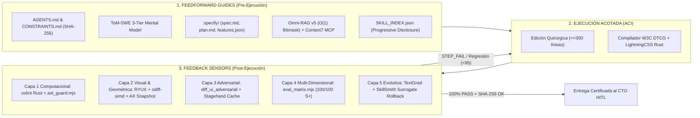

# CANON: Ingeniería de Harnesses Agénticos, ACI, Eval-Driven Development (EDD), Documentación Oficial, Libros y Videocursos (SOTA 2026)

**Alcance:** Este documento es la referencia canónica de `web-software-factory` sobre **Harness Engineering (Ingeniería de Arneses Agénticos)**, **Interfaces Agente-Computadora (ACI)**, **Eval-Driven Development (EDD)**, la estructura exacta del arnés ejecutable del Studio (`tools/factory.mjs`, `tools/intelligence/`, `tools/audit/`, `.specify/memory/`, `.agents/skills/`) y el compendio de documentación oficial, libros y videocursos de evaluación y control de agentes. NO es fuente de diseño cromático ni tokens CSS (ver `CANON_MULTI_BRAND_DESIGN_SYSTEMS_DTCG_STYLE_DICTIONARY_AND_ARCHETYPES_2026`), ni de shaders WebGL/audio (ver `CANON_2D_3D_GRAPHICS_SHADERS_AND_AESTHETICS_2026`).

---

## 1. Epistemología y Formalismo Matemático del Harness Agéntico ($H = \{E, T, C, S, L, V\}$)

En la ingeniería de IA de 2026, los modelos fundacionales son tratados como un *commodity* intercambiable; el **foso competitivo real (*core moat*) reside en el Agent Harness** (`[VERIFICADO: Anthropic Engineering & Martinfowler.com, 2026-10-26]`). La ecuación fundamental que gobierna nuestra fábrica es:

$$\text{Agente Confiable en Producción} = \text{Modelo Fundacional } (M) + \text{Harness Determinista } (H)$$

### 1.1 Formalismo de la Tupla de 6 Subsistemas
Todo arnés agéntico industrial se modela formalmente como la tupla de 6 componentes ortogonales:

$$H = \{E, T, C, S, L, V\}$$

| Símbolo | Subsistema del Harness | Función Cibernética | Implementación Real en `web-software-factory v2.2.0` |
| :---: | :--- | :--- | :--- |
| **$E$** | **Execution & Control Loop** | Orquestación determinista del ciclo *Specify $\rightarrow$ Plan $\rightarrow$ Implement $\rightarrow$ Verify $\rightarrow$ Evolve*, evitando bucles libres infinitos. | `tools/factory.mjs`, `tools/intelligence/factory_sweep.mjs`, `tools/preflight_check.mjs`, `.agents/agency/ORGANIZATION.md` (9 roles bajo patrón *Maker-Checker*). |
| **$T$** | **Tool Registry & ACI** | Interfaz Agente-Computadora (*Agent-Computer Interface*) con herramientas acotadas, tipadas y de bajo consumo de tokens. | `.mcp.json` (`web-factory-omni-rag` v5.2 con 6 tools, `context7`, `@playwright/mcp`), `tools/design/token_compiler.mjs`, lecturas quirúrgicas $\le 160$ líneas. |
| **$C$** | **Context Manager (JIT)** | Presupuesto estricto de ventana de contexto, revelación progresiva (*Progressive Disclosure*) y recuperación híbrida en $<10\text{ ms}$. | `tools/intelligence/rag_pipeline.mjs` (Índice Invertido Bitmask `O(1)` `_bodyInv`/`_titleInv` + `SQLite FTS5` + caché LRU), `code_and_wiki_graph.mjs`, `.agents/skills/SKILL_INDEX.json`. |
| **$S$** | **State Store & Memory** | Persistencia estructurada entre sesiones para erradicar la *amnesia de ventana de contexto* y modelar al usuario/CTO. | `.specify/memory/features.json`, `.specify/memory/PROGRESS.md`, `docs/STATE_PACKET.md`, `tools/intelligence/tom_swe_engine.mjs` (`memory/tom_swe_model.json`), `instincts_engine.mjs` (`temporal_ledger.json`). |
| **$L$** | **Lifecycle & Safety Hooks** | Compuertas pre-vuelo, bloqueo criptográfico de la Constitución y prevención de *Reward Hacking* (manipulación de tests). | `tools/intelligence/constitution_guard.mjs` (SHA-256 sobre `AGENTS.md` y `CONSTRAINTS.md` + auditoría estática de pisos numéricos), `delivery-gate`, `verify-before-claim`, `anti-shortcut-discipline`. |
| **$V$** | **Verification & Eval Sensors** | Sensores computacionales deterministas (`$0`, `<350ms`), pruebas adversariales guiadas por diff y optimización evolutiva con rollback. | `tools/intelligence/eval_matrix.mjs`, `ast_guard.mjs`, `tools/audit/ryux_design_gate.mjs`, `diff_ui_adversarial.mjs` (`oxlint` Rust + `Stagehand`), `visual_regression.mjs` (`odiff-bin` SIMD), `a11y_tree_snapshot.mjs`, `textgrad_skill_optimizer.mjs`. |

### 1.2 El Bucle de Dirección Cibernética: *Feedforward Guides* vs. *Feedback Sensors*
Siguiendo la formalización de **Birgitta Böckeler y Martin Fowler** (*Harness Engineering for Coding Agent Users*, Thoughtworks / `martinfowler.com`, 2026) y la **Ley de Acumulación de Errores de Mitchell Hashimoto** (*"Cada vez que un agente comete un error nuevo, no esperes que aprenda por prompt: codificá un sensor determinista en el harness para que sea físicamente imposible repetirlo"*):



---

## 2. Estructura Actual del Harness Agéntico en `web-software-factory` (`[VERIFICADO: codebase, 2026-10-26]`)

Nuestra fábrica implementa una arquitectura de **6 Anillos Concéntricos de Contención y Verificación** diseñados para operar con **$0 de costo de inferencia local** y **cero contenedores Docker** sobre hardware ligero:

### Anillo 1: Guardia Constitucional e Inmutabilidad Anti-Reward-Hacking
- **Archivo:** `tools/intelligence/constitution_guard.mjs` + `.agents/memory/constitution_lock.json`.
- **Mecanismo:**
  1. Calcula y verifica el hash criptográfico `SHA-256` (normalizado a LF) de `AGENTS.md` y `CONSTRAINTS.md`.
  2. Ejecuta `verifyAntiRewardHackingFloors()`: inspecciona estáticamente el código fuente de `eval_matrix.mjs` y `ast_guard.mjs` para impedir que un agente modifique los umbrales de aprobación (`compositeScore >= 95`, `distMb > 50`, `complianceScore === 100`, `missingMethodErrors === 0`, `securityBlockers === 0`).

### Anillo 2: Arnés de Continuidad Multi-Sesión (Patrón *Initializer + Coding Agent* de Anthropic)
- **Archivos:** `tools/factory.mjs`, `tools/intelligence/spec_generator.mjs`, `.specify/memory/constitution.md`, `.specify/memory/features.json`, `.specify/memory/PROGRESS.md` y `docs/STATE_PACKET.md`.
- **Mecanismo:**
  - Resuelve las dos patologías clásicas documentadas por Anthropic (*One-Shot Overreach* y *Premature Victory Declaration*):
    - **Initializer Step (`node tools/factory.mjs new <slug>` / `spec`):** Genera la especificación `spec-kit` (`spec.md`, `plan.md`, `tasks.md`), registra cada feature en `.specify/memory/features.json` con `"passes": false` y el comando exacto de verificación (`node tools/factory.mjs gate --project <slug>`), e inicializa la bitácora `.specify/memory/PROGRESS.md`.
    - **Coding Step:** En cada sesión, el agente lee `STATE_PACKET.md`, `features.json` y `PROGRESS.md`, aborda una única feature atómica ($\le 300$ líneas), ejecuta la compuerta determinista y actualiza su estado.

### Anillo 3: Interfaz Agente-Computadora (ACI) y Presupuesto de Contexto
- **Archivos:** `.mcp.json`, `tools/intelligence/mcp_omni_rag_server.mjs` (`v5.2`), `tools/audit/a11y_tree_snapshot.mjs`, `.agents/skills/SKILL_INDEX.json`.
- **Mecanismo (Inspirado en *SWE-agent ACI* de Princeton NLP):**
  - En lugar de saturar la ventana de contexto leyendo miles de líneas de HTML/DOM o cargando las 93 skills simultáneamente:
    1. **Snapshot Semántico de Accesibilidad (`node tools/factory.mjs snapshot`):** Extrae el árbol `AX` de Playwright (`landmarks`, `headings`, `controls`) reduciendo en **`-90%` los tokens** frente al HTML crudo.
    2. **Servidor MCP Nativo (`web-factory-omni-rag` v5.2):** Expone 6 herramientas estructuradas (`omni_rag_query`, `code_graph_query`, `omni_rag_stats`, `factory_style_catalog`, `factory_compile_tokens`, `factory_run_audit`).
    3. **Índice de Revelación Progresiva (`SKILL_INDEX.json`):** Mapea las 93 skills a los 9 roles de `.agents/agency/ORGANIZATION.md`, cargando en memoria únicamente el `SKILL.md` requerido por la tarea activa.

### Anillo 4: Los 7 Sensores Computacionales de Auditoría Web (`tools/audit/`)
1. **`tools/audit/code_clean_audit.mjs` + `tools/intelligence/ast_guard.mjs`:** Verificación simbólica AST lineal (cero vulnerabilidades ReDoS), cruce de métodos JS con handlers DOM y detección de bloqueos de seguridad (`eval`, `innerHTML` inseguro, credenciales expuestas).
2. **`tools/audit/ryux_design_gate.mjs` (`RYUX v2.14.2`):** Auditoría de 60 puntos de diseño anti-slop, tokens `W3C DTCG 2025.10` (`OKLCH` 90/8/2), tipografía fluida Utopia `clamp()` y ausencia de colores prohibidos.
3. **`tools/audit/diff_ui_adversarial.mjs` (`Browserbase ui-test` + `Stagehand` + `Oxc Rust`):**
   - Ejecuta el linter AST en Rust **`oxlint` en `<120ms`** sin demonios residentes.
   - Valida la caché de selectores con auto-curación (`memory/selector_cache.json` estilo `Stagehand v1.5`).
   - Aplica gobernanza quirúrgica basada en rutas sensibles y emite marcadores deterministas `STEP_PASS|<id>|<evidence>`.
4. **`tools/audit/visual_regression.mjs` (`odiff-bin` SIMD + `Pixelmatch`):** Renderiza el *Universal Web Component Testbench* (`site-header`, `hero-section`, `bento-card`, `pricing-card`) en Playwright sobre 3 viewports (`1440p`, `768p`, `390p`) y certifica **`0.000% pixel diff`** (umbral máximo $\le 1.0\%$).
5. **`tools/audit/cognitive_ux_auditor.mjs`:** Evalúa ergonomía cognitiva (Ley de Fitts para áreas táctiles, Ley de Hick para densidad de navegación, Ley de Miller y `CLS === 0.00`).
6. **`tools/audit/security_and_motion_audit.mjs`:** Verifica cabeceras Edge (`_headers`: `CSP`, `HSTS`, `X-Frame-Options`), validación `Valibot` y animaciones exclusivas de compositor GPU (`transform`, `opacity`, `@starting-style`, `interpolate-size: allow-keywords`).
7. **`tools/audit/floor_and_aeo_guard.mjs`:** Audita SEO/AEO/GEO para motores de respuesta IA (`llms.txt`, `llms-full.txt`, `Schema.org JSON-LD @graph` y `Speculation Rules API`).

### Anillo 5: Matriz de Evaluación Multi-Dimensional (`tools/intelligence/eval_matrix.mjs`)
Evalúa de extremo a extremo la salud del Studio y del proyecto activo sobre 5 ejes cuantitativos (puntuación certificada **`100.0 / 100.0 [S+ (Elite)]`**):
- **Dimensión 1 (Omni-RAG v5 Precision & Latency):** 30 consultas doradas bilingües sin circularidad, exigiendo `Hit@5 >= 95%` (actual: **`100.0% (30/30)`**), `Ragas Context Precision@3 >= 0.80` (actual: **`0.936`**), `Faithfulness` (**`0.983`**) y latencia $<350\text{ ms}$ por consulta (actual: **`68ms–212ms` totales para las 30 consultas**, es decir, **`2.3ms–7.0ms` por consulta**).
- **Dimensión 2 (AST & Symbolic Code Guard):** `100.0 / 100.0` con cero errores simbólicos y cero bloqueos de seguridad.
- **Dimensión 3 (Performance & Payload Budget):** Bundle de producción `dist/` compilado con `LightningCSS` (Rust) $\le 50\text{ MB}$ (actual: **`0.04 MB`**).
- **Dimensión 4 (Compliance & Semantic HTML5 Invariants):** Estructura legal, `lang`, `charset` y metadatos completos (`100/100`).
- **Dimensión 5 (Edge Security, Landmarks, Visual Regression, ToM-SWE & Diff-UI):** Certificación simultánea de `_headers`, landmarks ARIA, harness visual, modelo mental `ToM-SWE` y `Diff-UI Adversarial`.

### Anillo 6: Bucle de Auto-Evolución Gobernada (`tools/intelligence/factory_sweep.mjs` & `textgrad_skill_optimizer.mjs`)
- **`tools/intelligence/tom_swe_engine.mjs`:** Implementa *Theory of Mind for Software Engineering* (ICLR 2026) con memoria de 3 niveles (`Tier 1: cleaned_signals`, `Tier 2: session_analyses`, `Tier 3: overall_user_model` en `memory/tom_swe_model.json`) y consolidación *Sleeptime Compute*.
- **`tools/intelligence/textgrad_skill_optimizer.mjs`:** Calcula gradientes textuales ($\nabla_{\text{text}} L$) a partir de fallos o advertencias empíricas y ejecuta el **Verificador Sustituto (*SkillSmith Surrogate Verifier*)**: ninguna mutación de skill o instinto en `.agents/memory/temporal_ledger.json` se promueve si `constitution_guard.mjs` o `eval_matrix.mjs` sufren regresión.

---

## 3. Documentación Oficial y Especificaciones Industriales Ingeridas (2025–2026)

1. **Anthropic Official Engineering Documentation (`docs.anthropic.com` & Engineering Blog)**:
   - ***Building Effective Agents* (Erik Schluntz & Barry Zhang):** Distinción arquitectónica entre *Workflows* (caminos deterministas orquestados por código: *Prompt Chaining*, *Routing*, *Parallelization*) y *Agents* (bucles dirigidos por el modelo: *Orchestrator-Workers* y *Evaluator-Optimizer*). Regla: usar siempre el flujo más simple y determinista posible antes de delegar el control de flujo a un bucle abierto.
   - ***Effective Harnesses for Long-Running Agents*:** Protocolo de desacoplamiento entre el *Initializer Agent* y el *Coding Agent* mediante artefactos persistentes en JSON (`features.json`), bitácora de traspaso (`PROGRESS.md` / `claude-progress.txt`), script de arranque idempotente y verificación E2E en navegador real antes de marcar cualquier tarea como completada.
   - ***Claude Code Headless & CI/CD Harness Best Practices* (`claude -p --output-format json`):** Ejecución no interactiva en tuberías CI/CD gobernada por contratos estrictos en archivos raíz (`AGENTS.md` / `CLAUDE.md`), aislamiento en Git Worktrees y prohibición de credenciales en texto plano.
2. **Thoughtworks & Martin Fowler (`martinfowler.com` — Birgitta Böckeler, 2026)**:
   - ***Harness Engineering for Coding Agent Users*:** Clasifica los arneses en tres familias complementarias:
     1. *Maintainability Harness* (complejidad ciclomática, AST, formateo y tipado).
     2. *Architecture Fitness Harness* (funciones de aptitud arquitectónica que impiden violar límites de capas o dependencias prohibidas).
     3. *Behaviour Harness* (pruebas funcionales, contratos de API, regresión visual y jueces semánticos).
   - Principio de **Sensores Computacionales Primero (*Sensors-First*)**: ejecutar siempre validadores deterministas de costo `$0` y latencia en milisegundos (`oxlint`, `ast_guard`, `odiff-bin`) antes de invocar evaluadores inferenciales (*LLM-as-a-Judge*).
3. **HumanLayer — *12-Factor Agents* (`github.com/humanlayer/12-factor-agents` — Dex Horthy)**:
   - Los 12 factores aplicados a nuestro Studio:
     - *Factor 1:* Traducción de lenguaje natural a llamadas de herramientas tipadas.
     - *Factor 2:* Propiedad total de los prompts y skills (`.agents/skills/`).
     - *Factor 3:* Propiedad estricta de la ventana de contexto (`Omni-RAG v5` JIT + `SKILL_INDEX.json`).
     - *Factor 4:* Las herramientas son salidas estructuradas deterministas (MCP JSON-RPC 2.0).
     - *Factor 5:* Unificación del estado de ejecución y estado del proyecto (`factory.project.json` + `.specify/memory/features.json`).
     - *Factor 6:* Lanzar/Pausar/Reanudar con APIs y CLIs simples (`node tools/factory.mjs`).
     - *Factor 7:* Contactar al humano (CTO HITL) mediante herramientas estructuradas y paquetes de aprobación visual (`cto-hitl-visual-gate`).
     - *Factor 8:* Propiedad del flujo de control (`factory_sweep.mjs` controla el bucle de 6 etapas en código Node.js).
     - *Factor 9:* Compactación de errores en la ventana de contexto (marcadores `STEP_PASS`/`STEP_FAIL` de 1 línea en lugar de stack traces de 500 líneas).
     - *Factor 10:* Agentes pequeños y enfocados (9 roles especializados en `.agents/agency/roles/`).
     - *Factor 11:* Activación desde cualquier punto (CLI, MCP, comandos slash).
     - *Factor 12:* Agente como reductor sin estado interno oculto ($\text{Estado}_{t} + \text{Acción} \rightarrow \text{Estado}_{t+1}$ persistido en Git y disco).
4. **UK AI Security Institute — *Inspect AI* (`inspect.aisi.org.uk` / `UKGovernmentBEIS/inspect_ai`)**:
   - Arquitectura estándar para evaluación de agentes con separación estricta entre `Dataset` (casos de prueba), `Task` / `Solver` (cadena de ejecución y uso de herramientas en sandbox) y `Scorer` (graduadores deterministas o alineados por rúbrica con métricas `pass@k` y `pass^k`).
5. **Promptfoo (`promptfoo.dev`), DeepEval (`docs.confident-ai.com`) y Ragas (`docs.ragas.io`)**:
   - Matrices declarativas de evaluación continua y *Red-Teaming* adversarial (inyección de prompts, XSS, rotura de contratos JSON) combinadas con la tríada de fidelidad RAG (*Context Precision@K*, *Faithfulness / Groundedness* y *Answer Relevance*).
6. **Playwright MCP (`@playwright/mcp`) & Browserbase Stagehand (`stagehand.dev`)**:
   - Verificación agéntica sobre el árbol de accesibilidad (`AX Tree`) y primitivas híbridas (`act`, `extract`, `observe`) respaldadas por caché determinista de selectores con auto-curación (`memory/selector_cache.json`).

---

## 4. Libros Canónicos y Papers Fundacionales sobre Harnesses y Evaluación Agéntica

1. ***AI Engineering: Building Applications with Foundation Models*** — **Chip Huyen** (O'Reilly Media, 2025):
   - Formaliza la ingeniería de evaluación (*Evaluation-Driven Development*), pipelines de verificación en cascada (guardrails sintácticos $\rightarrow$ semánticos $\rightarrow$ ejecución en sandbox), observabilidad de trazas y optimización de latencia/costo en sistemas compuestos.
2. ***Evals for AI Engineers*** — **Hamel Husain & Shreya Shankar** (O'Reilly Media / Pragmatic AI Labs, 2025–2026):
   - Establece la metodología industrial de **Análisis de Errores Primero (*Error Analysis First*)**:
     - Prohibición de diseñar métricas genéricas abstractas sin antes inspeccionar trazas reales.
     - **Pirámide de Evaluación de 3 Niveles**:
       - *Nivel 1 (Assertions & Code Graders):* Verificaciones deterministas instantáneas ejecutadas en cada cambio (`oxlint`, AST, esquemas `Valibot`, regresión `odiff-bin`).
       - *Nivel 2 (Aligned Critique & Model Graders):* Jueces binarios (`PASS`/`FAIL`, nunca escalas difusas 1–5) calibrados contra el criterio del experto humano (CTO) hasta alcanzar $\kappa \ge 0.85$ (Cohen's Kappa).
       - *Nivel 3 (Production Telemetry & HITL):* Captura continua de señales implícitas y explícitas del usuario (`ToM-SWE` + `temporal_ledger.json`).
3. ***Applied LLMs: What We've Learned from a Year of Building with LLMs*** — **Eugene Yan, Bryan Bischof, Charles Frye, Hamel Husain, Jason Liu & Shreya Shankar** (O'Reilly, 2024/2025):
   - Patrones de producción para estructuración de salidas, diseño de arneses de herramientas, prevención de regresiones silenciosas y curación de conjuntos dorados (*Golden Datasets*).
4. ***Building Evolutionary Architectures: Automated Software Governance*** — **Neal Ford, Rebecca Parsons & Patrick Kua** (O'Reilly):
   - Introduce las **Funciones de Aptitud Arquitectónica (*Architectural Fitness Functions*)**, que constituyen la base teórica directa de nuestros sensores en `tools/intelligence/constitution_guard.mjs` y `tools/intelligence/eval_matrix.mjs`: pruebas ejecutables que protegen invariantes no funcionales (presupuesto de bundle $\le 50\text{ MB}$, latencia RAG $<350\text{ ms}$, contraste APCA, cero dependencias prohibidas).
5. ***Growing Object-Oriented Software, Guided by Tests (GOOS)*** — **Steve Freeman & Nat Pryce** & ***xUnit Test Patterns*** — **Gerard Meszaros**:
   - Fundamento del patrón **Esqueleto Caminante (*Walking Skeleton*)** y del diseño de *Test Harnesses* deterministas libres de fragilidad (*flakiness*).
6. **Papers Fundacionales de Frontera**:
   - **Yang et al. (Princeton NLP, ICLR 2025)** — *SWE-agent: Agent-Computer Interfaces Enable Automated Software Engineering*: Demuestra que optimizar el diseño de la interfaz de herramientas (ACI) incrementa el rendimiento del agente más que cambiar el modelo subyacente.
   - **Zhou et al. (CMU & All-Hands-AI, ICLR 2026)** — *ToM-SWE: User Mental Modeling for Software Engineering Agents*: Arquitectura de 3 niveles de memoria y *Sleeptime Compute* implementada en `tools/intelligence/tom_swe_engine.mjs`.
   - **Yuksekgonul et al. (Stanford, Nature 2025)** — *TextGrad: Automatic Differentiation via Text* & **Khattab et al. (Stanford)** — *DSPy MIPROv2*: Optimización de instrucciones y skills guiada por gradientes textuales de fallos verificados, implementada en `tools/intelligence/textgrad_skill_optimizer.mjs`.
   - **arXiv:2605.23950 (2026)** — *Stop Comparing LLM Agents Without Disclosing the Harness*: Demuestra empíricamente que las evaluaciones de agentes carecen de validez científica si no se especifica y versiona el arnés $H$.

---

## 5. Videocursos Magistrales y Currículos Universitarios Ingeridos

1. **Maven Cohort Course — *AI Evals for Engineers & PMs*** (**Hamel Husain & Shreya Shankar**):
   - El curso líder de la industria sobre construcción de arneses de evaluación: codificación abierta (*Open Coding*) y axial (*Axial Coding*) de modos de fallo, diseño de pruebas unitarias deterministas para agentes, calibración de jueces binarios y automatización de compuertas en CI/CD.
2. **UC Berkeley CS294-196 — *Large Language Model Agents MOOC*** (**Prof. Dawn Song, Shunyu Yao, Ofir Press, Oriol Vinyals** — `llmagents-learning.org`):
   - Cubre la arquitectura interna de `SWE-agent` y `SWE-bench`, diseño de *Agent-Computer Interfaces (ACI)*, bucles `ReAct` y `Reflexion`, seguridad contra inyección indirecta de prompts en herramientas y verificación formal de sistemas multi-agente.
3. **Stanford University CS329A — *Engineering Compound AI Systems & Self-Improving Agents*** (**Kian Katanforoosh & Andrew Ng** — `cs329a.stanford.edu`):
   - Demuestra cómo los **Sistemas de IA Compuestos (*Compound AI Systems*)** dotados de arneses deterministas, enrutadores semánticos y verificadores superan a los modelos monolíticos en precisión, latencia y costo (`FinOps`).
4. **DeepLearning.AI Specialized Short Courses**:
   - ***Agentic AI & AI Agentic Design Patterns*** (**Andrew Ng**): Los 4 patrones canónicos (*Reflection*, *Tool Use*, *Planning*, *Multi-Agent Collaboration*) gobernados por compuertas de evaluación.
   - ***Building Coding Agents with Tool Execution*** (**E2B & DeepLearning.AI**): Ejecución segura de código generado por agentes, captura estructurada de `stdout`/`stderr` y bucles de auto-reparación.
   - ***Automated Testing for LLMOps*** (**CircleCI & DeepLearning.AI — Rob Zuber**): Integración de compuertas de evaluación por niveles en cada commit.
   - ***Building and Evaluating Advanced RAG*** (**TruEra / Snowflake & DeepLearning.AI**): Evaluación sistemática de la tríada RAG (*Context Relevance*, *Groundedness/Faithfulness*, *Answer Relevance*).
5. **WalkingLabs — *Learn Harness Engineering*** (`walkinglabs.github.io/learn-harness-engineering`):
   - Currículo práctico de 14 lecciones sobre el diseño de arneses: *Context Budgeting*, el repositorio Git como única fuente de verdad, primitivas `features.json` + `PROGRESS.md`, prevención de *Premature Victory*, *Maker-Checker Loops* y máquinas de estado deterministas.
6. **Tessl / AI Engineer World's Fair Masterclasses**:
   - **Dru Knox (Tessl)** — *"Harness Engineering: How to Build a Software Factory"* (`Spec-Driven Development` donde la especificación ejecutable y el arnés de pruebas gobiernan la generación de código).
   - **Dex Horthy (HumanLayer)** — *"12-Factor Agents: Patterns for Reliable LLM Applications"*.
   - **Addy Osmani (Google Chrome)** — *"Lighthouse for Agents (`agent-house`) & Adversarial Multi-Agent Review (`adverse`)"*.

---

## 6. Comandos Operativos del Harness en `web-software-factory`

```powershell
# 1. Ejecutar el Barrido Maestro de 6 Etapas del Harness (Constitution + Pre-Flight + AST/Tokens/RYUX + Eval Matrix + TextGrad + Tech Scout)
node tools/intelligence/factory_sweep.mjs

# 2. Ejecutar la Matriz de Evaluación Multi-Dimensional (30 Golden Queries en ~68ms-212ms + AST + Payload + Compliance + Diff-UI)
node tools/intelligence/eval_matrix.mjs

# 3. Verificar el Bloqueo Criptográfico SHA-256 y Pisos Anti-Reward-Hacking
node tools/intelligence/constitution_guard.mjs

# 4. Ejecutar la Compuerta de 5 Etapas sobre un Proyecto Web
node tools/factory.mjs gate --project <slug>

# 5. Ejecutar la Compuerta Visual SOTA (RYUX v2.14.2 + UX Cognitivo + Seguridad/Motion + Diff-UI/Oxc)
node tools/factory.mjs visual-gate --project <slug>

# 6. Capturar Snapshot Semántico del Árbol de Accesibilidad AX (-90% tokens)
node tools/factory.mjs snapshot --project <slug>

# 7. Ejecutar Regresión Visual Píxel-a-Píxel SIMD (odiff-bin) en 3 Viewports (1440p, 768p, 390p)
node tools/audit/visual_regression.mjs
```

---
**Conexiones del Grafo (Obsidian):** [[INDEX]] · [[CANON_HARNESS_ENGINEERING_INTEGRAL_2026]] · [[CANON_ECC_EVERYTHING_CLAUDE_CODE_AGENT_HARNESS_2026]] · [[CANON_50_REPOS_AGENTIC_SOFTWARE_FACTORY_TOM_SWE_STAGEHAND_AND_OXC_2026]] · [[CANON_SELF_EVOLVING_SOFTWARE_FACTORY_AND_SPECULATIVE_RAG_2026]] · [[CANON_COURSES_AGENTIC_AI_AND_SYSTEMS]] · [[CANON_WEB_SOFTWARE_FACTORY_MCP_DTCG_AND_LIGHTNINGCSS_2026]] · #software_factory #harness_engineering #aci #evals
