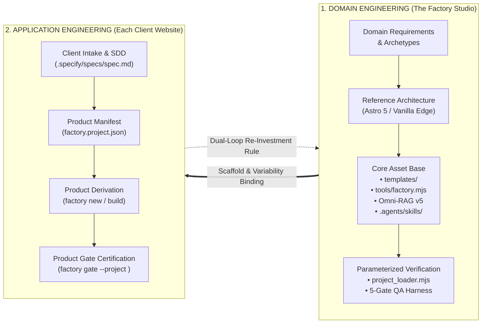

# CANON: Software Product Line Engineering (ISO/IEC 26550) & Agentic Web Software Factories (2026)

> **Alcance:** Estándares ISO/IEC 26550 SPLE, Spec-Driven Development, compilación de tokens W3C DTCG y automatización de la Web Software Factory.

> **Scope:** Canonical architectural treatise for Squad 0–9 on Software Product Line Engineering (SPLE), ISO/IEC 26550, Greenfield & Short *Software Factories*, Clements & Northrop *Product Lines*, Pohl *Variability Management*, and Spec-Driven Multi-Project Web Delivery (`factory.project.json` + `spec-kit`).
> **Sources Verified:** ISO/IEC 26550 Reference Model; Jack Greenfield & Keith Short (*Software Factories*, Wiley); Paul Clements & Linda Northrop (*Software Product Lines: Practices and Patterns*, CMU SEI); Klaus Pohl, Günter Böckle & Frank van der Linden (*Software Product Line Engineering*, Springer); GitHub `spec-kit` (MIT); ThoughtWorks Technology Radar (2025–2026) `[VERIFICADO: 2026-10-25]`.

---

## 1. Fundamental Theory: Economies of Scope vs. Economies of Scale

In industrial software engineering, Jack Greenfield & Keith Short (*Software Factories: Assembling Applications with Patterns, Models, Frameworks, and Tools*) and CMU SEI (*Software Product Lines*) distinguish two economic regimes:

1. **Economies of Scale:** Producing millions of identical copies of a single software product (e.g., an operating system or SaaS monolith).
2. **Economies of Scope:** Producing **multiple distinct, customized software products (`Product 1..N`)** for different clients or domains at a fraction of the cost/time of greenfield development by sharing a **Core Asset Base** and a **Automated Production Pipeline**.

Mathematically, let $C_{\text{unique}}(p_i)$ be the cost of building product $p_i$ from scratch, $C_{\text{factory}}$ be the upfront investment in the Software Factory Core (RAG, Skills, Templates, Quality Gates), and $C_{\text{delta}}(p_i)$ be the customization cost of deriving product $p_i$ from the Factory:

$$\sum_{i=1}^{N} C_{\text{factory\_derived}}(p_i) = C_{\text{factory}} + \sum_{i=1}^{N} C_{\text{delta}}(p_i) \ll \sum_{i=1}^{N} C_{\text{unique}}(p_i) \quad \text{for } N \ge 2$$

In an Agentic Web Software Factory (`N` client websites), $C_{\text{delta}}(p_i)$ is reduced by **70%–85%** because:
- The **5-Gate Quality Harness** (`oxlint`, Playwright 4-viewport, `diff_ui_adversarial`, Lighthouse/Pa11y, AEO) is written once and parameterized via `factory.project.json`.
- The **Design System Pipeline** (W3C DTCG `2025.10`, OKLCH 90/8/2, Utopia `clamp()`, `@starting-style`) is pre-wired in `templates/astro-edge` and `templates/vanilla-edge`.
- The **Agentic Memory & RAG (`Omni-RAG v5`)** accumulates cross-project engineering patterns without leaking client-specific business logic.

---

## 2. The ISO/IEC 26550 Dual-Lifecycle Reference Model

ISO/IEC 26550 (*Software and systems engineering — Reference model for product line engineering and management*) divides the Software Factory into two strictly decoupled planes connected by variability bindings:

### 2.1 Domain Engineering (The Factory Studio)
Builds and maintains reusable assets that are **100% agnostic of any single client**:
- **`tools/lib/project_loader.mjs`:** Parses the declarative variability contract (`factory.project.json`).
- **`tools/factory.mjs`:** Master CLI orchestrating `status`, `new`, `spec`, `build`, `gate`, and `extract-studio`.
- **`templates/`:** Versioned, pre-audited starter molds (`templates/vanilla-edge`, `templates/astro-edge`).
- **`tools/audit/` & `tools/intelligence/`:** Static, visual, accessibility, and compliance verifiers parameterized by the active project manifest.

### 2.2 Application Engineering (Individual Websites: `example-client.pages.dev`, `client-2`, ..., `client-N`)
Builds a specific website by binding variability points declared in `factory.project.json`:
- **Product #1 (`example-client.pages.dev`):** Binds `archetype: "streamer-casino-suite"`, `complianceProfile: "gambling-18plus"`, 8 OBS overlays, and RealtimeHub OAuth/Bot invariants.
- **Product #2..N (SaaS, E-Commerce, Corporate, Portfolio):** Binds `archetype: "saas-b2b" | "ecommerce" | "marketing"`, `complianceProfile: "standard-web"`, zero OBS overlays, and standard WCAG 2.2 AA + AEO + CWV invariants.

---

## 3. Variability Management & Binding Times (Pohl, Böckle & van der Linden)

Every variation point between two client websites is governed by an explicit **Binding Time**:

| Binding Time | Mechanism in Our Web Software Factory | Artifacts Controlled |
| :--- | :--- | :--- |
| **1. Scaffold-Time** (`factory new`) | Template selection (`--template astro-edge \| vanilla-edge`) & placeholder substitution (`{{PROJECT_ID}}`, `{{PROJECT_NAME}}`, `{{PROJECT_ARCHETYPE}}`) | Directory structure, `factory.project.json`, `AGENTS.md`, `CONSTRAINTS.md`, `wrangler.toml`, `llms.txt` |
| **2. Spec-Time** (`factory spec`) | Spec-Driven Development (`spec_generator.mjs` + GitHub `spec-kit`) | `.specify/memory/constitution.md`, `.specify/specs/<slug>/{spec.md,plan.md,tasks.md}`, `docs/specs/<slug>.spec.json` |
| **3. Design-Time** (`tokens/`) | W3C DTCG `2025.10` token overrides (`tokens/design.tokens.json`) | OKLCH surface/text/brand palette, Utopia fluid type scale, border radii, motion springs |
| **4. Build & Gate-Time** (`factory build` / `factory gate`) | `loadProjectConfig()` in `tools/lib/project_loader.mjs` | Conditional asset bundling (`esbuild`/`astro build`), profile-aware compliance checks (`gambling-18plus` vs `standard-web`), custom invariants |
| **5. Runtime (Edge)** | Cloudflare Worker environment bindings (`env.DB`, `env.ASSETS`, `.dev.vars`) | Per-tenant database, secrets, rate limits, and edge caching rules |

---

## 4. The Dual-Loop Re-Investment Rule (Preventing Factory Drift)

A common failure mode in web agencies is **"Clone-and-Own Drift"**: developers fix bugs inside Client Site B, and Client Site A or future Client Site C never benefit.
To prevent drift, the Factory enforces the **Dual-Loop Re-Investment Law**:
1. **If an improvement or bugfix is domain-generic** (e.g., a better CSP header in `_headers`, a faster OKLCH glassmorphism utility, a new Playwright layout-shift detector, or a new skill in `.agents/skills/`): it **MUST** be committed to the **Factory Studio / Templates (`templates/*`, `tools/*`, `knowledge/*`)**.
2. **If an improvement is strictly business-specific** (e.g., a slot bonus hunt calculator for `example-client.pages.dev` or a custom pricing calculator for a B2B SaaS client): it stays inside that **Product's directory/repository** and is declared in its `factory.project.json`.

---

## 5. Knowledge Graph Connections (Obsidian)
- [[INDEX]]
- [[CANON_AI_SOFTWARE_FACTORY_SOTA_2026-10-24]]
- [[CANON_ASTRO5_CLOUDFLARE_WORKERS_AND_MODERN_WEB_TEMPLATES_2026]]
- [[CANON_MULTI_BRAND_DESIGN_SYSTEMS_DTCG_STYLE_DICTIONARY_AND_ARCHETYPES_2026]]
- [[CANON_SOFTWARE_FACTORY_CURRICULUM_BOOKS_PAPERS_AND_VIDEO_COURSES_2026]]
- #software_factory #architecture_and_books
